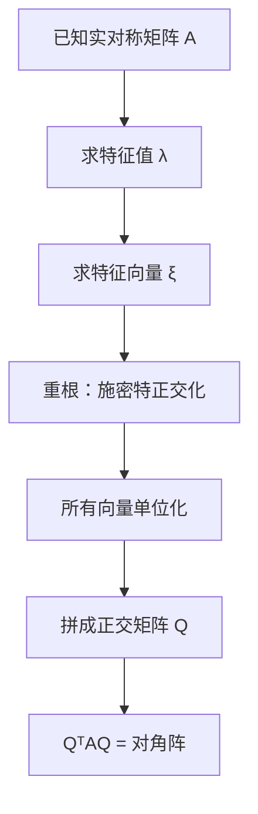

# 实对称矩阵的正交相似对角化
前面已经学过，任一矩阵若要有 $n$ 个线性无关的特征向量，才能对角化。但对一般方阵，“特征向量是否足够”并不保证，还要讨论代数重数与几何重数是否相等。

实对称矩阵有一个非常“友好”的结论：任何实对称矩阵**一定可以**相似于对角矩阵，而且特征向量可以取成两两正交的单位向量——也就是说，它一定能被**正交矩阵**对角化。

> [!IMPORTANT]
> 设 $A$ 为 $n$ 阶实对称矩阵，则存在正交矩阵 $Q$，使
> $$Q^{-1}AQ=Q^{\mathrm T}AQ=\operatorname{diag}(\lambda_1,\lambda_2,\dots,\lambda_n),$$
> 其中 $\lambda_1,\lambda_2,\dots,\lambda_n$ 恰为 $A$ 的全部（实）特征值。

这里 $Q$ 的列向量就是 $A$ 的 $n$ 个两两正交的单位特征向量。

---

## 为什么需要它

在二次型标准化问题中，若只要求可逆线性变换把二次型化为平方和，可逆矩阵 $C$ 并不唯一，几何意义也不够强。但若希望变换前后保持**向量的长度与夹角**，就要求变换矩阵是正交矩阵。实对称矩阵的这一性质保证了：存在**正交变换** $X=QY$，使二次型化为标准形。

---

## 具体步骤

对实对称矩阵 $A$，求正交相似对角化的标准流程如下：

1. 求特征值：解特征方程 $|\lambda E-A|=0$。
2. 对每个特征值求对应的特征子空间的一组基础解系。
3. 对同一特征值的多个特征向量，若不正交，用施密特正交化处理。
4. 将全部特征向量单位化。
5. 以这些单位正交特征向量为列，构成正交矩阵 $Q$，则
   $$
   Q^{-1}AQ=Q^{\mathrm T}AQ=\Lambda.
   $$

---

## 与普通对角化的区别

| 项目 | 一般可对角化 | 实对称矩阵正交对角化 |
| --- | --- | --- |
| 是否一定可对角化 | 不一定 | ==一定可以== |
| 变换矩阵 $P$ | 可逆矩阵即可 | 必须取==正交矩阵== $Q$ |
| 不同特征值的特征向量 | 线性无关 | ==必正交== |
| 重根对应特征向量 | 可能线性无关但未必正交 | 可正交化且单位化 |

> [!WARNING]
> 普通矩阵“不同特征值对应的特征向量线性无关”并不保证正交；但==实对称矩阵不同特征值对应的特征向量自动正交==。这是最容易丢分的地方。

---

## 常见错误

- 同一特征值对应的基础解系中各向量若不正交，**不能直接单位化后放进 $Q$**，必须先施密特正交化，再单位化。
- 只做正交化而忘记单位化，矩阵就不是正交矩阵，只能保证 $Q^{-1}AQ=\Lambda$，不能写成 $Q^{\mathrm T}AQ=\Lambda$。
- 重根对应特征向量取自基础解系时，若线性无关但彼此不正交，不利用题目给出的对称性去检查正交关系，就会导致后续单位化后仍不是正交矩阵。

---

## 一个完整例子

设

$$
A=\begin{pmatrix}
3&-1&-1\\
-1&3&-1\\
-1&-1&3
\end{pmatrix}.
$$

**第一步：求特征值。**

$$
|\lambda E-A|=(\lambda-1)(\lambda-4)^2,
$$

所以

$$
\lambda_1=1,\qquad \lambda_2=\lambda_3=4.
$$

**第二步：求特征向量。**

- $\lambda=1$ 时，解得 $\xi_1=(1,1,1)^{\mathrm T}$；
- $\lambda=4$ 时，解得基础解系
  $$
  \xi_2=(1,-1,0)^{\mathrm T},\qquad \xi_3=(1,0,-1)^{\mathrm T}.
  $$

**第三步：处理重根特征向量的正交性。**

$\xi_2$ 与 $\xi_3$ 对应同一特征值 $4$，它们线性无关但不正交：

$$
\xi_2^{\mathrm T}\xi_3=1\neq 0.
$$

因此对它们施密特正交化。取

$$
\eta_2=\xi_2,\qquad
\eta_3=\xi_3-\frac{\eta_2^{\mathrm T}\xi_3}{\eta_2^{\mathrm T}\eta_2}\,\eta_2
=\left(\frac12,\frac12,-1\right)^{\mathrm T}.
$$

**第四步：单位化。**

$$
q_1=\frac1{\sqrt3}\begin{pmatrix}1\\1\\1\end{pmatrix},
\quad
q_2=\frac1{\sqrt2}\begin{pmatrix}1\\-1\\0\end{pmatrix},
\quad
q_3=\frac1{\sqrt6}\begin{pmatrix}1\\1\\-2\end{pmatrix}.
$$

**第五步：构造正交矩阵并验证。**

$$
Q=\begin{pmatrix}
\frac1{\sqrt3}&\frac1{\sqrt2}&\frac1{\sqrt6}\\[2mm]
\frac1{\sqrt3}&-\frac1{\sqrt2}&\frac1{\sqrt6}\\[2mm]
\frac1{\sqrt3}&0&-\frac2{\sqrt6}
\end{pmatrix}.
$$

此时

$$
Q^{-1}AQ=Q^{\mathrm T}AQ
=\begin{pmatrix}
1&0&0\\
0&4&0\\
0&0&4
\end{pmatrix}.
$$

在二次型中，令 $X=QY$，则对应二次型化为标准形

$$
f=y_1^2+4y_2^2+4y_3^2.
$$

---

> [!TIP]
> 记忆口诀：**先特征、再正交、后单位、拼正交阵**。  
> 遇到“实对称矩阵 + 重根”，一定要先检查同组特征向量是否正交，再决定是否需要施密特正交化。
