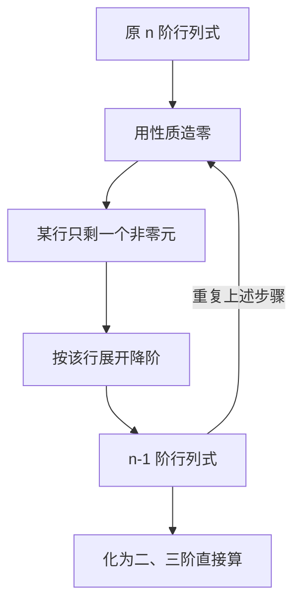

# 行列式按行（列）展开法则

## 什么是按行（列）展开

三阶以上的行列式没有“对角线法则”可用，直接按定义展开又涉及 $n!$ 项。按行（列）展开定理告诉我们：**一个 $n$ 阶行列式，可以沿某一行（列）拆成 $n$ 个 $n-1$ 阶行列式的线性组合**，把高阶问题降阶处理。

> [!IMPORTANT]
> 行列式 $D$ 按第 $i$ 行展开：
> $$D = a_{i1}A_{i1} + a_{i2}A_{i2} + \cdots + a_{in}A_{in}$$
> 其中 $A_{ij} = (-1)^{i+j}M_{ij}$ 为**代数余子式**，$M_{ij}$ 为划去第 $i$ 行第 $j$ 列后剩下的**余子式**。

## 为什么这样算更省事

如果某行（列）本来就有多个零，展开时对应的项直接消失。于是标准套路是：

> [!TIP]
> 先用行列式性质把某一行（列）化为仅含 1 个非零元素，再按此行（列）展开，变为低一阶的行列式，如此继续，直到化为三阶或二阶行列式。

## 一个必须分清的细节

| 名称 | 记号 | 定义 | 是否带符号 |
|------|------|------|------------|
| 余子式 | $M_{ij}$ | 划去第 $i$ 行第 $j$ 列后的 $n-1$ 阶行列式 | 不带 |
| 代数余子式 | $A_{ij}$ | $(-1)^{i+j}M_{ij}$ | 带 $(-1)^{i+j}$ |

> [!WARNING]
> 符号 $(-1)^{i+j}$ 由**元素所在位置**决定，与元素本身的正负无关。求“余子式之和”时直接相加；求“代数余子式之和”或 $A_{ij}$ 的线性组合时，必须先补回符号。

## 算对的例子

已知
$$D = \begin{vmatrix} 1 & 1 & 3 \\ 0 & 2 & 1 \\ 1 & 2 & 6 \end{vmatrix},\quad \text{求 } 2A_{12} + A_{13}.$$

直接计算两个代数余子式：

$$A_{12} = (-1)^{1+2}\begin{vmatrix} 0 & 1 \\ 1 & 6 \end{vmatrix} = -(0-1) = 1,$$

$$A_{13} = (-1)^{1+3}\begin{vmatrix} 0 & 2 \\ 1 & 2 \end{vmatrix} = 0-2 = -2.$$

因此
$$2A_{12} + A_{13} = 2\times 1 + (-2) = \boxed{0}.$$

> [!NOTE]
> 更快捷的看法：$2A_{12}+A_{13}$ 相当于把 $D$ 的第一行换成 $(0,2,1)$ 后按第一行展开。新行列式第一行与第二行 $(0,2,1)$ 完全相同，故值为 0，与直接计算一致。

## 常见的坑

> [!CAUTION]
> 1. 把 $A_{ij}$ 当成 $M_{ij}$ 忘记符号，尤其 $i+j$ 为奇数时。
> 2. 展开前没有先造零，导致每一项都要算一个高阶余子式，计算量反而更大。
> 3. 求某行（列）代数余子式的线性组合 $\sum k_jA_{ij}$ 时，误用原行列式元素 $a_{ij}$ 作系数；正确做法是把第 $i$ 行换成系数 $(k_1,\dots,k_n)$ 后求新行列式。
