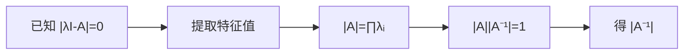

# 方阵的行列式及乘法公式 |AB|=|A||B|

## 方阵行列式的乘法公式

如果已知两个 $n$ 阶方阵 $A, B$ 的行列式，如何不计算乘积矩阵 $AB$ 就直接得到 $|AB|$？这正是乘法公式解决的核心问题。它将复杂的矩阵运算转化为简单的数的运算，是连接“矩阵”与“数量”的关键桥梁。

> [!IMPORTANT]
> 核心公式：对于同阶方阵 $A, B$，恒有 $==|AB| = |A||B|==$。该性质可推广至有限个方阵乘积，即 $|ABC| = |A||B||C|$。

### 为什么需要这个公式

直接计算 $AB$ 再求行列式往往计算量巨大。例如在判断向量组线性相关性时，我们只需关心变换矩阵的行列式是否为 0，而无需算出具体乘积。若 $|A||B| \neq 0$，则 $AB$ 一定可逆；反之，只要其中一个因子行列式为 0，乘积矩阵必奇异。这为判定可逆性、秩以及特征值问题提供了快捷通道。

### 怎么用：从真题看应用

以南邮考题为例：设 3 阶矩阵 $A$ 满足 $|6I - A| = |I + A| = |2A - I| = 0$，求 $|A^{-1}|$。

1.  **翻译条件**：由 $|\lambda I - A|=0$ 知 $\lambda$ 是特征值，故 $A$ 的特征值为 $6, -1, \frac{1}{2}$。
2.  **关联行列式**：$|A| = 6 \times (-1) \times \frac{1}{2} = -3$（特征值之积等于行列式）。
3.  **套用乘法公式**：因 $AA^{-1}=I$，故 $|A||A^{-1}|=|I|=1$，解得 $|A^{-1}| = \frac{1}{-3} = -\frac{1}{3}$。

此题全程未计算 $A^{-1}$ 的具体元素，仅靠乘法公式与特征值性质即可秒杀。

### 易混概念辨析

| 对比项 | 正确结论 | 常见错误 |
| :--- | :--- | :--- |
| 乘法 | $|AB| = |A||B|$ | $|A+B| = |A|+|B|$ ❌ |
| 数乘 | $|kA| = k^n|A|$ | $|kA| = k|A|$ ❌ |
| 转置 | $|A^T| = |A|$ | $|A^T| = -|A|$ ❌ |
| 逆矩阵 | $|A^{-1}| = |A|^{-1}$ | $|A^{-1}| = -|A|$ ❌ |

> [!WARNING]
> 加法没有类似公式！$|A+B| \neq |A|+|B|$ 是高频陷阱。只有当 $A,B$ 有特殊结构（如分块对角）时才可能拆分。

### 证明思路点拨

课件中“若 $|AB|=I$，则 $|A||B|=1$”其实是乘法公式的特例。完整证明通常借助分块矩阵初等变换：构造 $\begin{pmatrix} A & O \\ -I & B \end{pmatrix}$，通过行变换化为上三角分块阵，利用拉普拉斯展开即可证得。理解这一过程有助于明白为何公式==仅对方阵成立==——非方阵无法定义行列式。

> [!TIP]
> 记忆口诀：“行列式乘法变数乘，数乘记得带次方；加法千万别乱拆，正交伴随要验模。” 遇到正交矩阵证明题（如 $A^*$ 正交），先用 $|A|=\pm1$ 简化，再用乘法公式验证 $(A^*)^T A^* = I$。

### 一个算对的例子

回顾计算题中判定线性相关性的场景：向量组经矩阵 $B = \begin{pmatrix} 1 & 0 & -1 \\ -1 & 1 & 0 \\ 0 & -1 & 1 \end{pmatrix}$ 变换后是否无关？直接算 $|B| = 1(1) + (-1)(-1) + (-1)(1) = 0$，由乘法公式思想可知，原向量组即使无关，经奇异矩阵变换后必相关。这里 $|B|=0$ 就是“相关性传递”的代数判据，无需真正做矩阵乘法。
