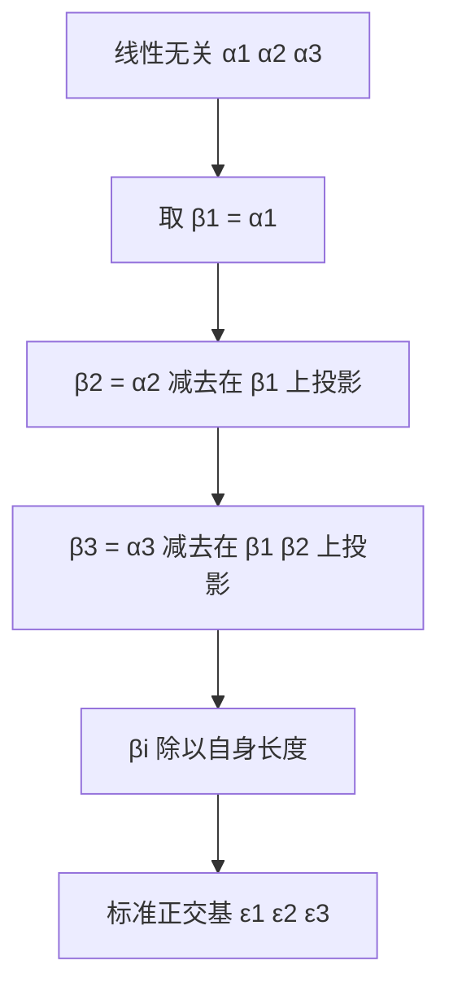

# Schmidt正交规范化方法与正交矩阵的性质

## 为什么要"正交化"

平面直角坐标系里，$\boldsymbol{i}=(1,0)^T$、$\boldsymbol{j}=(0,1)^T$ 两两垂直且长度为 1，用它表示任何向量都干净利落。但实际问题中拿到的向量组往往只是**线性无关**，却未必两两垂直、长度也未必是 1。Schmidt 正交规范化方法就是做这件事的"流水线"：先把一组线性无关的向量改造成**两两正交**的向量组，再**单位化**成标准正交基。

> [!IMPORTANT]
> 正交化（Schmidt 方法）+ 单位化 = 正交规范化。它只改变向量的"方向搭配"，不改变它们张成的空间，即 $\operatorname{span}\{\boldsymbol{\alpha}_1,\dots,\boldsymbol{\alpha}_s\}=\operatorname{span}\{\boldsymbol{\varepsilon}_1,\dots,\boldsymbol{\varepsilon}_s\}$。

## 内积、长度、夹角——准备工作

对 $\boldsymbol{\alpha}=(a_1,a_2,a_3)^T$，$\boldsymbol{\beta}=(b_1,b_2,b_3)^T$，规定内积

$$(\boldsymbol{\alpha},\boldsymbol{\beta})=a_1b_1+a_2b_2+a_3b_3=\boldsymbol{\alpha}^T\boldsymbol{\beta},$$

长度 $|\boldsymbol{\alpha}|=\sqrt{(\boldsymbol{\alpha},\boldsymbol{\alpha})}$，夹角满足 $\cos\theta=\dfrac{(\boldsymbol{\alpha},\boldsymbol{\beta})}{|\boldsymbol{\alpha}||\boldsymbol{\beta}|}$。当 $(\boldsymbol{\alpha},\boldsymbol{\beta})=0$ 时称两向量**正交**。

## Schmidt 正交化的两步走

设 $\boldsymbol{\alpha}_1,\boldsymbol{\alpha}_2,\boldsymbol{\alpha}_3$ 线性无关。

**第一步：正交化**——逐个"减去已得部分在已正交向量上的投影"：

$$\boldsymbol{\beta}_1=\boldsymbol{\alpha}_1,\qquad \boldsymbol{\beta}_2=\boldsymbol{\alpha}_2-\frac{(\boldsymbol{\beta}_1,\boldsymbol{\alpha}_2)}{(\boldsymbol{\beta}_1,\boldsymbol{\beta}_1)}\boldsymbol{\beta}_1,$$

$$\boldsymbol{\beta}_3=\boldsymbol{\alpha}_3-\frac{(\boldsymbol{\beta}_1,\boldsymbol{\alpha}_3)}{(\boldsymbol{\beta}_1,\boldsymbol{\beta}_1)}\boldsymbol{\beta}_1-\frac{(\boldsymbol{\beta}_2,\boldsymbol{\alpha}_3)}{(\boldsymbol{\beta}_2,\boldsymbol{\beta}_2)}\boldsymbol{\beta}_2.$$

**第二步：单位化**——每个 $\boldsymbol{\beta}_i$ 除以自身长度：

$$\boldsymbol{\varepsilon}_i=\frac{\boldsymbol{\beta}_i}{|\boldsymbol{\beta}_i|}.$$

> [!TIP]
> 分子分母都是内积，分母恒为 $|\boldsymbol{\beta}_i|^2$。算完一个 $\boldsymbol{\beta}_i$ 立刻检查它与前面每个 $\boldsymbol{\beta}_j$ 的内积是否为 0，是免费的验算。

## 正交矩阵——单位正交向量排成方阵

把标准正交基 $\boldsymbol{\varepsilon}_1,\dots,\boldsymbol{\varepsilon}_n$ 按列排成矩阵 $A=(\boldsymbol{\varepsilon}_1,\dots,\boldsymbol{\varepsilon}_n)$，则

$$A^TA=E,\quad\text{即}\quad A^{-1}=A^T,$$

这样的方阵称为**正交矩阵**。

> [!IMPORTANT]
> $A$ 为正交矩阵 $\iff$ $A$ 的列（行）向量组是标准正交基 $\iff$ $A^TA=E\iff A^{-1}=A^T\iff |A|=\pm1$。

**例（求参数）** 设 $A=\begin{pmatrix}a&\frac{1}{\sqrt2}&0\\ b&\frac{1}{\sqrt2}&0\\0&0&1\end{pmatrix}$ 为正交矩阵，由 $AA^T=E$ 得

$$a^2+\tfrac12=1,\quad b^2+\tfrac12=1,\quad a+b=0,$$

解得 $a=\frac{1}{\sqrt2},b=-\frac{1}{\sqrt2}$ 或 $a=-\frac{1}{\sqrt2},b=\frac{1}{\sqrt2}$。

## 一个完整算例

把 $\boldsymbol{\alpha}_1=(1,1,0)^T$，$\boldsymbol{\alpha}_2=(0,1,1)^T$，$\boldsymbol{\alpha}_3=(1,0,1)^T$ 正交规范化。

$$\boldsymbol{\beta}_1=\boldsymbol{\alpha}_1,\qquad \boldsymbol{\beta}_2=\boldsymbol{\alpha}_2-\frac{1}{2}\boldsymbol{\beta}_1=\left(\tfrac12,-\tfrac12,1\right)^T\parallel(1,-1,2)^T,$$

$$\boldsymbol{\beta}_3=\boldsymbol{\alpha}_3-\frac{1}{2}\boldsymbol{\beta}_1-\frac{1}{6}\boldsymbol{\beta}_2=\left(-\tfrac13,\tfrac13,\tfrac13\right)^T\parallel(-1,1,1)^T.$$

单位化得

$$\boldsymbol{\varepsilon}_1=\left(\tfrac{1}{\sqrt2},\tfrac{1}{\sqrt2},0\right)^T,\ \boldsymbol{\varepsilon}_2=\left(\tfrac{1}{\sqrt6},-\tfrac{1}{\sqrt6},\tfrac{2}{\sqrt6}\right)^T,\ \boldsymbol{\varepsilon}_3=\left(-\tfrac{1}{\sqrt3},\tfrac{1}{\sqrt3},\tfrac{1}{\sqrt3}\right)^T.$$

## 易错点与辨析

| 概念 | 关键区别 |
|---|---|
| 正交向量组 vs 标准正交基 | 只要求内积为 0；还要求每个长度为 1 且能作基 |
| $A^TA=E$ vs $AA^T=E$ | 对方阵二者等价，列正交 $\iff$ 行正交 |
| 正交矩阵 vs 正定矩阵 | 正交：$A^{-1}=A^T$；正定：$x^TAx>0$。若 $A$ 既正定又正交，则 $A^2=E$ 且 $A+I$ 可逆，推出 $A=E$ |

> [!WARNING]
> 正交化时**必须用前面已经算出的 $\boldsymbol{\beta}_i$**，不能图省事代回原始的 $\boldsymbol{\alpha}_i$；单位化放在全部正交化完成之后，不要算一个除一个，否则后续投影分母会出错。
