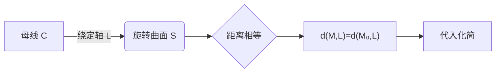

# 常见二次曲面（椭球面、双曲面、抛物面）、旋转曲面、柱面及投影曲线

## 旋转曲面与常见二次曲面

空间解析几何的核心任务是将“形”转化为“数”。面对一个陌生的曲面方程，我们如何快速识别它的形状？反过来，给定一条平面曲线绕轴旋转，又该如何写出它的空间方程？这不仅是期末考试的高频考点，更是后续学习重积分、曲面积分的几何基础。

### 旋转曲面方程的生成法则

> [!IMPORTANT]
> ==绕谁转，谁不变；另一变量换为距离==。这是求解坐标轴旋转曲面方程的唯一核心口诀。

设 $xOy$ 面上的曲线 $C: f(x, y)=0, z=0$：
-   **绕 $x$ 轴旋转**：$x$ 保留，$y \to \pm\sqrt{y^2+z^2}$，得 $f(x, \pm\sqrt{y^2+z^2})=0$；
-   **绕 $y$ 轴旋转**：$y$ 保留，$x \to \pm\sqrt{x^2+z^2}$，得 $f(\pm\sqrt{x^2+z^2}, y)=0$。

其余坐标面（$yOz$, $zOx$）同理类推。本质上，==旋转曲面上任一点到旋转轴的距离，等于母线上对应点到该轴的距离==。

[!TIP]
若母线方程含根号或分式，建议先平方整理再替换，避免最终方程出现复杂嵌套根号。例如填空25中 $y=x^2$ 绕 $x$ 轴旋转，直接写 $\sqrt{y^2+z^2}=x^2$ 即可，无需强行展开为四次方程。

### 常见二次曲面辨识

掌握以下标准方程是“看图识字”的关键：

| 曲面名称 | 标准方程 | 关键特征 |
| :--- | :--- | :--- |
| 椭球面 | $\frac{x^2}{a^2}+\frac{y^2}{b^2}+\frac{z^2}{c^2}=1$ | 三项同号，截痕均为椭圆 |
| 单叶双曲面 | $\frac{x^2}{a^2}+\frac{y^2}{b^2}-\frac{z^2}{c^2}=1$ | ==两正一负，连通曲面== |
| 双叶双曲面 | $-\frac{x^2}{a^2}-\frac{y^2}{b^2}+\frac{z^2}{c^2}=1$ | 两负一正，分为上下两叶 |
| 椭圆抛物面 | $z=\frac{x^2}{a^2}+\frac{y^2}{b^2}$ | 一次项与二次项异侧，开口朝上 |
| 双曲抛物面 | $z=\frac{x^2}{a^2}-\frac{y^2}{b^2}$ | ==马鞍面，过原点== |

[!WARNING]
区分单叶与双叶双曲面：看==等式右边为+1时，左边正项个数==。两个正项是单叶（像冷却塔），一个正项是双叶（像两个对顶碗）。切勿仅凭变量名判断，必须化为标准型。

### 空间曲线的投影

求曲线 $\begin{cases} F(x,y,z)=0 \\ G(x,y,z)=0 \end{cases}$ 在 $xOy$ 面的投影，本质是==消去 $z$ 得到投影柱面 $H(x,y)=0$==，再联立 $z=0$。

以真题为例：求 $\begin{cases} x^2+y^2+z^2=4 \\ z=\sqrt{3(x^2+y^2)} \end{cases}$ 在 $xOy$ 面的投影。
1.  将第二式平方代入第一式消 $z$：$x^2+y^2+3(x^2+y^2)=4 \Rightarrow x^2+y^2=1$；
2.  此即投影柱面，故投影曲线为 $\begin{cases} x^2+y^2=1 \\ z=0 \end{cases}$。

[!CAUTION]
投影曲线≠原曲线！投影只是原曲线在坐标面上的“影子”，丢失了高度信息。答题时务必写成方程组形式并标明 $z=0$，单独写 $x^2+y^2=1$ 会被扣分。
