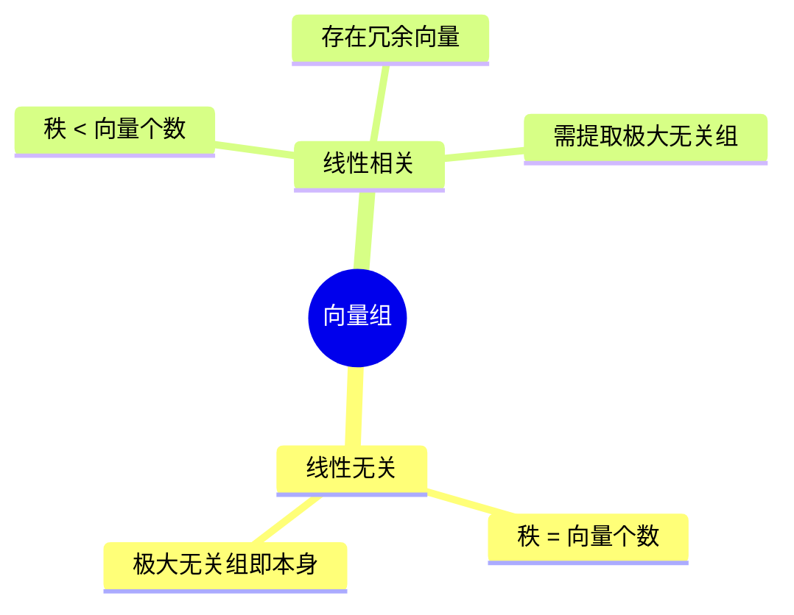

# 向量组的极大线性无关组与向量组的秩的求法

## 核心概念：什么是极大线性无关组与秩

想象你有一组向量，其中有些是“冗余”的（可以由其他向量线性表示）。==极大线性无关组==就是从中挑出的一组“骨干”向量，它们满足两个条件：
1. **线性无关**：内部没有冗余。
2. **极大性**：再往里面加任何一个原向量组的向量，就会变得线性相关。

这组“骨干”向量的个数，就是==向量组的秩==，记为 $r(\alpha_1, \dots, \alpha_s)$。

> [!IMPORTANT]
> 核心性质：向量组的秩等于其构成的矩阵的秩。即 $r(\alpha_1, \dots, \alpha_s) = r(A)$，其中 $A=(\alpha_1, \dots, \alpha_s)$。

## 为什么需要它？

在解析几何和工程应用中，我们常需确定空间的“维度”或寻找最简基底。
- **降维去噪**：剔除冗余信息，保留独立特征。
- **判定相关性**：若秩 < 向量个数，则向量组线性相关。

## 怎么求？（标准算法）

不要试图通过观察法猜测，请使用**初等行变换**。

1. **构造矩阵**：将向量按**列**排成矩阵 $A = (\alpha_1, \alpha_2, \dots, \alpha_n)$。
2. **行变换**：将 $A$ 化为**行阶梯形**或**行简化阶梯形**。
3. **定秩**：非零行的行数即为秩 $r$。
4. **找组**：**主元（每行第一个非零元）所在的列**对应的原向量，构成一个极大线性无关组。

> [!TIP]
> 记忆口诀：**“列向量，行变换；看主元，选原列。”**
> 注意：一定要回指**原矩阵**的列，而不是阶梯形矩阵的列！

## 常见误区与辨析

| 概念 | 说明 | 易错点 |
| :--- | :--- | :--- |
| **唯一性** | 极大线性无关组**不唯一** | 不同变换路径可能选出不同的列，但个数（秩）一定相同 |
| **零向量** | 含零向量的组必相关 | 零向量永远不在极大无关组中 |
| **等价性** | 任意两个极大无关组等价 | 它们可以相互线性表示 |

> [!WARNING]
> **高危误区**：对矩阵进行初等**列**变换会改变列向量之间的线性关系！求极大无关组时，**严禁使用列变换**，只能做行变换。

## 典型例题解析

**题目**：求向量组 $\alpha_1=(1,1,3,1)^T, \alpha_2=(-1,1,-1,3)^T, \alpha_3=(5,-2,8,-9)^T, \alpha_4=(-1,3,1,7)^T$ 的秩及一个极大线性无关组。

**解**：
构造矩阵并进行初等行变换：
$$
A = \begin{pmatrix} 1 & -1 & 5 & -1 \\ 1 & 1 & -2 & 3 \\ 3 & -1 & 8 & 1 \\ 1 & 3 & -9 & 7 \end{pmatrix} \xrightarrow{r_2-r_1, r_3-3r_1, r_4-r_1} \begin{pmatrix} 1 & -1 & 5 & -1 \\ 0 & 2 & -7 & 4 \\ 0 & 2 & -7 & 4 \\ 0 & 4 & -14 & 8 \end{pmatrix}
$$
继续化简：
$$
\xrightarrow{r_3-r_2, r_4-2r_2} \begin{pmatrix} 1 & -1 & 5 & -1 \\ 0 & 2 & -7 & 4 \\ 0 & 0 & 0 & 0 \\ 0 & 0 & 0 & 0 \end{pmatrix}
$$
此时已为行阶梯形。
1. **定秩**：非零行有 2 行，故 $r(A)=2$。
2. **选组**：主元位于第 1、2 列。
3. **结论**：秩为 2，一个极大线性无关组为 $\alpha_1, \alpha_2$。

> [!NOTE]
> 若需表示其余向量，可进一步化为**行简化阶梯形**，直接读取系数。例如本题中可推导出 $\alpha_3, \alpha_4$ 由 $\alpha_1, \alpha_2$ 线性表示的具体系数。
