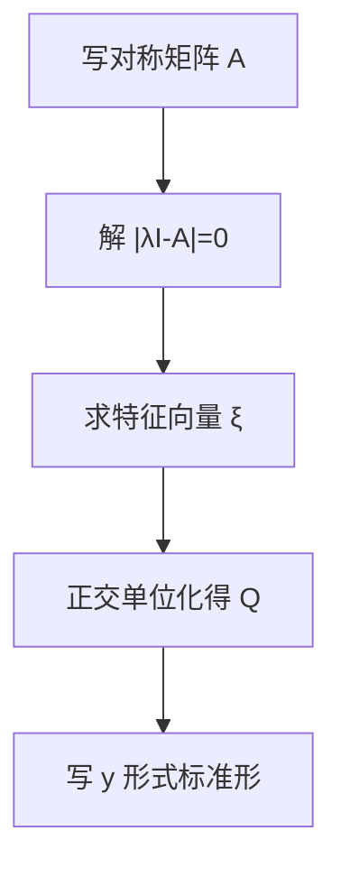

# 用正交变换法化二次型为标准形

## 它是什么

二次型 $f=x^TAx$ 里混着平方项和交叉项（如 $-4x_2x_3$）。==用正交变换 $x=Qy$ 化标准形，就是找一个正交矩阵 $Q$，把 $f$ 变成只含平方项的 $\lambda_1y_1^2+\lambda_2y_2^2+\lambda_3y_3^2$==，其中 $\lambda_i$ 正是 $A$ 的特征值。

为什么必须正交？因为保持长度和角度不变，几何图形形状才不会扭曲，才能顺带判断 $f=1$ 是什么曲面。

## 怎么做

先写出对称矩阵 $A$（交叉项系数平分给 $a_{ij},a_{ji}$），再走四步：

[!IMPORTANT]
> 标准形里平方项系数顺序跟 $Q$ 的列向量顺序严格对应；换列就要换系数顺序。

单根的特征向量天然正交，只需单位化；==重根的特征向量必须先施密特正交化，再单位化==，否则拼出的 $Q$ 不满足 $Q^TQ=I$。

## 和相近概念的区别

| 方法 | 变换要求 | 结果名称 | 系数 |
|------|----------|----------|------|
| 正交变换法 | $Q$ 正交 | 标准形 | 特征值 |
| 配方法 | 可逆线性替换 | 标准形 | 非特征值 |
| 规范形 | 可逆替换+缩放 | 规范形 | 仅 $1,-1,0$ |

## 常见的坑

[!WARNING]
> 交叉项 $-4x_2x_3$ 对应 $a_{23}=a_{32}=-2$，不是 $-4$。

[!CAUTION]
> 忘记正交化重根向量是最典型丢分点；最后单位化别漏，模长要开根。

## 算对了的例子

取 $f=x_1^2-2x_2^2+x_3^2-4x_2x_3$，矩阵

$$A=\begin{pmatrix}1&0&0\\0&-2&-2\\0&-2&1\end{pmatrix}$$

$|\lambda I-A|=(\lambda-1)(\lambda+3)(\lambda-2)$，得 $\lambda=1,2,-3$。对应单位向量

$$e_1=(1,0,0)^T,\ e_2=\left(0,\tfrac1{\sqrt5},-\tfrac2{\sqrt5}\right)^T,\ e_3=\left(0,\tfrac2{\sqrt5},\tfrac1{\sqrt5}\right)^T$$

拼成 $Q=(e_1,e_2,e_3)$，即 $x=Qy$，标准形为

$$f=y_1^2+2y_2^2-3y_3^2$$

[!TIP]
> 两个正系数、一个负系数，右端为 $1$ 即 **双叶双曲面**；全正是椭球面，一正两负是单叶双曲面。

[!NOTE]
> 若题目先给特征值反求参数，把根代回 $|\lambda I-A|=0$ 即可，随后常规求 $Q$。
