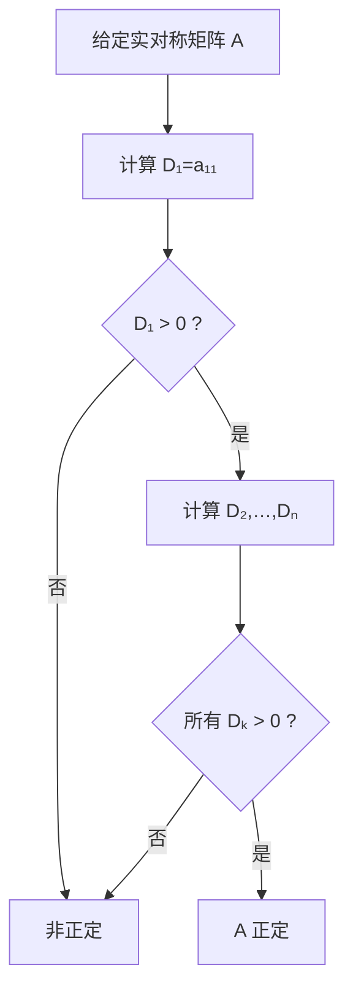

# 正定二次型与正定矩阵的定义及判定条件（顺序主子式等）

## 二次型的正定性：从定义到判定

### 什么是正定二次型

设实二次型 $f(X) = X^\mathrm{T} A X$，其中 $A$ 为实对称矩阵。若对任意非零列向量 $X \neq 0$，恒有

$$
f(X) > 0 \quad ( \text{且 } f(0)=0 )
$$

则称 $f$ 为**正定二次型**，称矩阵 $A$ 为**正定矩阵**，记为 $A > 0$。

从这个定义出发，正定二次型在非零点上的值一定大于零，绝不会等于零或小于零。反之，如果对任意 $X \neq 0$ 恒有 $f(X) < 0$，则称 $f$ 为**负定二次型**，$A$ 为**负定矩阵**，记为 $A < 0$。

> [!IMPORTANT]
> 正定矩阵一定是实对称矩阵。讨论正定性之前，务必先确保矩阵对称！

### 为什么需要正定性

在几何与优化问题中，正定二次型是自然出现的核心结构：

- 二次型 $X^\mathrm{T} A X$ 可理解为向量 $X$ 在矩阵 $A$ 作用下的“广义平方长度”。
- 正定矩阵保证了二次型的图形是开口向上的椭球面（二维时是椭圆），其最小值唯一且在原点。
- 在判断多元函数极值时，Hessian 矩阵的正定性直接决定驻点是否为极小值点。

因此，掌握正定性的快速判定，是解析几何曲面分类、最优化理论的基础。

### 如何判定：顺序主子式法

直接使用定义判定（验证所有 $X \neq 0$ 的函数值）几乎不可行。最实用的充要条件是 **Sylvester 准则**。

设 $A = (a_{ij})_{n \times n}$ 是实对称矩阵，其各阶**顺序主子式**定义为

$$
D_k =
\begin{vmatrix}
a_{11} & a_{12} & \cdots & a_{1k} \\
a_{21} & a_{22} & \cdots & a_{2k} \\
\vdots & \vdots & \ddots & \vdots \\
a_{k1} & a_{k2} & \cdots & a_{kk}
\end{vmatrix}
\quad (k=1,2,\dots,n)
$$

> [!TIP]
> **Sylvester 准则**  
> $A$ 正定 $\;\Longleftrightarrow\;$ 所有顺序主子式 $D_k > 0$。

也就是说，我们只需按顺序检查左上角子式，每一步都大于零即可下结论。

### 常见的坑与辨析

> [!WARNING]
> **只检查主子式不够，必须是顺序主子式！**  
> 例如 $A = \begin{pmatrix} 1 & 0 \\ 0 & -1 \end{pmatrix}$ 的主子式包含了 $-1$，但顺序主子式 $D_1=1>0, D_2=-1<0$，故不正定。务必从左上角开始依次截取。

> [!CAUTION]
> 二次型的矩阵表示中，交叉项系数要**折半**分配给对称位置。  
> 若交叉项为 $2a x_i x_j$，则矩阵元 $a_{ij}=a_{ji}=a$，非 $2a$。

> [!NOTE]
> 正定与负定的关系：$A<0 \iff -A>0$。  
> 判定负定时，可转化为判定 $-A$ 的正定性。半正定则允许主子式等于零，但顺序主子式均非负只是必要条件，真正判定还需检查所有主子式，此处不展开。

### 完整演算示例

**题目** 取自课堂例题：  
设 $f(x_1,x_2,x_3) = x_1^2 + 2x_2^2 + x_3^2 + 2x_1x_2 + 2t x_2x_3$ 正定，求 $t$ 的范围。

**第一步：写出对称矩阵**
交叉项折半：

$$
\begin{aligned}
2x_1x_2 &\rightarrow a_{12}=a_{21}=1 \\
2t x_2x_3 &\rightarrow a_{23}=a_{32}=t
\end{aligned}
$$

于是

$$
A = \begin{pmatrix}
1 & 1 & 0 \\
1 & 2 & t \\
0 & t & 1
\end{pmatrix}
$$

**第二步：顺序主子式**

$$
\begin{aligned}
D_1 &= 1 > 0 \\
D_2 &= \begin{vmatrix} 1 & 1 \\ 1 & 2 \end{vmatrix} = 2 - 1 = 1 > 0 \\
D_3 &= |A| = 1 \cdot \begin{vmatrix} 2 & t \\ t & 1 \end{vmatrix} - 1 \cdot \begin{vmatrix} 1 & t \\ 0 & 1 \end{vmatrix} \\
    &= (2 - t^2) - (1 - 0) = 1 - t^2
\end{aligned}
$$

**第三步：令所有顺序主子式大于零**

$$
1 - t^2 > 0 \;\Longrightarrow\; t^2 < 1 \;\Longrightarrow\; -1 < t < 1
$$

> [!IMPORTANT]
> ==正定充要条件：顺序主子式全正；交叉项系数折半入矩阵；先保证对称再判定。==

**答案**：$t$ 的取值范围是 $-1 < t < 1$，对应选项 A。
（说明：本节选用的课堂例题，按标准矩阵化方法计算即得此结果。实际考试中若选项形式不同，请仔细核对原题二次型系数。）
