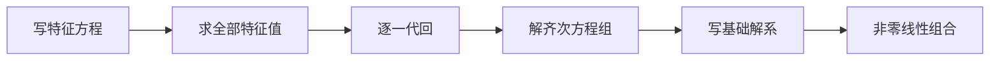

# 方阵的特征值与特征向量的定义及求法

## 定义：矩阵作用后方向不变

设 $A$ 是 $n$ 阶方阵。若存在数 $\lambda$ 和**非零**列向量 $\alpha$，使得

$$
A\alpha=\lambda\alpha,
$$

则称 $\lambda$ 为 $A$ 的==特征值==，$\alpha$ 为 $A$ 的属于 $\lambda$ 的==特征向量==。

它的几何意义是：矩阵把 $\alpha$ 变成同一直线上的向量，只改变长度或方向是否反向。特征值与特征向量是后续研究相似对角化、二次型的基础。

> [!IMPORTANT]
> 特征向量必须满足 $\alpha\ne 0$；$\lambda$ 可以为 $0$。零向量虽然总满足 $A0=\lambda0$，但不是特征向量。

## 求法：先求特征值，再求特征向量

由 $A\alpha=\lambda\alpha$ 且 $\alpha\ne0$，得

$$
(\lambda E-A)\alpha=0
$$

有非零解，因此 $|\lambda E-A|=0$。称 $|\lambda E-A|$ 为 $A$ 的**特征多项式**，相应方程为**特征方程**。

具体步骤：

1. 解 $|\lambda E-A|=0$，求出全部特征值，重根要按重数保留；
2. 对每个 $\lambda_i$，解 $(\lambda_iE-A)x=0$；
3. 若基础解系为 $\xi_1,\dots,\xi_s$，则属于 $\lambda_i$ 的全体特征向量为
   $$
   k_1\xi_1+\cdots+k_s\xi_s,
   $$
   其中 $k_1,\dots,k_s$ 不全为零。

> [!WARNING]
> 不要只写 $k\xi$ 而漏掉 $k\ne0$；有多个线性无关特征向量时，也不能把系数误写成“全不为零”，正确条件是==不全为零==。

## 算例：二阶矩阵完整求解

设

$$
A=\begin{pmatrix}1&-1\\2&4\end{pmatrix}.
$$

先计算

$$
|\lambda E-A|
=\begin{vmatrix}\lambda-1&1\\-2&\lambda-4\end{vmatrix}
=\lambda^2-5\lambda+6
=(\lambda-2)(\lambda-3),
$$

故 $\lambda_1=2,\lambda_2=3$。

当 $\lambda_1=2$ 时，$(2E-A)x=0$ 化为 $x_1+x_2=0$，取

$$
\xi_1=\binom{1}{-1},
$$

全体特征向量为 $k_1\xi_1\ (k_1\ne0)$。

当 $\lambda_2=3$ 时，方程化为 $2x_1+x_2=0$，取

$$
\xi_2=\binom{1}{-2},
$$

全体特征向量为 $k_2\xi_2\ (k_2\ne0)$。检验可得 $A\xi_1=2\xi_1,\ A\xi_2=3\xi_2$。

## 相近结论与常见坑

若 $A\alpha=\lambda\alpha$，则 $A^k\alpha=\lambda^k\alpha$；当 $A$ 可逆时，$A^{-1}\alpha=\lambda^{-1}\alpha$。此外，$A$ 与 $A^T$ 有相同特征多项式和特征值，但特征向量不能直接认为相同。

| 对象 | 特征值 | 对应特征向量 |
|---|---|---|
| $A$ | $\lambda$ | $\alpha$ |
| $A^k$ | $\lambda^k$ | $\alpha$ |
| $A^{-1}$ | $\lambda^{-1}$ | $\alpha$ |
| $P^{-1}AP$ | $\lambda$ | $P^{-1}\alpha$ |

> [!TIP]
> 看到 $|aE+bA|=0$，先化成 $|\lambda E-A|=0$ 再读特征值。例如 $|2A-E|=0$ 对应 $\lambda=\frac12$，不要误读成 $2$。
