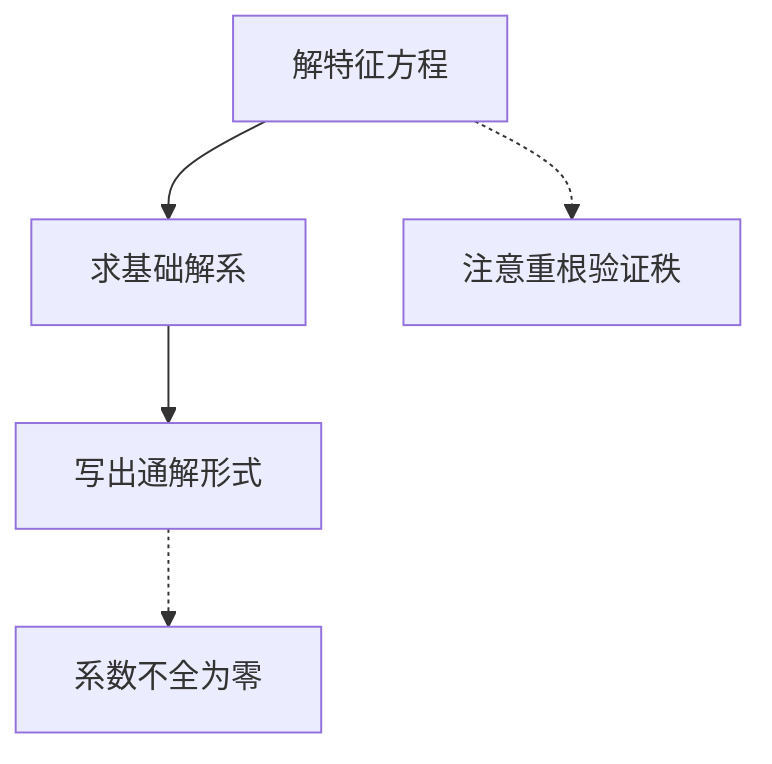

# 特征值与特征向量的性质及判定条件

特征值与特征向量揭示了矩阵在特定方向上的“缩放本质”。若 $Ax = \lambda x$（$x \neq 0$），则 $\lambda$ 为特征值，$x$ 为对应特征向量。为什么需要它？因为它是==判断矩阵相似对角化、分析二次型正定性及求解矩阵幂==的核心工具，能将复杂的矩阵运算转化为简单的数乘运算。

## 判定条件与核心性质

求特征值即解特征方程 $|\lambda I - A| = 0$。但计算前请先思考：能否利用性质避免繁琐的行列式展开？

> [!IMPORTANT]
> ==特征值的代数重数 $\ge$ 几何重数==。即 $k$ 重特征值对应的线性无关特征向量个数 $t$ 满足 $1 \le t \le k$。这是判定矩阵能否对角化的关键依据。

常用推导性质如下表所示（设 $\lambda$ 是 $A$ 的特征值，$x$ 是对应特征向量）：

| 矩阵变换 | 新特征值 | 特征向量 | 备注 |
| :--- | :--- | :--- | :--- |
| $kA$ | $k\lambda$ | $x$ | $k$ 为常数 |
| $A^m$ | $\lambda^m$ | $x$ | $m$ 为正整数 |
| $A^{-1}$ | $\lambda^{-1}$ | $x$ | $A$ 可逆时成立 |
| $A^*$ | $\|A\|/\lambda$ | $x$ | $A$ 可逆时成立 |
| $f(A)$ | $f(\lambda)$ | $x$ | $f$ 为多项式函数 |
| $P^{-1}AP$ | $\lambda$ | $P^{-1}x$ | 相似矩阵特征值相同 |

> [!TIP]
> 实对称矩阵具有三大优良性质：==特征值全为实数==；不同特征值对应的特征向量==必正交==；$k$ 重特征值必有 $k$ 个线性无关的特征向量（即代数重数=几何重数）。

## 标准求解流程与易错点

求解过程分为三步，每一步都有容易踩坑的细节：

> [!WARNING]
> 特征向量是==非零向量==！写出通解 $c_1\eta_1 + \cdots + c_t\eta_t$ 时，必须标注“$c_i$ 不全为零”。对于重特征值，务必验证 $(\lambda I - A)x=0$ 的基础解系含向量个数是否等于重数，否则可能漏解或误判可对角化条件。

## 典型例题解析

以课件例1为例，求 $A=\begin{pmatrix}3&2&4\\2&0&2\\4&2&3\end{pmatrix}$ 的特征值与特征向量。

**第一步**：解 $|\lambda I - A|=0$，得 $\lambda_1=8, \lambda_2=\lambda_3=-1$。

**第二步**：对 $\lambda_1=8$，解 $(8I-A)x=0$，得基础解系 $\alpha_1=(2,1,2)^T$，特征向量为 $k_1\alpha_1 (k_1 \neq 0)$。

**第三步**：对二重根 $\lambda=-1$，解 $(-I-A)x=0$。此时需特别注意：系数矩阵秩为1，故基础解系含 $3-1=2$ 个向量，解得 $\alpha_2=(1,0,-1)^T, \alpha_3=(1,-2,0)^T$。特征向量为 $k_2\alpha_2+k_3\alpha_3$（$k_2,k_3$ 不全为零）。

> [!CAUTION]
> 本题中 $\lambda=-1$ 是二重根，若只求出一个线性无关向量，说明计算有误。==实对称矩阵的重根一定“配满”特征向量==，这是检验计算正确性的天然标尺。若题目改为一般矩阵且重根缺向量，则该矩阵不可对角化。
