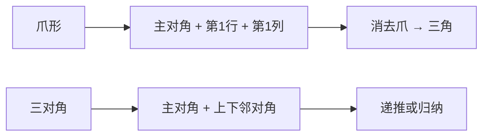

# 特殊行列式计算（三角法、爪形、三对角、递推法、数学归纳法）

## 特殊行列式的计算思路

计算高阶行列式，最怕直接按定义展开——那几乎不可操作。实际解题时，核心思路只有一条：**先观察结构，再决定方法**。本章涉及的几类特殊行列式，各有固定的“破局点”。

### 三角法：化出零的阶梯

若行列式的主对角线一侧全为零，即为**三角行列式**，其值等于主对角元之积：

$$
\begin{vmatrix}
a_{11} & a_{12} & \cdots & a_{1n} \\
0 & a_{22} & \cdots & a_{2n} \\
\vdots & \vdots & \ddots & \vdots \\
0 & 0 & \cdots & a_{nn}
\end{vmatrix}
= a_{11}a_{22}\cdots a_{nn}.
$$

即使原行列式不是三角形状，也常可通过行的倍加变换把它化为三角行列式，这就是**三角法**。它的价值在于：==只要能把一侧“清空”成零，行列式的值立刻读出==。

### 爪形与三对角：结构决定方法

两类高频结构需要认出来：

**爪形行列式**形如：

$$
\begin{vmatrix}
a_{0} & b_{1} & b_{2} & \cdots & b_{n} \\
c_{1} & a_{1} & 0 & \cdots & 0 \\
c_{2} & 0 & a_{2} & \cdots & 0 \\
\vdots & \vdots & \vdots & \ddots & \vdots \\
c_{n} & 0 & 0 & \cdots & a_{n}
\end{vmatrix}.
$$

做法非常固定：当 $a_i \neq 0$ 时，用第 $i$ 行乘 $-\dfrac{c_i}{a_i}$ 加到第 $1$ 行，把“爪子”的臂全部消成零，行列式变为**上三角**，直接相乘。

> [!TIP]
> 爪形行列式的口诀：==“断臂求生”==——先处理掉第一行和第一列的“爪子”，剩下就是三角。

**三对角行列式**只含主对角线和紧邻的上下两条对角线，其余元素全为零。直接展开会得到**递推关系**。

### 递推法：寻找低一阶的同构

对于三对角行列式 $D_n$，按第一行（或第一列）展开，会出现 $D_{n-1}$ 与 $D_{n-2}$ 的组合，从而建立：

$$
D_n = p\,D_{n-1} - q\,D_{n-2}.
$$

若结构均匀，可进而求出通项。递推法的关键不是“展开”，而是==展开后要能认出与原行列式同构的低阶行列式==。

### 数学归纳法：先证再算

若题目已给出结果，或可先算出小规模情形猜出通式，就可用数学归纳法：

1. 验证 $n = 1,2$ 时结论成立；
2. 假设 $D_{n-1}, D_{n-2}$ 满足通式；
3. 代入递推关系，证明 $D_n$ 也满足。

> [!IMPORTANT]
> 已给结论的行列式证明，==首选数学归纳法==；未给结论时，先算 $D_1, D_2, D_3$ 找规律再归纳。

### 一个算对的例子

计算 $n+1$ 阶爪形行列式：

$$
D = 
\begin{vmatrix}
3 & 1 & 1 & \cdots & 1 \\
1 & 1 & 0 & \cdots & 0 \\
1 & 0 & 1 & \cdots & 0 \\
\vdots & \vdots & \vdots & \ddots & \vdots \\
1 & 0 & 0 & \cdots & 1
\end{vmatrix}.
$$

**解**：第 $i$ 行 $\times(-1)$ 加到第 $1$ 行（$i=2,\dots,n+1$），第 $1$ 行变为

$$
(3-n,\ 0,\ 0,\ \dots,\ 0),
$$

行列式化为上三角，故

$$
D = 3-n.
$$

> [!WARNING]
> 爪形消元时，**只有当 $a_i \neq 0$** 才能直接用第 $i$ 行消去 $c_i$。若某个 $a_i = 0$，必须先按该列展开降阶，或换用其他行变换。

### 方法速查

| 结构特征 | 首选方法 | 核心操作 |
|---|---|---|
| 主对角线一侧全零 | 三角法 | 行倍加清空 |
| 主对角 + 首行 + 首列 | 爪形消元 | 断爪成三角 |
| 主对角 + 上下邻对角 | 递推法 | 按首行展开找递推 |
| 结果已知 | 数学归纳法 | 验证基例 + 递推步 |
| 含参数需讨论 | 三角 + 分类 | 注意特殊参数使消元失效 |
