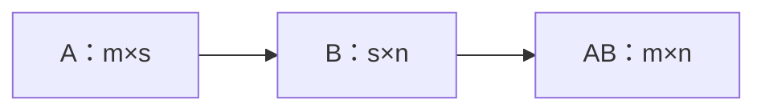

# 矩阵的概念及加法、数乘、乘法、转置运算

## 矩阵是什么

把 $m\times n$ 个数排成 $m$ 行 $n$ 列的数表，就得到一个矩阵，记作
$$A=(a_{ij})_{m\times n}.$$
矩阵是一张“整体数据表”，不是数；只有方阵才有行列式，且 $|A|$ 是一个数。矩阵可以表示线性方程组、线性变换和向量组，后续求逆、解矩阵方程都依赖本节运算。

## 加法、数乘与转置

同型矩阵才能相加：对应元素相加；数乘则是==每个元素都乘 $\lambda$==。加法与数乘统称矩阵的线性运算，满足交换律、结合律及分配律。

转置是行列互换：$(A^T)_{ij}=a_{ji}$，并有
$$(A+B)^T=A^T+B^T,\qquad(\lambda A)^T=\lambda A^T,\qquad(AB)^T=B^TA^T.$$

> [!WARNING]
> 数乘矩阵与数乘行列式不同：$\lambda A$ 是全部元素乘 $\lambda$；若 $A$ 为 $n$ 阶方阵，则 $|\lambda A|=\lambda^n|A|$。

## 矩阵乘法怎么做

若 $A$ 为 $m\times s$ 矩阵，$B$ 为 $s\times n$ 矩阵，则 $AB$ 为 $m\times n$ 矩阵，且
$$c_{ij}=\sum_{k=1}^{s}a_{ik}b_{kj}.$$
即“==左矩阵第 $i$ 行，乘右矩阵第 $j$ 列==”，对应元素相乘再求和。可乘条件可记为：

矩阵乘法满足结合律、对加法的分配律，但==一般不满足交换律和消去律==，因此必须分清左乘、右乘。通常 $AB\ne BA$；$AB=O$ 也不能推出 $A=O$ 或 $B=O$。不过方阵行列式满足 $|AB|=|A||B|$，这不表示矩阵本身可以交换。

| 运算 | 关键条件或规律 | 易错点 |
|---|---|---|
| $A+B$ | 必须同型 | 不能只看元素个数 |
| $\lambda A$ | 每个元素都乘 | 与行列式数乘混淆 |
| $AB$ | 内维相同 | 随意交换顺序 |
| $(AB)^T$ | 等于 $B^TA^T$ | 转置后忘记反序 |

## 一个算对的例子

由考题 $2X=AX+A$，先移项并提取 $X$：
$$2X-AX=A\quad\Longrightarrow\quad(2I-A)X=A.$$
这里 $X$ 在右边，所以只能左乘 $(2I-A)^{-1}$，得
$$X=(2I-A)^{-1}A.$$
题中
$$2I-A=\begin{pmatrix}1&1&0\\-1&1&-1\\0&-1&1\end{pmatrix},\qquad |2I-A|=1\ne0,$$
故可逆。求得
$$(2I-A)^{-1}=\begin{pmatrix}0&-1&1\\1&1&-1\\1&1&-2\end{pmatrix},$$
再按“行乘列”计算：
$$X=\begin{pmatrix}0&-1&1\\1&1&-1\\1&1&-2\end{pmatrix}
\begin{pmatrix}1&-1&0\\1&1&1\\0&1&1\end{pmatrix}
=\begin{pmatrix}-1&0&0\\2&-1&0\\2&-2&-1\end{pmatrix}.$$

> [!TIP]
> 解矩阵方程先看 $X$ 的位置，再决定左乘还是右乘；最后代回原方程检验，最容易发现顺序错误。
