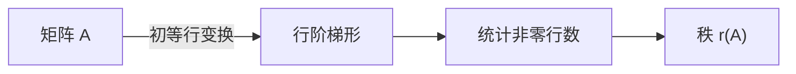

# 矩阵的秩的概念、求法及秩的运算性质

## 矩阵的秩

在矩阵理论中，秩是刻画矩阵“本质大小”的核心概念。它告诉我们：一个矩阵的行（或列）中，真正“独立”的向量有多少个。

### 从线性方程组解的唯一性说起

考虑一个线性方程组 $Ax = b$。什么时候它有唯一解？什么时候有无穷多解？什么时候无解？这些问题的答案，并不取决于矩阵的外形（几行几列），而取决于矩阵的**内在信息量**——也就是秩。

直观上，如果一个 $3 \times 3$ 的矩阵有一个行可以用另外两行线性表示，那么它本质上只包含两行“有效信息”，其秩就是 2。

### 秩的严格定义

设 $A$ 为 $m \times n$ 矩阵。

> [!IMPORTANT]
> ==矩阵 $A$ 的秩 $r(A)$ 等于其最高阶非零子式的阶数。==

这里“子式”指从 $A$ 中任取 $k$ 行、$k$ 列构成的行列式。

等价定义（任选其一理解即可）：
- 列秩：$A$ 的列向量组的极大无关组所含向量个数。
- 行秩：$A$ 的行向量组的极大无关组所含向量个数。
- 行阶梯形：化为行阶梯形矩阵后，==非零行的行数==。

任意矩阵的行秩与列秩恒相等，这就是我们统称“秩”的原因。

### 秩的求法

在实际计算中，通常采用**初等变换法**：

1. 用初等行变换将 $A$ 化为行阶梯形。
2. 数出非零行的行数。

[!TIP]
初等变换**不改变矩阵的秩**，这是计算秩的理论依据。

### 秩的运算性质

以下性质在证明与计算中频繁使用，务必熟记。

| 运算规则 | 公式 / 结论 |
| :--- | :--- |
| 转置 | $r(A^T) = r(A)$ |
| 乘积 | $r(AB) \le \min\{r(A), r(B)\}$ |
| 可逆矩阵不改变秩 | 若 $P, Q$ 可逆，则 $r(PAQ) = r(A)$ |
| 加法 | $r(A \pm B) \le r(A) + r(B)$ |
| 分块对角 | $r\left(\begin{smallmatrix}A & 0 \\ 0 & B\end{smallmatrix}\right) = r(A) + r(B)$ |
| 伴随矩阵 | 当 $n \ge 2$ 时：$r(A^*) = \begin{cases} n, & r(A)=n \\ 1, & r(A)=n-1 \\ 0, & r(A)<n-1 \end{cases}$ |

> [!WARNING]
> ==$r(AB) \le r(A)$ 且 $r(AB) \le r(B)$==，但左右两边并不相等。很多同学误认为乘积的秩“取最小”，这只是上限，而不是等于。

### 一个极易混淆的判断选择题

选择题中常出现这样的说法，我们来辨析一下：

设 $r(A) = r$，则：
- ✅ **$A$ 的 $r$ 阶子式不全为零**（定义保证：至少存在一个非零的 $r$ 阶子式）。
- ❌ $A$ 的 $r$ 阶子式全不为零（可能部分 $r$ 阶子式为零，只要不全为零即可）。
- ❌ $A$ 的阶数小于 $r$ 的子式全为零（小于等于 $r-1$ 阶的子式当然可能非零，比如有非零的 $r-1$ 阶子式）。

只有第一种说法是正确且严谨的秩的描述。

### 例题：综合证明中的秩估计

**题目**（取自综合题改编）：已知 $n$ 维非零实列向量 $\alpha, \beta$ 正交，证明 $A = \alpha\alpha^T - \beta\beta^T$ 的秩 $r(A)=2$。

**分析思路**：既要证明秩不超过 2，又要证明秩不小于 2。

**证明过程**：

1.  **上界**：$A$ 的每一列都是 $\alpha$ 和 $\beta$ 的线性组合，因此列空间维数不超过 2，即 ==$r(A) \le 2$==。

2.  **下界**：利用正交条件 $\alpha^T\beta = 0$：
    $$
    A\alpha = \alpha(\alpha^T\alpha) - \beta(\beta^T\alpha) = \|\alpha\|^2\alpha
    $$
    $$
    A\beta = \alpha(\alpha^T\beta) - \beta(\beta^T\beta) = -\|\beta\|^2\beta
    $$
    由于 $\alpha, \beta$ 是非零向量，$\|\alpha\|^2 \neq 0$、$\|\beta\|^2 \neq 0$，说明 $\alpha$ 和 $\beta$ 分别是 $A$ 对应于两个非零特征值的特征向量。正交保证它们线性无关，因此 $A$ 的列空间中至少有两个线性无关的向量，即 ==$r(A) \ge 2$==。

综合上下界，$r(A) = 2$ 得证。

[!NOTE]
秩的上下界联合估计（夹逼）是证明秩等于某个值时的常用技巧：利用线性组合找上界，利用特征向量或特殊构造找下界。
