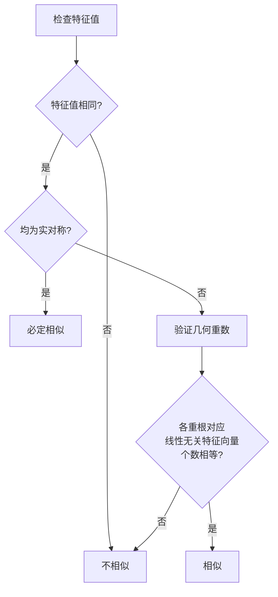

# 矩阵相似的概念、性质与判定

## 矩阵相似的概念与核心性质

如果两个矩阵 $A$ 和 $B$ 描述的是同一个线性变换，只是在不同基底下坐标表示不同，它们之间有什么关系？这种关系就是==矩阵相似==。

> [!IMPORTANT]
> **定义**：设 $A, B$ 为 $n$ 阶方阵，若存在可逆矩阵 $P$，使得 $P^{-1}AP = B$，则称 $A$ 与 $B$ ==相似==，记作 $A \sim B$。其中 $P$ 称为过渡矩阵（或相似变换矩阵）。

相似关系本质上是一种等价关系，满足反身性、对称性和传递性。它保证了矩阵在“换基”过程中保留了最本质的代数特征。

### 相似矩阵的不变量

既然相似矩阵是同一变换的不同“面孔”，哪些量在相似变换下保持不变？

| 不变量 | 公式表达 | 备注 |
| :--- | :--- | :--- |
| 行列式 | $\|A\| = \|B\|$ | 体积缩放因子相同 |
| 迹 | $tr(A) = tr(B)$ | 特征值之和相等 |
| 秩 | $r(A) = r(B)$ | 像空间维数相同 |
| 特征多项式 | $\|\lambda E - A\| = \|\lambda E - B\|$ | ==特征值完全相同== |
| 可逆性 | $A$ 可逆 $\Leftrightarrow$ $B$ 可逆 | 且 $B^{-1} = P^{-1}A^{-1}P$ |

> [!TIP]
> **解题口诀**：相似必同特（征值）、同行列、同迹、同秩。做题时若已知 $A \sim B$，优先利用迹和行列式建立方程求未知参数。

### 如何判定两个矩阵相似？

特征值相同只是相似的==必要条件==，而非充分条件。判定时需分两步走：

> [!WARNING]
> **高频误区**：仅凭特征值相同就断定相似是错误的！例如 $A=\begin{pmatrix}1&1\\0&1\end{pmatrix}$ 与 $E=\begin{pmatrix}1&0\\0&1\end{pmatrix}$ 特征值均为 1（二重），但 $A \not\sim E$，因为 $A$ 只有一个线性无关的特征向量。

### 相似变换下的特征向量关系

这是考试中最容易混淆的点：若 $A \sim B$，它们的特征值相同，但==特征向量不同==。

设 $A\alpha = \lambda \alpha$，且 $B = P^{-1}AP$，则 $B$ 对应于同一特征值 $\lambda$ 的特征向量为 $P^{-1}\alpha$，而非 $P\alpha$ 或 $P^T\alpha$。

> [!CAUTION]
> **推导验证**：$B(P^{-1}\alpha) = (P^{-1}AP)(P^{-1}\alpha) = P^{-1}A(PP^{-1})\alpha = P^{-1}(A\alpha) = P^{-1}(\lambda\alpha) = \lambda(P^{-1}\alpha)$。务必记住左乘 $P^{-1}$ 这一结论。

### 典型例题解析

**题目**：设 $A=\begin{pmatrix}5 & 7 \\ 0 & 7\end{pmatrix}$ 与 $B=\begin{pmatrix}b & a \\ a & b\end{pmatrix}(a>0)$ 相似，求 $a, b$。

**解**：由相似性质知 $tr(A)=tr(B)$ 且 $|A|=|B|$。
$$
\begin{cases}
5+7 = 2b \\
5\times7 = b^2 - a^2
\end{cases}
\Rightarrow
\begin{cases}
b = 6 \\
36 - a^2 = 35
\end{cases}
$$
解得 $a^2=1$，因 $a>0$，故 $a=1, b=6$。

> [!NOTE]
> 此题利用了相似的最基本不变量。若题目改为判断两个非对称矩阵是否相似，则必须进一步计算各自特征值对应的线性无关特征向量个数（即 $n-r(\lambda E-A)$）是否一致。
