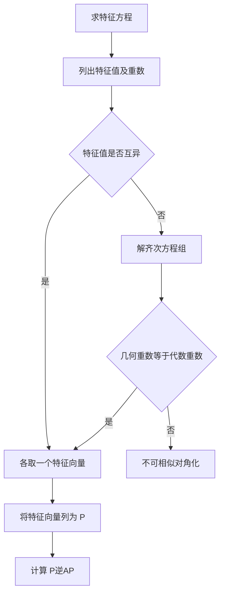

# 矩阵可相似对角化的充要条件与方法

## 核心结论

设 $A\in M_n(\mathbb R)$。若存在可逆矩阵 $P$，使

$$
P^{-1}AP=\operatorname{diag}(\lambda_1,\lambda_2,\ldots,\lambda_n),
$$

则称 $A$ **可相似对角化**，也称 $A$ 可对角化。此时 $P$ 的各列是 $A$ 的线性无关特征向量，且

$$
A=P\operatorname{diag}(\lambda_1,\ldots,\lambda_n)P^{-1}.
$$

> [!IMPORTANT]
> $n$ 阶矩阵可相似对角化的充要条件是：它有 $n$ 个线性无关的特征向量。

这一定理是特征值、特征向量与相似变换之间的联系。

## 为什么需要判断

矩阵的相似对角化能把复杂运算转化为对角矩阵上的计算。例如求 $A^m$，若

$$
A=PDP^{-1},
$$

则

$$
A^m=PD^mP^{-1},
$$

其中 $D^m=\operatorname{diag}(\lambda_1^m,\ldots,\lambda_n^m)$。

另外，矩阵是否可对角化，还决定了能否建立由特征向量组成的基。在线性代数中，特征值、特征向量、矩阵的秩以及二次型等问题常通过这一知识点联系起来。

## 怎样判断

### 不同特征值法

先求特征方程

$$
\det(\lambda E-A)=0
$$

的根。若 $A$ 有 $n$ 个互不相同的特征值，则每个特征值至少对应一个特征向量；由于不同特征值对应的特征向量线性无关，所以 $A$ 一定可对角化。

### 重特征值法

若 $\lambda$ 是 $A$ 的 $k$ 重特征值，则需检查

$$
\dim\ker(\lambda E-A)=k.
$$

也就是 $\lambda E-A$ 的零空间维数是否等于该特征值的重数。若相等，则能找出 $k$ 个线性无关的特征向量；若小于 $k$，则不能对角化。

也可按特征值重数累加几何重数：

$$
\sum_{\lambda}\dim\ker(\lambda E-A)=n.
$$

> [!WARNING]
> “有 $n$ 个特征值（计重数）”并不等于“可对角化”。当存在重特征值时，还必须检查对应特征子空间的维数。

## 求解步骤

当特征值互异时，不必分别求出所有特征向量，也可利用已知的一个特征向量构造 $P$。若已知一个特征值 $\lambda_1$ 及非零特征向量 $\xi_1$，则

$$
\xi_2=(A-\lambda_1E)\xi_1,\qquad
\xi_3=(A-\lambda_2E)\xi_2
$$

在条件合适时是同一特征子空间中的其他线性无关向量。

## 一个算对了的例子

设

$$
A=\begin{pmatrix}2&-4\\1&-1\end{pmatrix}.
$$

计算特征多项式：

$$
\det(\lambda E-A)
=\begin{vmatrix}\lambda-2&-4\\-1&\lambda+1\end{vmatrix}
=(\lambda-2)(\lambda+1).
$$

因此 $\lambda_1=2,\lambda_2=-3$ 互异，$A$ 可相似对角化。分别求特征向量：

$$
(A-2E)X=0
\quad\Rightarrow\quad
\xi_1=\begin{pmatrix}4\\1\end{pmatrix},
$$

$$
(A+3E)X=0
\quad\Rightarrow\quad
\xi_2=\begin{pmatrix}1\\-1\end{pmatrix}.
$$

取

$$
P=(\xi_1,\xi_2)
=\begin{pmatrix}4&1\\1&-1\end{pmatrix},
\qquad |P|=-5\ne0.
$$

于是

$$
P^{-1}AP=
\begin{pmatrix}2&0\\0&-3\end{pmatrix},
$$

即

$$
A=P
\begin{pmatrix}2&0\\0&-3\end{pmatrix}
P^{-1}.
$$

## 实对称矩阵的特殊结论

若 $A$ 是实对称矩阵，则一定可相似对角化，并且不同特征值对应的特征向量相互正交。求出一组正交的特征向量并单位化后，可取正交矩阵 $Q$，使

$$
Q^{-1}AQ=Q^TAQ
=\operatorname{diag}(\lambda_1,\ldots,\lambda_n).
$$

因此，实对称矩阵常用 **Schmidt 正交化方法**处理重特征值：先在每个特征子空间内选取正交基，再将全部特征向量单位化。

## 容易混淆的概念

| 概念 | 判断依据 | 结论 |
|---|---|---|
| 矩阵可对角化 | 存在可逆 $P$，使 $P^{-1}AP$ 为对角阵 | 等价于有 $n$ 个线性无关特征向量 |
| 矩阵可相似对角化 | 与某个对角矩阵相似 | 与“可对角化”是同一概念 |
| 矩阵是实对称矩阵 | $A^T=A$ | 一定可正交相似对角化 |
| 矩阵有 $n$ 个特征值 | 特征值按代数重数计算 | 不能单独保证可对角化 |

> [!TIP]
> 记忆口诀：**特征值数不够，就查几何重数；实对称矩阵，必能正交对角化。**

> [!CAUTION]
> 不要把“矩阵可逆”“矩阵有特征值”和“矩阵可对角化”混为一谈。可逆只说明 $0$ 不是特征值，却不能保证存在完整的特征向量基。
