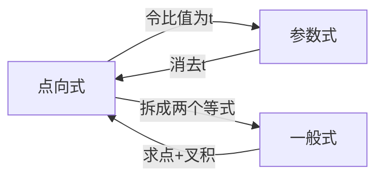

# 空间直线的点向式（对称式）、参数式与一般式方程及转换

## 空间直线的三种方程

要从几何上确定一条空间直线，需要两个要素：**直线上的一点** $P_0(x_0,y_0,z_0)$ 和**直线的方向向量** $\vec{s}=(l,m,n)$。同一个几何对象，根据解题场景不同，有三种常用的代数写法。

### 点向式（对称式）

设方向向量 $\vec{s}=(l,m,n)$ 中 $l,m,n$ 均不为零，则直线上任意点 $P(x,y,z)$ 满足向量 $\overrightarrow{P_0P}$ 与 $\vec{s}$ 平行，即对应分量成比例：

$$
\frac{x-x_0}{l}=\frac{y-y_0}{m}=\frac{z-z_0}{n}
$$

> [!IMPORTANT]
> 点向式的本质是“两个独立的比例等式”，实际代表两个平面方程的交线。其中 **$P_0$ 是直线上已知点，$(l,m,n)$ 是方向向量**，二者缺一不可。

### 参数式

令点向式的公共比值为参数 $t$，立即得到：

$$
x=x_0+lt,\quad y=y_0+mt,\quad z=z_0+nt \quad (t\in\mathbb{R})
$$

参数式的几何意义是：从定点 $P_0$ 出发，沿方向 $\vec{s}$ 走 $t$ 个单位。$t$ 变化时，点就扫出整条直线。

### 一般式

直线也可以看作两个不平行平面的交线：

$$
\begin{cases}
A_1x+B_1y+C_1z+D_1=0\\
A_2x+B_2y+C_2z+D_2=0
\end{cases}
$$

两平面的法向量分别为 $\vec{n}_1=(A_1,B_1,C_1)$、$\vec{n}_2=(A_2,B_2,C_2)$，它们的交线方向 $\vec{s}$ 同时垂直于两个法向量，故可取：

$$
\vec{s}=\vec{n}_1\times\vec{n}_2
$$

## 三种形式如何互相转换

**点向式 → 一般式**：把连等式拆成任意两个等式（如取前两项相等、后两项相等），化简即可。

**一般式 → 点向式**：分两步走——

1. **找点**：令 $z=0$（或 $x=0$、$y=0$，选一个让方程组好算的值），解出对应的 $x,y$，得到直线上一点 $P_0$。
2. **找方向**：$\vec{s}=\vec{n}_1\times\vec{n}_2$，用行列式计算。

> [!TIP]
> 找点时，若令 $z=0$ 后方程组无解或不好解，就换令 $y=0$ 或 $x=0$。任何一个坐标都可以先“赋值”，只要解出的点确实满足原方程组。

## 例题与常见坑

**例** 将直线 $L:\begin{cases} x+y+z+1=0\\ 2x-y+3z+4=0\end{cases}$ 化为点向式和参数式。

**解** 令 $z=0$，代入得
$$
\begin{cases} x+y=-1\\ 2x-y=-4\end{cases}
$$
相加得 $3x=-5$，即 $x=-\frac{5}{3}$，回代得 $y=\frac{2}{3}$。故 $P_0\left(-\frac{5}{3},\frac{2}{3},0\right)$。

方向向量：
$$
\vec{s}=\vec{n}_1\times\vec{n}_2
=
\begin{vmatrix}
\vec{i} & \vec{j} & \vec{k}\\
1 & 1 & 1\\
2 & -1 & 3
\end{vmatrix}
=(4,-1,-3)
$$

所以点向式方程：
$$
\frac{x+\frac{5}{3}}{4}=\frac{y-\frac{2}{3}}{-1}=\frac{z}{-3}
$$

==参数式方程==：
$$
x=-\frac{5}{3}+4t,\quad y=\frac{2}{3}-t,\quad z=-3t
$$

> [!WARNING]
> 点向式中方向向量的分量**不能全为零**，但可以个别为零。例如 $\vec{s}=(2,0,-1)$ 时，$y$ 恒等于 $y_0$，此时方程写作
> $$
> \frac{x-x_0}{2}=\frac{z-z_0}{-1},\quad y=y_0
> $$
> 不能机械地在分母写 $0$。

> [!CAUTION]
> 一般式化为点向式时，“找点”这一步骤最容易被跳过。**没有定点 $P_0$ 就无法写出点向式**——方向向量只决定了直线的“倾斜方向”，必须再有一个点才能把直线“钉”在空间中唯一的位置。
