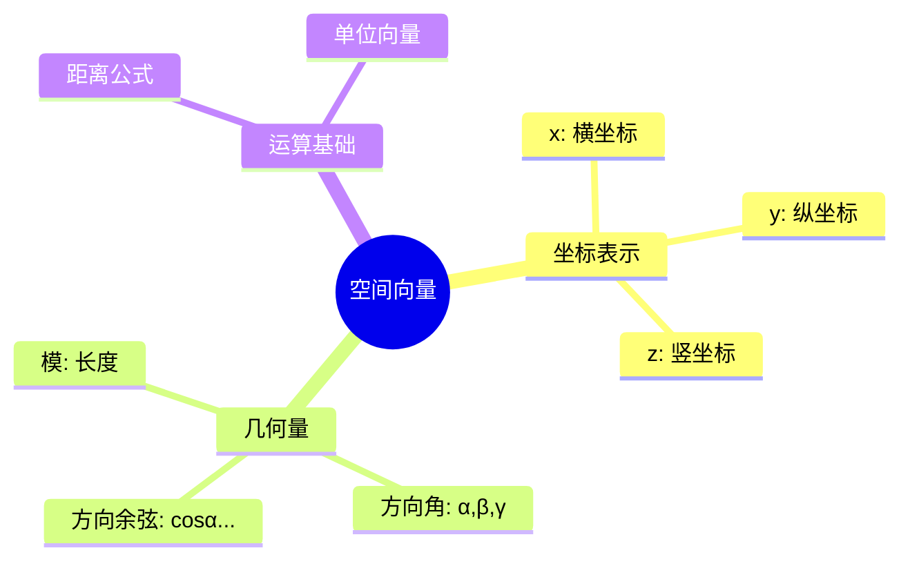

# 空间直角坐标系、向量的坐标表示、模与方向余弦

# 空间直角坐标系与向量的坐标表示

## 核心概念：从几何到代数

在三维空间中，如何精确定位一个点或描述一个方向？我们需要**空间直角坐标系**。过定点 $O$ 作三条相互垂直、单位长度相同的数轴（$x, y, z$ 轴），即构成右手系。

在此体系下，任意向量 $\vec{a}$ 均可唯一表示为坐标形式 $\vec{a} = (x, y, z)$。这种“坐标化”是将几何问题转化为代数运算（如加减、求模、夹角）的基础。

## 关键计算：模与方向余弦

### 1. 向量的模（长度）
设两点 $M_1(x_1,y_1,z_1)$，$M_2(x_2,y_2,z_2)$，则向量 $\overrightarrow{M_1M_2} = (x_2-x_1, y_2-y_1, z_2-z_1)$。
其模长为：
$$ |\overrightarrow{M_1M_2}| = \sqrt{(x_2-x_1)^2 + (y_2-y_1)^2 + (z_2-z_1)^2} $$

### 2. 方向余弦
向量 $\vec{a}=(x,y,z)$ 与三坐标轴正向的夹角 $\alpha, \beta, \gamma$ 称为**方向角**。它们的余弦值称为==方向余弦==：
$$ \cos\alpha = \frac{x}{|\vec{a}|}, \quad \cos\beta = \frac{y}{|\vec{a}|}, \quad \cos\gamma = \frac{z}{|\vec{a}|} $$

> [!IMPORTANT]
> 方向余弦的重要性质：
> $$ \cos^2\alpha + \cos^2\beta + \cos^2\gamma = 1 $$
> 此式常用于检验计算是否正确，或已知两个方向余弦求第三个。

### 3. 单位向量
与 $\vec{a}$ 同方向的单位向量 $\vec{a}^0$ 可直接由方向余弦构成：
$$ \vec{a}^0 = \frac{\vec{a}}{|\vec{a}|} = (\cos\alpha, \cos\beta, \cos\gamma) $$

## 易错点辨析

| 概念 | 定义/公式 | 常见误区 |
| :--- | :--- | :--- |
| **方向角** | $\alpha, \beta, \gamma \in [0, \pi]$ | 误以为角度可以是负数或大于 $\pi$ |
| **方向余弦** | 坐标除以模 | 忘记除以模，直接写坐标 |
| **单位向量** | 模为1的向量 | 混淆“方向一致”与“相等” |

> [!WARNING]
> **坑点提醒**：计算方向角时，若 $\cos\alpha < 0$，则 $\alpha$ 为钝角（$\frac{\pi}{2} < \alpha \le \pi$）。切勿直接使用计算器锐角模式而忽略象限判断。

## 典型例题解析

**题目**：已知 $M_1(2,2,\sqrt{2})$ 与 $M_2(1,3,0)$，求 $\overrightarrow{M_1M_2}$ 的模、方向余弦及同向单位向量。

**解**：
1.  **求向量坐标**：
    $$ \overrightarrow{M_1M_2} = (1-2, 3-2, 0-\sqrt{2}) = (-1, 1, -\sqrt{2}) $$
2.  **求模**：
    $$ |\overrightarrow{M_1M_2}| = \sqrt{(-1)^2 + 1^2 + (-\sqrt{2})^2} = \sqrt{1+1+2} = 2 $$
3.  **求方向余弦**：
    $$ \cos\alpha = \frac{-1}{2}, \quad \cos\beta = \frac{1}{2}, \quad \cos\gamma = \frac{-\sqrt{2}}{2} $$
4.  **求方向角**：
    $$ \alpha = \frac{2\pi}{3}, \quad \beta = \frac{\pi}{3}, \quad \gamma = \frac{3\pi}{4} $$
5.  **求单位向量**：
    $$ \vec{a}^0 = \left(-\frac{1}{2}, \frac{1}{2}, -\frac{\sqrt{2}}{2}\right) $$

> [!TIP]
> **解题技巧**：求单位向量时，直接用“原向量坐标 / 模”最快，无需先算角度再取余弦，后者容易引入精度误差。
