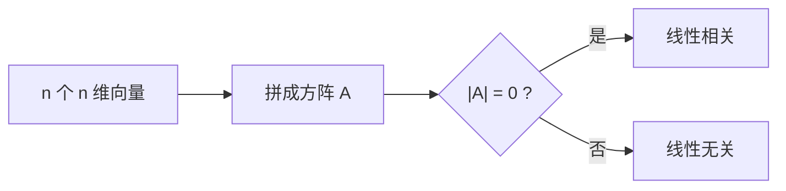

# 向量组线性相关与线性无关的定义及判定定理

## 向量组线性相关与线性无关

### 从齐次方程组出发

设向量组 $\alpha_1,\alpha_2,\dots,\alpha_m$，考虑关于 $k_1,k_2,\dots,k_m$ 的方程

$$
k_1\alpha_1+k_2\alpha_2+\cdots+k_m\alpha_m=0
$$

这是“定义式”，也是判定相关性的出发点。

> [!IMPORTANT]
> 若上式**只有零解** $k_1=k_2=\cdots=k_m=0$，则向量组==线性无关==；若存在**不全为零**的 $k_i$ 使等式成立，则向量组==线性相关==。

为什么关心这件事？因为线性相关意味着组里“信息冗余”——某向量能被其余向量拼出来；线性无关则每个向量都独立贡献了一个方向。

### 两个等价说法

判定定理给出了更直观的等价描述：

> [!NOTE]
> 向量组线性相关 $\iff$ 组中**至少有一个**向量可由其余向量线性表示。
> 向量组线性无关 $\iff$ 组中**任意一个**向量都不能由其余向量线性表示。

注意是“至少有一个”，不是“全部互相表示”。例如 $\alpha_1=(1,0)^T$，$\alpha_2=(2,0)^T$，$\alpha_3=(0,1)^T$ 线性相关（因为 $\alpha_2=2\alpha_1$），但 $\alpha_3$ 不能由 $\alpha_1,\alpha_2$ 表示。

### 方阵情形：看行列式

当向量个数 $m$ 等于维数 $n$ 时，把向量按列拼成矩阵 $A$：

这正是考题中反复出现的格式：

> [!TIP]
> $|A|\neq 0 \Rightarrow A$ 可逆 $\Rightarrow$ 齐次方程组 $Ax=0$ 只有零解 $\Rightarrow$ 列向量组线性无关。

**算例**：判断 $\alpha_1=(2,1,3)^T$，$\alpha_2=(x,3,2)^T$，$\alpha_3=(3,2,-1)^T$ 何时线性无关。

$$
|\alpha_1,\alpha_2,\alpha_3|=\begin{vmatrix}2&x&3\\1&3&2\\3&2&-1\end{vmatrix}=7x-35
$$

令 $7x-35\neq 0$，得 $x\neq 5$。==当 $x\neq 5$ 时线性无关；$x=5$ 时线性相关==。

### 一般情形：看秩

向量个数 $m$ 与维数 $n$ 不一定相等，此时通用的判定手段是**秩**。

> [!IMPORTANT]
> 设 $r=\operatorname{rank}(\alpha_1,\alpha_2,\dots,\alpha_m)$（矩阵列向量组的秩），则
> - $r=m$（列满秩）$\iff$ 向量组==线性无关==；
> - $r<m$ $\iff$ 向量组==线性相关==。

当 $m>n$ 时（向量个数超过维数），必然 $r\leq n<m$，所以：

> [!WARNING]
> **向量个数大于维数时，向量组必线性相关。** 这是最容易被忽略的“送分判断”。

通俗地讲：$n$ 维空间至多容纳 $n$ 个“独立方向”，超过的向量必然可以被前面的表出。

### 部分组与整体

课件中的性质 (3) 是一个单向结论：

> [!CAUTION]
> **部分组线性相关 $\Rightarrow$ 整体线性相关**；但整体线性相关**不能推出**部分组线性相关。

前者直观：若部分组已能凑出零向量（系数不全为零），那整体把这些向量系数保留、其余补零即可。反例：$\alpha_1,\alpha_2$ 无关，但 $\alpha_1,\alpha_2,\alpha_1+\alpha_2$ 相关。

其逆否命题反而常用：==整体线性无关 $\Rightarrow$ 任意部分组线性无关==。

### 表出与相关性的一条推理链

“线性相关 + 部分组无关”能推出特定的表出关系：

> [!NOTE]
> 若 $\alpha_1,\alpha_2,\alpha_3$ 线性相关，而 $\alpha_2,\alpha_3$ 线性无关，则 $\alpha_1$ 必可由 $\alpha_2,\alpha_3$ 线性表示。

理由：存在不全为零的 $k_1,k_2,k_3$ 使得 $k_1\alpha_1+k_2\alpha_2+k_3\alpha_3=0$。若 $k_1=0$，则 $k_2\alpha_2+k_3\alpha_3=0$ 且 $k_2,k_3$ 不全为零，与 $\alpha_2,\alpha_3$ 无关矛盾。故 $k_1\neq 0$，移项即得 $\alpha_1=-\dfrac{k_2}{k_1}\alpha_2-\dfrac{k_3}{k_1}\alpha_3$。

### 线性相关 vs 线性无关速查

| 判定角度 | 线性相关 | 线性无关 |
|---|---|---|
| 齐次方程 $k_1\alpha_1+\cdots+k_m\alpha_m=0$ | 有非零解 | 只有零解 |
| 表出关系 | 至少一个向量可由其余表示 | 任意向量都不能由其余表示 |
| 方阵行列式 | $=0$ | $\neq 0$ |
| 秩 | $r<m$ | $r=m$ |
| 向量个数 $>$ 维数 | 成立（必相关） | 不可能（$r<m$ 必然） |

> [!TIP]
> 记忆：相关 = 冗余 = 秩不足 = 行列式为零 = 方程有非零解。
