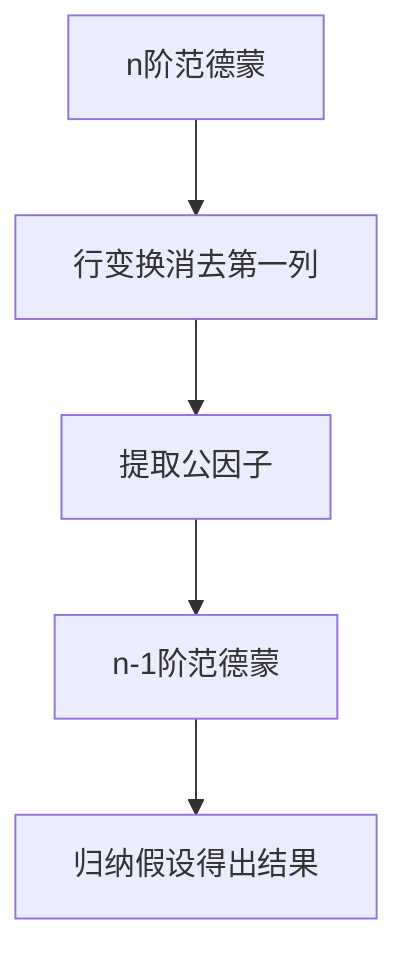

# 范德蒙(Vandermonde)行列式及其证明

## 什么是范德蒙行列式

观察下面这个 $n$ 阶行列式，它的每一列都是某个数 $x_i$ 的连续方幂：

$$
D_n = \begin{vmatrix}
1 & 1 & \cdots & 1 \\
x_1 & x_2 & \cdots & x_n \\
x_1^2 & x_2^2 & \cdots & x_n^2 \\
\vdots & \vdots & \ddots & \vdots \\
x_1^{n-1} & x_2^{n-1} & \cdots & x_n^{n-1}
\end{vmatrix}
$$

这就是**范德蒙（Vandermonde）行列式**。它的标准特征是：==第一行全为 1（即 0 次幂），第 $k$ 行为各底数的 $k-1$ 次幂==。

> [!IMPORTANT]
> 范德蒙行列式的值等于所有可能的“后减前”底数之差的连乘积：
> $$D_n = \prod_{1 \le j < i \le n} (x_i - x_j)$$

为什么需要它？在遇到各行（列）是某元素不同方幂的行列式时，直接按定义展开极其繁琐，而认出它是范德蒙行列式即可“秒杀”。

## 证明思路

如何证明这个优美的结论？我们尝试用数学归纳法结合行列式性质来化简。

当 $n=2$ 时，$D_2 = \begin{vmatrix} 1 & 1 \\ x_1 & x_2 \end{vmatrix} = x_2 - x_1$，结论成立。

假设 $n-1$ 阶范德蒙行列式成立，往证 $n$ 阶也成立。关键操作是从最后一行起，将第 $i$ 行减去第 $i-1$ 行的 $x_1$ 倍（$i=n, n-1, \dots, 2$）。这样第一列除了第一个元素外全变为 0，且其余各列均可提取公因子 $(x_i - x_1)$，从而降阶为一个 $n-1$ 阶的范德蒙行列式，由归纳假设即得证。

## 怎么做：识别与变形

考试中给出的行列式往往不是标准的范德蒙形式，需要利用行列式性质进行转化。

| 遇到的非标准情况 | 处理方法 |
| :--- | :--- |
| 幂次倒序排列（如 $x^2, x, 1$） | 调换行（列）次序，注意每次换行变号 |
| 某行（列）多出常数倍 | 提取该行（列）的公因子 |
| 缺少某次幂的行 | 构造新行列式补全（常结合代数余子式考查） |

> [!TIP]
> 速记口诀：“认准底数排好队，后减前差全相乘”。计算时只需盯住第二行的底数 $x_1, x_2, \dots, x_n$，列出所有满足 $j < i$ 的 $(x_i - x_j)$ 相乘即可。

## 常见坑点辨析

> [!WARNING]
> **减法顺序绝不能反！** 公式要求的是 $\prod_{1 \le j < i \le n} (x_i - x_j)$，即下标大的减下标小的。写成 $(x_j - x_i)$ 会导致符号错误。

> [!CAUTION]
> **转置也是范德蒙！** 如果方幂是按“列”递增而不是按“行”递增，由于 $|A| = |A^T|$，它依然是范德蒙行列式，底数在第一列中读取。

> [!NOTE]
> 范德蒙行列式与普通上（下）三角行列式的区别在于：三角行列式靠主对角线元素相乘求值，而范德蒙行列式靠底数两两作差求值，两者同属必须熟记的特殊行列式。

## 算对了的例子

**题目**：试求 $\begin{vmatrix} 1 & 1 & 1 \\ 3 & 5 & 6 \\ 9 & 25 & 36 \end{vmatrix}$。

**解析**：
观察结构：第一行全是 $1$（0次幂），第二行是 $3, 5, 6$（1次幂），第三行是 $9, 25, 36$（恰好是 $3^2, 5^2, 6^2$，即2次幂）。
这是一个标准的 3 阶范德蒙行列式，底数分别为 $x_1=3, x_2=5, x_3=6$。

根据公式，结果为所有“后减前”的差之积：
$$
D_3 = (x_2 - x_1)(x_3 - x_1)(x_3 - x_2)
$$
代入数据：
$$
D_3 = (5 - 3) \times (6 - 3) \times (6 - 5) = 2 \times 3 \times 1 = 6
$$

> [!IMPORTANT]
> 在矩阵运算题中，若出现形如 $B = A \begin{pmatrix} 1 & 1 & 1 \\ 1 & 2 & 3 \\ 1 & 4 & 9 \end{pmatrix}$ 的结构，右侧矩阵正是底数为 $1, 2, 3$ 的范德蒙行列式，其值为 $(2-1)(3-1)(3-2)=2$。利用 $|B|=|A|\cdot|C|$ 可快速求解。
