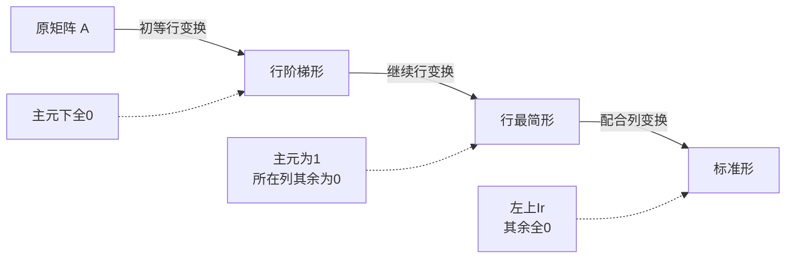

# 行阶梯形矩阵、行最简形矩阵与标准形

## 三种矩阵形态的辨析

在矩阵运算中，初等变换是核心工具。我们将矩阵化为不同形态，旨在简化结构以揭示其本质属性（如秩、线性相关性）。这三种形态层层递进：

1.  **行阶梯形矩阵**：非零行的首非零元（主元）所在列标严格递增，且全零行在最下方。
2.  **行最简形矩阵**：在行阶梯形基础上，每个主元均为 $1$，且主元所在列的其他元素均为 $0$。
3.  **标准形**：形式为 $\begin{pmatrix} I_r & 0 \\ 0 & 0 \end{pmatrix}$，其中 $r$ 为矩阵的秩。

> [!IMPORTANT]
> **核心结论**：任何 $m \times n$ 矩阵 $A$ 均可经有限次初等行变换化为行阶梯形和行最简形；若允许行列混合变换，则可化为唯一的标准形。

## 为什么需要它们？

*   **求秩**：行阶梯形中 ==非零行的行数== 即为矩阵的秩 $r(A)$。
*   **解方程组**：行最简形可直接读出基础解系，避免回代计算。
*   **判可逆**：$n$ 阶矩阵 $A$ 可逆 $\iff$ 其标准形为 $I_n$（即 $r(A)=n$）。

> [!TIP]
> **解题技巧**：求极大线性无关组时，将向量构成矩阵并化为**行最简形**。主元所在的列对应的原向量即为极大无关组，非主元列可由主元列线性表示（系数直接读取）。

## 常见误区与辨析

| 特性 | 行阶梯形 | 行最简形 | 标准形 |
| :--- | :--- | :--- | :--- |
| **变换类型** | 仅初等**行**变换 | 仅初等**行**变换 | 初等**行+列**变换 |
| **唯一性** | 不唯一 | **唯一** | **唯一** |
| **主要用途** | 快速定秩 | 求解线性方程组 | 理论推导、等价分类 |

> [!WARNING]
> **易错坑**：
> 1. 混淆“行最简”与“标准形”。行最简形通常不是对角阵，除非矩阵本身特殊。
> 2. 求标准形时忘记 $r \le \min(m,n)$。
> 3. 误以为只有行变换能化标准形。**标准形必须允许列变换**，或者理解为 $PAQ = \begin{pmatrix} I_r & 0 \\ 0 & 0 \end{pmatrix}$。

## 典型例题解析

**题目**：求矩阵 $A$ 的秩，并找出列向量的一个极大线性无关组。
$$ A = \left(\begin{array}{r r r r}2&3&1&4\\1&- 1&3&- 3\\3&2&4&1\\- 1&0&- 2&1\end{array}\right) $$

**解析步骤**：
对 $A$ 进行初等行变换化为行最简形：

$$
A \rightarrow \left(\begin{array}{r r r r}1&0&2&- 1\\0&1&- 1&2\\0&0&0&0\\0&0&0&0\end{array}\right) = B
$$

1.  **定秩**：$B$ 中有 2 个非零行，故 $r(A)=2$。
2.  **找无关组**：$B$ 的主元位于第 1、2 列。因此，原矩阵 $A$ 的第 1、2 列 $\alpha_1, \alpha_2$ 构成极大线性无关组。
3.  **表示其余向量**：由 $B$ 可直接读出：
    *   第 3 列 $(2, -1, 0, 0)^T \Rightarrow \alpha_3 = 2\alpha_1 - \alpha_2$
    *   第 4 列 $(-1, 2, 0, 0)^T \Rightarrow \alpha_4 = -\alpha_1 + 2\alpha_2$

> [!NOTE]
> 注意：若题目只要求“行阶梯形”，结果可能不唯一，但非零行数（秩）一定相同。若要求“行最简形”，结果唯一，便于直接写出线性组合系数。
