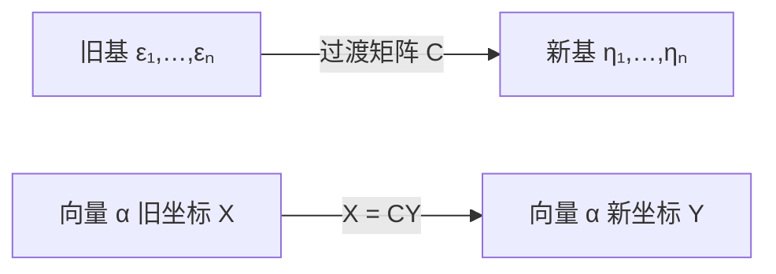

# 基变换的过渡矩阵与向量的坐标变换

## 基变换与坐标变换

### 为什么需要它

同一个向量，在不同基下有不同的坐标。研究线性变换时，==选“好”的基能让变换矩阵变简单==。基变换回答：两组基之间怎么互相表示？同一个向量的坐标怎么随之变化？

先从一道填空题出发：

> 向量 $\alpha=(2,0,0)^{\mathrm{T}}$ 在三组向量
> $\eta_1=(1,1,0)^{\mathrm{T}},\ \eta_2=(1,0,1)^{\mathrm{T}},\ \eta_3=(0,1,1)^{\mathrm{T}}$
> 下的坐标是什么？

解这道题只需：设坐标 $(x_1,x_2,x_3)^{\mathrm{T}}$，解
$$
x_1\eta_1+x_2\eta_2+x_3\eta_3=\alpha
$$
代入得方程组，解得 $x_1=1,\ x_2=1,\ x_3=-1$。答案 $(1,1,-1)^{\mathrm{T}}$。

这是求坐标的基本操作。但如果有两组基，能不能直接用公式转换？

---

### 过渡矩阵的定义

设 $\varepsilon_1,\dots,\varepsilon_n$ 和 $\eta_1,\dots,\eta_n$ 是 $V$ 的两组基。把新基的每个向量用旧基展开，系数按**列**存放：
$$
(\eta_1,\eta_2,\dots,\eta_n)=(\varepsilon_1,\varepsilon_2,\dots,\varepsilon_n)C
$$
称 $C$ 是从旧基 $\{\varepsilon_i\}$ 到新基 $\{\eta_i\}$ 的**过渡矩阵**。

> [!IMPORTANT]
> 过渡矩阵 $C$ 的**第 $j$ 列**，就是 $\eta_j$ 在 $\varepsilon_1,\dots,\varepsilon_n$ 下的坐标。$C$ 必定可逆。

再看一道真题：

> $\mathbb{R}^2$ 中，由基 $(1,0)^{\mathrm{T}},(0,1)^{\mathrm{T}}$ 到基 $(1,2)^{\mathrm{T}},(-2,1)^{\mathrm{T}}$ 的过渡矩阵。

旧基就是标准基 $E=I$，所以 $(\eta_1,\eta_2)=E\cdot P$ 直接给出 $P$ 的列就是新基本身：
$$
P=\begin{pmatrix}1 & -2\\ 2 & 1\end{pmatrix}
$$
这题利用了标准基下过渡矩阵等于新基矩阵。

---

### 坐标变换公式

同一个向量 $\alpha$，在旧基下坐标 $X$，新基下坐标 $Y$。因为
$$
\alpha=(\varepsilon_1,\dots,\varepsilon_n)X=(\eta_1,\dots,\eta_n)Y=(\varepsilon_1,\dots,\varepsilon_n)CY
$$
所以
> [!IMPORTANT]
> ==$X = CY$== ，即**旧坐标 = 过渡矩阵 × 新坐标**。

反过来求新坐标，就是 $Y=C^{-1}X$。

> [!WARNING]
> 常见混淆：过渡矩阵 $C$ 是“旧 $\to$ 新”，但坐标变换是“新坐标 $Y$ 乘 $C$ 得旧坐标 $X$”。记口诀：==基变列排 C，坐标反着来==。

---

### 过渡矩阵怎么求

一般地，已知旧基 $A=(\varepsilon_1,\dots,\varepsilon_n)$、新基 $B=(\eta_1,\dots,\eta_n)$，由 $B=AC$ 得
$$
C=A^{-1}B
$$
实际操作：对矩阵 $(A \mid B)$ 做初等行变换成 $(I \mid C)$。

---

### 易错点与辨析

| 易错点 | 辨析 |
|--------|------|
| 过渡矩阵的行、列方向 | 列对应新基向量在旧基下的坐标，切忌转置 |
| 坐标变换乘在左边还是右边 | 旧坐标 $X$ = 过渡矩阵 $C\ \times$ 新坐标 $Y$ |
| 标准基的过渡矩阵 | 若旧基是标准基 $I$，则 $C=B$，直接写下新基矩阵 |
| 基向量展开时的系数位置 | 写成矩阵形式时，第一个下标为行，第二个为列 ($c_{ij}$ 在第 $i$ 行第 $j$ 列) |

> [!TIP]
> 检验：代入验证。用 $B=AC$ 检查过渡矩阵是否正确；用 $X=CY$ 检查坐标是否自洽。

---

### 一个算对了的例子

已知 $\mathbb{R}^3$ 标准基到新基 $\eta_1=(1,0,1)^{\mathrm{T}},\ \eta_2=(0,1,1)^{\mathrm{T}},\ \eta_3=(1,1,0)^{\mathrm{T}}$ 的过渡矩阵为
$$
C=\begin{pmatrix}1&0&1\\0&1&1\\1&1&0\end{pmatrix}
$$
向量 $\alpha$ 在新基下坐标 $Y=(1,-1,2)^{\mathrm{T}}$，求 $\alpha$ 在原标准基下的坐标。

解：
$$
X=CY=\begin{pmatrix}1&0&1\\0&1&1\\1&1&0\end{pmatrix}\begin{pmatrix}1\\-1\\2\end{pmatrix}=\begin{pmatrix}3\\1\\0\end{pmatrix}
$$
$\alpha$ 在原标准基下坐标是 $(3,1,0)^{\mathrm{T}}$。

理解过渡矩阵与坐标变换后，就能在不同基下自由切换，为下一节==线性变换在不同基下的矩阵表示==打好基础。
