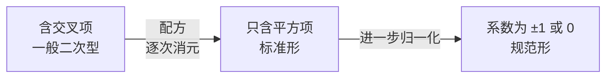

# 用配方法化二次型为标准形与惯性定理

## 配方法化二次型为标准形

### 为什么需要用配方法

二次型 $f(\mathbf{x}) = \mathbf{x}^\mathrm{T}\mathbf{A}\mathbf{x}$ 往往含有交叉项（如 $x_1x_2$），难以直接看出其几何特征。配方法的目标是：**通过可逆线性变换 $\mathbf{x} = \mathbf{C}\mathbf{y}$，将二次型化为只含平方项的标准形** $f = d_1y_1^2 + d_2y_2^2 + \cdots + d_ny_n^2$，从而直接读出二次型的秩、正负惯性指数与规范形。

### 怎么做：配方法的通用步骤

配方法的核心思路是**逐次锁定一个变量，将其所在的所有项配成完全平方**，剩余部分再对其余变量重复此过程。

**情形一：存在平方项（如 $x_1^2$ 系数不为零）**

1. **按 $x_1$ 集中**：把含 $x_1$ 的全部项提出：$ax_1^2 + bx_1x_2 + cx_1x_3 + \cdots$
2. **配方**：系数 $a$ 提出后凑完全平方。课件中给出的公式一极为实用：
   $$ \begin{aligned} a x_1^2 + b x_1x_2 + c x_1x_3 \longrightarrow \left(\sqrt{a}x_1 + \frac{b}{2\sqrt{a}}x_2 + \frac{c}{2\sqrt{a}}x_3\right)^2 \\ - \frac{b^2}{4a}x_2^2 - \frac{c^2}{4a}x_3^2 - \frac{bc}{2a}x_2x_3 \end{aligned} $$
3. **整理剩余**：配方产生的“余项”不再含 $x_1$，对 $x_2, x_3, \cdots$ 重复上述过程。

**情形二：没有平方项，但至少有交叉项（如 $ax_ix_j$ 且 $a \neq 0$）**

先作变换 $x_i = y_1 + y_2$，$x_j = y_1 - y_2$，其余 $x_k = y_k$，则产生 $y_1^2 - y_2^2$ 型平方项，再转回情形一。

> [!TIP]
> 记忆口诀：==有平先配方，无平造平方；一次消一个，余下再重复。==

### 惯性定理

同一个二次型，用不同的可逆线性变换得到的标准形，其平方项系数可能不同，但一个本质特征是永恒不变的——这就是**惯性定理**的核心结论：

> [!IMPORTANT]
> ==无论用何种可逆线性变换将二次型化为标准形，正系数个数（正惯性指数 $p$）与负系数个数（负惯性指数 $q$）都是唯一确定的==，且 $p + q = \operatorname{rank}(\mathbf{A})$。

换言之，标准形不是唯一的，但**规范形**（系数只取 $1, -1, 0$）是唯一的。惯性定理为二次型分类提供了理论根基。

### 计算示例

将二次型 $f = x_1^2 + x_2^2 + x_3^2 + 4x_1x_2 + 4x_1x_3 + 4x_2x_3$ 化为规范形。

**第一步：按 $x_1$ 集中并配方**
$$ \begin{aligned} f &= (x_1^2 + 4x_1x_2 + 4x_1x_3) + x_2^2 + x_3^2 + 4x_2x_3 \\ &= (x_1 + 2x_2 + 2x_3)^2 - 4x_2^2 - 4x_3^2 - 8x_2x_3 + x_2^2 + x_3^2 + 4x_2x_3 \\ &= (x_1 + 2x_2 + 2x_3)^2 - 3x_2^2 - 3x_3^2 - 4x_2x_3 \end{aligned} $$

**第二步：配方产生的余项再按 $x_2$ 集中（公式二）**
$$ \begin{aligned} -3x_2^2 - 4x_2x_3 &= -\left[3x_2^2 + 4x_2x_3\right] \\ &= -\left[\left(\sqrt{3}x_2 + \frac{2\sqrt{3}}{3}x_3\right)^2 - \frac{4}{3}x_3^2\right] \\ &= -\left(\sqrt{3}x_2 + \frac{2\sqrt{3}}{3}x_3\right)^2 + \frac{4}{3}x_3^2 \end{aligned} $$

代回原式：
$$ f = (x_1 + 2x_2 + 2x_3)^2 - \left(\sqrt{3}x_2 + \frac{2\sqrt{3}}{3}x_3\right)^2 - \frac{5}{3}x_3^2 $$

**第三步：写出规范形**
令：
$$ \begin{cases} y_1 = x_1 + 2x_2 + 2x_3 \\ y_2 = \sqrt{3}x_2 + \frac{2\sqrt{3}}{3}x_3 \\ y_3 = \frac{\sqrt{15}}{3}x_3 \end{cases} $$

得规范形：$f = y_1^2 - y_2^2 - y_3^2$，正惯性指数 $p = 1$，负惯性指数 $q = 2$，秩为 $3$。

> [!WARNING]
> 配方过程中若变量系数不为 $1$，务必小心系数提取与配方修正项的计算，这是最常见的计算失误点。每次配方后建议心算展开验证。
