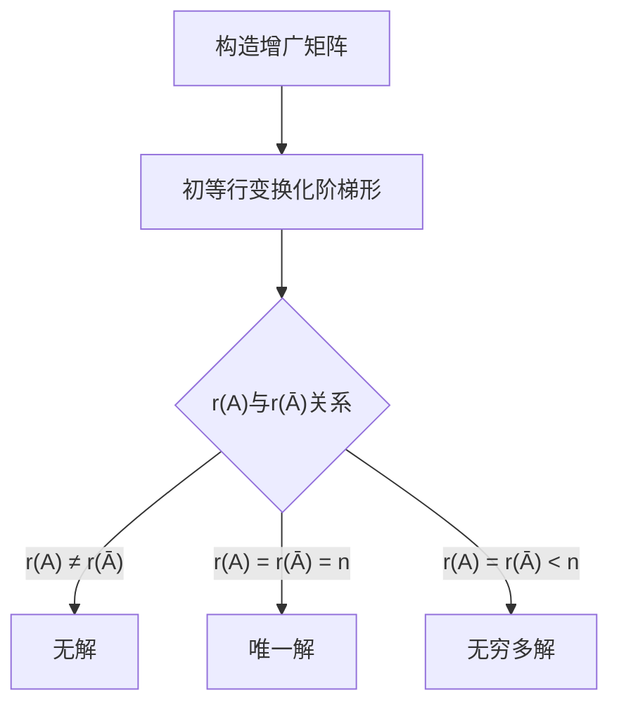

# 非齐次线性方程组 Ax=b 有解的判定（系数矩阵与增广矩阵的秩）

---
title: 非齐次线性方程组 Ax=b 有解的判定（系数矩阵与增广矩阵的秩）
requires: [线性代数与解析几何/矩阵的秩, 线性代数与解析几何/初等行变换]
---

给定一个含 $n$ 个未知数的非齐次线性方程组 $Ax=b$，怎么一眼看出它到底有没有解？如果有解，是唯一解还是无穷多解？答案全藏在两个数字里：==系数矩阵 $A$ 的秩==和==增广矩阵 $\bar{A}=(A \mid b)$ 的秩==。

## 为什么看这两个秩？

把 $Ax=b$ 写成列向量的形式：$x_1\alpha_1 + x_2\alpha_2 + \cdots + x_n\alpha_n = b$。
这个方程有解，意味着什么？意味着向量 $b$ 能被 $A$ 的列向量组线性表示。也就是说，把 $b$ 加进 $A$ 的列向量组后，整个向量组的“有效信息量”（即极大无关组包含的向量个数）没有增加。而“有效信息量”正是矩阵的秩。

因此，判断的核心逻辑如下：

> [!IMPORTANT]
> 含有 $n$ 个未知量的非齐次线性方程组 $Ax=b$ 有解的充要条件是 $R(A) = R(\bar{A})$。且当 $R(A)=R(\bar{A})=n$ 时有唯一解；当 $R(A)=R(\bar{A})=r<n$ 时有无穷多解。

## 与齐次方程组的区别

很多同学习惯用行列式 $|A|$ 来判断解的情况，但这只适用于 $m=n$ 的方阵。对于一般的 $m \times n$ 矩阵，必须依靠秩。对比记忆：

| 方程组类型 | 秩的条件 | 解的情况 |
| :--- | :--- | :--- |
| 非齐次 $Ax=b$ | $R(A) \neq R(\bar{A})$ | ==无解== |
| 非齐次 $Ax=b$ | $R(A) = R(\bar{A}) = n$ | 唯一解（不是零解） |
| 非齐次 $Ax=b$ | $R(A) = R(\bar{A}) < n$ | 无穷多解（不含零解） |
| 齐次 $Ax=0$ | $R(A) = n$ | 唯一解（零解） |
| 齐次 $Ax=0$ | $R(A) < n$ | 无穷多解（含零解） |

> [!NOTE]
> 讨论向量 $\beta$ 能否由 $\alpha_1, \alpha_2, \cdots, \alpha_m$ 线性表示，本质上就是讨论以它们为列的非齐次方程组是否有解的问题。

## 算对一个例子

**题目**：当 $\lambda$ 取何值时，方程组 $\begin{cases} x_1+x_2+2x_3=1 \\ x_1+\lambda x_2+x_3=2 \\ \lambda x_1+x_2+x_3=\lambda+1 \end{cases}$ 无解、有唯一解或有无穷多解？

**步骤一：写出增广矩阵并做初等行变换。**

$$
\bar{A} = \left[\begin{array}{ccc|c} 
1 & 1 & 2 & 1 \\ 
1 & \lambda & 1 & 2 \\ 
\lambda & 1 & 1 & \lambda+1 
\end{array}\right]
\xrightarrow[r_3 - \lambda r_1]{r_2 - r_1}
\left[\begin{array}{ccc|c} 
1 & 1 & 2 & 1 \\ 
0 & \lambda-1 & -1 & 1 \\ 
0 & 1-\lambda & 1-2\lambda & 1 
\end{array}\right]
$$

继续消元，$r_3 + r_2$：

$$
\rightarrow
\left[\begin{array}{ccc|c} 
1 & 1 & 2 & 1 \\ 
0 & \lambda-1 & -1 & 1 \\ 
0 & 0 & \lambda-3 & 2 
\end{array}\right]
$$

**步骤二：根据主对角线元素分类讨论。**

- **唯一解**：需要三个主元都不为零，即 $\lambda-1 \neq 0$ 且 $\lambda-3 \neq 0$。此时 $R(A)=R(\bar{A})=3=n$，故 ==$\lambda \neq 1$ 且 $\lambda \neq 3$ 时有唯一解==。
- **无解**：若 $\lambda=3$，最后一行变为 $[0, 0, 0 \mid 2]$，出现矛盾方程 $0=2$。此时 $R(A)=2 \neq R(\bar{A})=3$，故 ==$\lambda=3$ 时无解==。
- **无穷多解**：若 $\lambda=1$，矩阵化为 $\left[\begin{array}{ccc|c} 1 & 1 & 2 & 1 \\ 0 & 0 & -1 & 1 \\ 0 & 0 & -2 & 2 \end{array}\right] \xrightarrow{r_3-2r_2} \left[\begin{array}{ccc|c} 1 & 1 & 2 & 1 \\ 0 & 0 & -1 & 1 \\ 0 & 0 & 0 & 0 \end{array}\right]$。此时 $R(A)=R(\bar{A})=2 < 3$，故 ==$\lambda=1$ 时有无穷多解==。

> [!WARNING]
> 对增广矩阵作初等行变换时，**只能使用行变换**，绝不能使用列变换！列变换会打乱未知数 $x_i$ 与对应列的绑定关系，导致求出的解完全错误。
