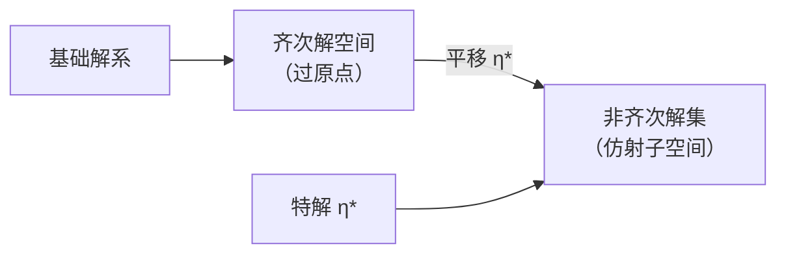

# 非齐次线性方程组通解结构（特解加齐次通解）

# 非齐次线性方程组通解结构

## 从解的结构说起

设 $A$ 是 $m \times n$ 矩阵，$\mathbf{x} \in \mathbb{R}^n$，$\mathbf{b} \in \mathbb{R}^m$。对于非齐次方程组 $A\mathbf{x} = \mathbf{b}$，若已知它有一个特解 $\boldsymbol{\eta}^*$，你能否用这个特解“生成”出其他解？

只需注意到：如果 $\boldsymbol{\xi}$ 是导出组 $A\mathbf{x} = \mathbf{0}$ 的任意一个解，那么
$$
A(\boldsymbol{\eta}^* + \boldsymbol{\xi}) = A\boldsymbol{\eta}^* + A\boldsymbol{\xi} = \mathbf{b} + \mathbf{0} = \mathbf{b},
$$
所以 $\boldsymbol{\eta}^* + \boldsymbol{\xi}$ 仍是 $A\mathbf{x} = \mathbf{b}$ 的解。反过来，任意两个非齐次解之差一定是导出组的解。于是得到核心结构：

> [!IMPORTANT]
> 非齐次线性方程组 $A\mathbf{x} = \mathbf{b}$ 的通解等于它的一个特解 $\boldsymbol{\eta}^*$ 加上导出组 $A\mathbf{x} = \mathbf{0}$ 的通解，即
> $$\mathbf{x} = \boldsymbol{\eta}^* + k_1\boldsymbol{\xi}_1 + k_2\boldsymbol{\xi}_2 + \cdots + k_{n-r}\boldsymbol{\xi}_{n-r},$$
> 其中 $\boldsymbol{\xi}_1, \dots, \boldsymbol{\xi}_{n-r}$ 是导出组的基础解系，$k_i$ 为任意实数，$r = r(A)$。

这就是“==特解 + 齐次通解==”的结构。它说明非齐次方程组的解集是把齐次解空间“平移”一个特解向量得到的。

## 为什么需要这个结构

如果直接对增广矩阵 $\widetilde{A} = (A \mid \mathbf{b})$ 做初等行变换，当然也可以解出全部解。但通解结构的意义在于**一分解就看清几何本质**：

- 导出组的解空间是 $\mathbb{R}^n$ 中过原点的 $n - r$ 维子空间；
- 非齐次方程组的解集是把这个子空间平移 $\boldsymbol{\eta}^*$ 后得到的“仿射子空间”，不经过原点（当 $\mathbf{b} \neq \mathbf{0}$ 时）。

## 怎么求通解：标准步骤

**第一步：** 解出导出组 $A\mathbf{x} = \mathbf{0}$ 的基础解系 $\boldsymbol{\xi}_1, \dots, \boldsymbol{\xi}_{n-r}$。

**第二步：** 求出 $A\mathbf{x} = \mathbf{b}$ 的一个特解 $\boldsymbol{\eta}^*$。通常对增广矩阵 $\widetilde{A}$ 做初等行变换，令自由变量全取 $0$，即可求出。

**第三步：** 将二者相加写成通解。

## 一个算对了的例子

已知四阶方阵 $A$ 的秩为 $3$，$\boldsymbol{\eta}_1, \boldsymbol{\eta}_2, \boldsymbol{\eta}_3$ 是 $A\mathbf{x} = \mathbf{b}$ 的解，且
$$
2\boldsymbol{\eta}_1 - \boldsymbol{\eta}_2 = (2,3,4,5)^T, \qquad \boldsymbol{\eta}_3 = (1,2,3,4)^T.
$$

**关键观察：** 虽然 $2\boldsymbol{\eta}_1 - \boldsymbol{\eta}_2$ 长得不像“差”，但它仍是非齐次方程组的解，因为
$$
A(2\boldsymbol{\eta}_1 - \boldsymbol{\eta}_2) = 2A\boldsymbol{\eta}_1 - A\boldsymbol{\eta}_2 = 2\mathbf{b} - \mathbf{b} = \mathbf{b}.
$$
所以 $(2,3,4,5)^T$ 也是特解。两个非齐次解之差是齐次解：
$$
(2\boldsymbol{\eta}_1 - \boldsymbol{\eta}_2) - \boldsymbol{\eta}_3 = (1,1,1,1)^T \in \ker A.
$$

由于 $r(A) = 3$ 且 $A$ 为四阶方阵，导出组基础解系含 $4 - 3 = 1$ 个向量，所以 $(1,1,1,1)^T$ 本身就是基础解系。取 $\boldsymbol{\eta}_3$ 为特解，得通解
$$
\mathbf{x} = (1,2,3,4)^T + k(1,1,1,1)^T, \quad k \in \mathbb{R}.
$$

> [!TIP]
> 遇到“已知几个非齐次解，求通解”的题，核心动作是**构造齐次解**：找两个非齐次解的差，或找“系数和为 $0$ 的组合”（如 $\boldsymbol{\eta}_1 - \boldsymbol{\eta}_2$ 的系数和为 $0$）。

## 与齐次通解的区别

| 对比项 | 齐次 $A\mathbf{x} = \mathbf{0}$ | 非齐次 $A\mathbf{x} = \mathbf{b}$（$\mathbf{b} \neq \mathbf{0}$） |
|:---|:---|:---|
| 解集是否过原点 | 必过原点 | 不过原点 |
| 几何结构 | 子空间 | 子空间的平移（仿射子空间） |
| 通解形式 | 基础解系的任意线性组合 | 一个特解 + 齐次通解 |
| 自由变量个数 | $n - r(A)$ | $n - r(A)$（相同） |

## 常见的坑

> [!WARNING]
> 任意两个非齐次解的线性组合**一般不再是解**。只有系数之和为 $1$ 的“仿射组合”才仍是解：$\lambda \boldsymbol{\eta}_1 + (1 - \lambda)\boldsymbol{\eta}_2$ 是 $A\mathbf{x} = \mathbf{b}$ 的解，但 $2\boldsymbol{\eta}_1 - \boldsymbol{\eta}_2$ 虽然系数和也是 $1$，它是解；而 $\boldsymbol{\eta}_1 + \boldsymbol{\eta}_2$ 的系数和为 $2$，它是 $A\mathbf{x} = 2\mathbf{b}$ 的解，不是原方程组的解。

> [!CAUTION]
> 通解中“特解”可以自由选择——题目给哪个非齐次解都行，但基础解系向量必须对应齐次方程 $A\mathbf{x} = \mathbf{0}$。把非齐次解直接当齐次解用是常见错误。
