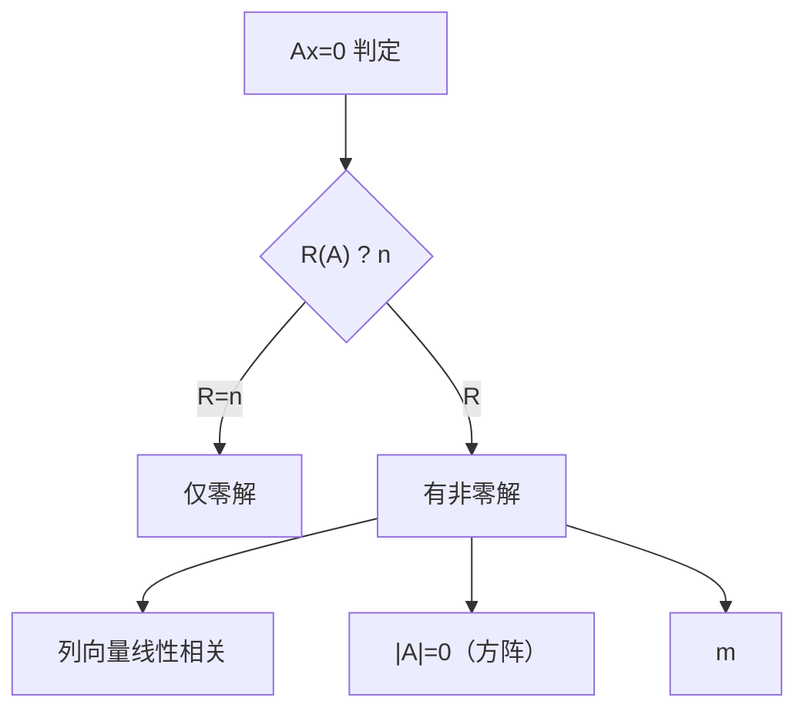

# 齐次线性方程组 Ax=0 有非零解的条件

齐次线性方程组 $A_{m\times n}\mathbf{x}=\mathbf{0}$ 的右边全是零，所以 $\mathbf{x}=\mathbf{0}$ 永远是一个解（零解）。我们真正关心的是：==**什么时候会有非零解？**==有了非零解，才谈得上基础解系和通解结构；没有非零解，方程组的"唯一解就是零解"。

## 从秩看有无非零解

不妨先问一句：$n$ 个未知量、$m$ 个方程，把 $A$ 化成行阶梯形后，自由未知量的个数由谁决定？答案是 $n-r(A)$。每个自由未知量都能取到非零值，从而产生非零解。于是有：

> [!IMPORTANT]
> **有非零解的充要条件**：齐次线性方程组 $A_{m\times n}\mathbf{x}=\mathbf{0}$ ==有非零解 $\Leftrightarrow R(A)<n$==（$n$ 为未知量个数，即列数）。等价地，$R(A)=n$（列满秩）时只有零解。

用一张关系图把常见判定串起来：

几个高频等价说法（南邮考题里反复出现）：

| 说法 | 等价条件 |
|---|---|
| 只有零解 | $R(A)=n$，$A$ 列满秩，列向量线性无关，$\|A\|\neq 0$（方阵） |
| 有非零解 | $R(A)<n$，列向量线性相关，$\|A\|=0$（方阵），$m<n$ |
| 特征值场景 | $(A-\lambda E)\mathbf{x}=\mathbf{0}$ 有非零解 $\Leftrightarrow\lambda$ 是特征值 |

> [!WARNING]
> $m<n$（方程个数少于未知量）只是**充分条件**：此时一定 $R(A)\le m<n$，必有非零解；但反过来 $m\ge n$ 时也可能有非零解，别把它当成充要条件。

## 和基础解系、解空间的衔接

一旦 $R(A)=r<n$，就有 $n-r$ 个自由未知量，解空间 $S$ 的维数为 $\dim S=n-r$。取一组线性无关的解 $\boldsymbol{\xi}_1,\dots,\boldsymbol{\xi}_{n-r}$ 张成 $S$，就叫**基础解系**，通解为 $\mathbf{x}=k_1\boldsymbol{\xi}_1+\cdots+k_{n-r}\boldsymbol{\xi}_{n-r}$。

> [!TIP]
> 记忆链：==$R(A)<n$ $\to$ 有非零解 $\to$ 解空间维数 $n-R(A)$ $\to$ 基础解系含 $n-R(A)$ 个向量==。

## 一个算对了的例子

设 $A=\begin{bmatrix}1&2&3&4\\1&3&2&1\\1&2&3&-1\end{bmatrix}$，$R(A)=3$。这里有 $n=4$ 个未知量、$r=3$。

因为 $R(A)=3<4=n$，所以 $A\mathbf{x}=\mathbf{0}$ ==有非零解==，且基础解系应含 $n-R(A)=4-3=1$ 个向量。换句话说，解空间是一维的，任意一个非零解 $\boldsymbol{\xi}\neq\mathbf{0}$ 都能作为基础解系，通解为 $\mathbf{x}=k\boldsymbol{\xi}$。

## 常见坑

> [!CAUTION]
> - 把"方程个数 $m$"当成秩：$R(A)$ 是**行阶梯形非零行数**，与 $m$ 不必相等。
> - 判断 $(A-\lambda E)\mathbf{x}=\mathbf{0}$ 时套错：此时 $n$ 是矩阵阶数，有非零解当且仅当 $|A-\lambda E|=0$。
> - 基础解系个数写成 $R(A)$ 或 $m-R(A)$：正确是 $n-R(A)$，$n$ 指未知量个数（列数）。
