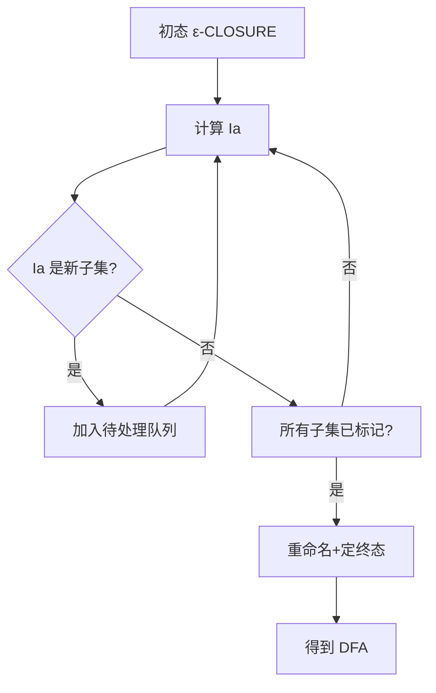

# DFA与NFA的关系及转换（子集法）

## 为什么需要子集法

NFA 允许 $\varepsilon$ 转移和同一输入对应多个后继状态，这虽然方便从正规式构造自动机，但无法直接用于词法分析器的代码实现。计算机在读取一个字符时，必须确切知道跳转到哪一个状态。因此，我们需要一种算法将 NFA “确定化”。==子集法的核心思想是：将 NFA 中可能同时处于的多个状态组成的集合，视为 DFA 中的一个新状态==。这样，不确定性就被封装在了“状态集合”这一概念内部，对外呈现出确定性。

## 核心概念与构造步骤

在动手转换前，必须先掌握两个关键运算：

-   **$\varepsilon\text{-CLOSURE}(I)$**：从状态子集 $I$ 出发，仅经过任意条 $\varepsilon$ 弧所能到达的所有状态集合（包含 $I$ 自身）。
-   **$I_a$**：先从 $I$ 中每个状态经一条 $a$ 弧到达状态集 $J$，再求 $\varepsilon\text{-CLOSURE}(J)$。即 $I_a = \varepsilon\text{-CLOSURE}(J)$。

> [!IMPORTANT]
> DFA 的新状态就是 NFA 的状态子集。构造过程本质上是不断计算 $I_a$ 并记录新子集的过程，直到不再产生新子集为止。

构造步骤如下：

1.  **初始化**：令 DFA 初态为 $\varepsilon\text{-CLOSURE}(\{S_0\})$，其中 $S_0$ 为 NFA 初态。
2.  **扩展**：对当前未标记的子集 $I$ 及每个输入符号 $a$，计算 $I_a$。若 $I_a$ 是新子集，则加入待处理队列。
3.  **终止**：当所有子集都被标记且无新子集产生时停止。
4.  **重命名**：将每个子集重命名为简洁符号（如 A, B, C），含 NFA 终态的子集即为 DFA 终态。

## 实例演练

设 NFA $M=(\{A,B\}, \{a,b\}, M, \{A\}, \{B\})$，转换函数为：$M(A,a)=\{A,B\}$，$M(A,b)=\{B\}$，$M(B,a)=\varnothing$，$M(B,b)=\{A,B\}$。本题无 $\varepsilon$ 弧，故 $\varepsilon\text{-CLOSURE}(I)=I$。

| DFA 状态 | NFA 子集 | $a$ ($I_a$) | $b$ ($I_b$) | 是否终态 |
| :--- | :--- | :--- | :--- | :--- |
| 0 | $\{A\}$ | $\{A,B\}$ (→2) | $\{B\}$ (→1) | 否 |
| 1 | $\{B\}$ | $\varnothing$ (→D) | $\{A,B\}$ (→2) | ==是== |
| 2 | $\{A,B\}$ | $\{A,B\}$ (→2) | $\{A,B\}$ (→2) | ==是== |
| D | $\varnothing$ | $\varnothing$ (→D) | $\varnothing$ (→D) | 否 |

> [!TIP]
> 解题时建议先画出 NFA 状态图，直观观察 $\varepsilon$ 弧和转移关系，再列表计算，避免遗漏。

## 常见误区辨析

| 易错点 | 正确做法 |
| :--- | :--- |
| 忘记 $\varepsilon$ 闭包 | 每次求 $I_a$ 后必须再做一次 $\varepsilon\text{-CLOSURE}$ |
| 忽略死状态 $\varnothing$ | 若某 $I_a=\varnothing$，需显式引入死状态 D 并补全转换 |
| 终态判断错误 | ==只要子集中包含 NFA 任一终态，该 DFA 状态即为终态== |
| 初态未做闭包 | DFA 初态必须是 $\varepsilon\text{-CLOSURE}(\{S_0\})$，而非 $\{S_0\}$ |

> [!WARNING]
> 子集法在最坏情况下会产生 $2^n$ 个状态（$n$ 为 NFA 状态数）。考试中若子集数量激增，请检查是否漏合并了等价状态或计算有误。
