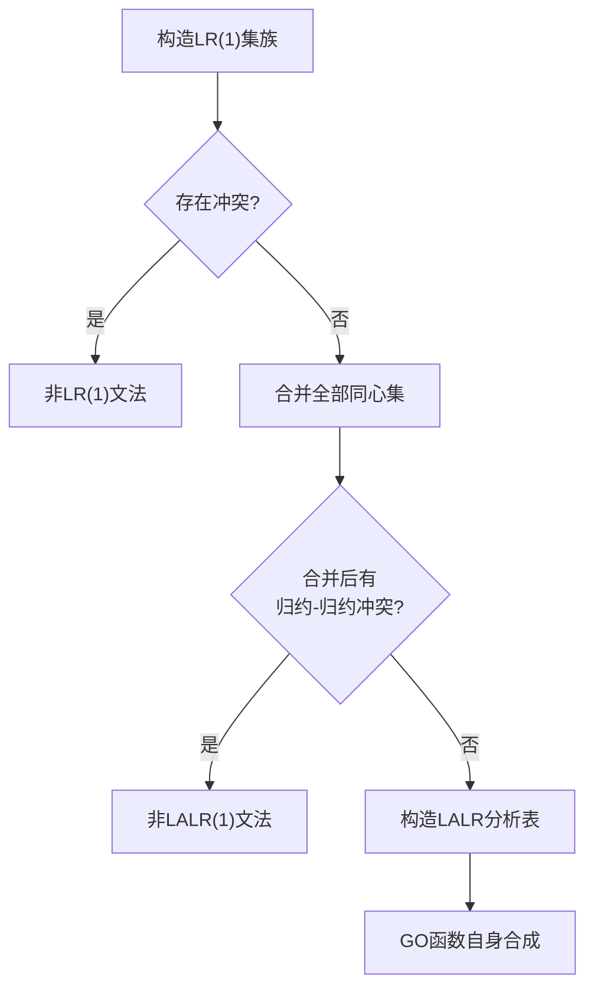

# LALR分析表构造（同心集合并）

## 什么是同心集与 LALR 分析表

LR(1) 分析虽然精确，但状态数庞大。LALR(1) 的核心思想是 ==合并同心集==：将 LR(1) 项目集中**核心（Core）相同、仅向前看符号（Lookahead）不同**的状态合并为一个新状态。合并后的新项目集族记为 $C' = \{J_0, J_1, \dots, J_m\}$，其中含 $[S' ::= \cdot S, \#]$ 的集合为初态。

> [!IMPORTANT]
> LALR(1) 的能力介于 SLR(1) 和 LR(1) 之间，是 Yacc/Bison 等工具的默认算法。其本质是用“归约-归约冲突”的风险换取状态空间的压缩。

## 为什么移进-归约不冲突，归约-归约却可能冲突？

这是考试高频简答题。思考一下：合并操作改变了什么？

-   **移进-归约安全**：移进动作仅取决于项目核心中的点位置与后继符号，与 Lookahead 无关。同心集核心相同，故 ==合并不会产生新的移进-归约冲突==。
-   **归约-归约风险**：归约动作依赖 Lookahead。若两个同心集中分别有 $[A \to \alpha \cdot, a]$ 和 $[B \to \beta \cdot, b]$，原本 $a \neq b$ 无冲突；合并后变为 $[A \to \alpha \cdot, \{a,b\}]$ 与 $[B \to \beta \cdot, \{a,b\}]$，当 $a=b$ 时即产生 ==归约-归约冲突==。

> [!WARNING]
> 若 LR(1) 文法在合并同心集后出现归约-归约冲突，则该文法 **不是** LALR(1) 文法。这是证明“是 LR(1) 而非 LALR(1)”的唯一判据。

## 构造步骤与 GO 函数合成

> [!TIP]
> 合并后的转换函数 $GO[J, X]$ 无需重新计算闭包，可直接由原 LR(1) 的 $GO$ 函数 ==自身合成== 得到：若 $J = I_i \cup I_k$，则 $GO[J, X] = GO[I_i, X] \cup GO[I_k, X]$（结果仍为某个已合并的同心集）。

## 经典例题：是 LR(1) 但不是 LALR(1)

以真题 G4[S] 为例，关键状态如下：

| 状态 | 项目 | Lookahead | 说明 |
| :--- | :--- | :--- | :--- |
| $I_6$ | $A \to x \cdot$，$B \to x \cdot$ | $\{a\}$，$\{b\}$ | LR(1)下无冲突 |
| $I_9$ | $A \to x \cdot$，$B \to x \cdot$ | $\{b\}$，$\{a\}$ | LR(1)下无冲突 |
| $I_{69}$ | $A \to x \cdot$，$B \to x \cdot$ | $\{a,b\}$，$\{a,b\}$ | ==归约-归约冲突== |

在 $I_6$ 中，输入 $a$ 只归约 $A$，输入 $b$ 只归约 $B$；$I_9$ 同理。故 G4 是 LR(1) 文法。但合并为 $I_{69}$ 后，面对输入 $a$（或 $b$），既可归约 $A \to x$ 也可归约 $B \to x$，产生冲突，因此 ==G4 不是 LALR(1) 文法==。

> [!CAUTION]
> 填表题中，合并状态的 Action 栏若同一格子对应多个归约动作（如 $r_2/r_3$），即为归约-归约冲突的标志，说明该文法无法构造合法的 LALR(1) 分析表。
