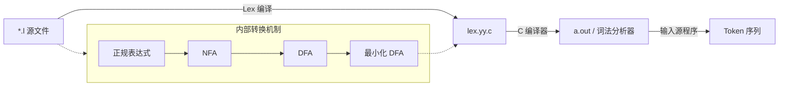

# 词法分析程序的自动生成（LEX）

# 词法分析程序的自动生成（LEX）

## 它是什么与为什么需要

在手工构造词法分析器时，我们通常经历“正规文法 $\to$ 状态转换图 $\to$ 有穷自动机（FA） $\to$ 代码”的过程。然而，对于复杂的语言规则，手动绘制和编码状态转换图不仅繁琐且极易出错。

==LEX（Lexical Analyzer Generator）== 是一种工具，它能根据用户提供的**正规表达式**规则，自动生成高效的 C 语言词法分析程序源码。其核心思想是将“描述规则”与“实现逻辑”分离：你只需定义“什么算一个单词”，LEX 负责将其转化为确定有限自动机（DFA）并生成扫描代码。

> [!IMPORTANT]
> LEX 的输入是 `.l` 文件（包含正规表达式），输出是 `lex.yy.c`（C 源代码）。它极大地简化了从**正规表达式**到**有穷自动机**的转换过程。

## LEX 的工作原理与流程

LEX 的工作流可以概括为以下三个阶段：



1.  **定义规则**：在 `.l` 文件中用正规表达式描述单词模式（如标识符、关键字、常数）。
2.  **自动转换**：LEX 内部将正规表达式转换为 NFA，再确定化为 DFA，并进行最小化处理。
3.  **生成代码**：生成包含状态转移表的 C 代码 `lex.yy.c`。

## 怎么做：LEX 文件结构

一个标准的 LEX 源文件由三部分组成，用 `%%` 分隔：

```c
%{
/* 定义部分：C 头文件、全局变量 */
#include <stdio.h>
%}

/* 声明部分：正规表达式定义 */
digit   [0-9]
letter  [a-zA-Z]

%%
/* 规则部分：正规表达式 { 动作 } */
{letter}({letter}|{digit})*   { printf("ID: %s\n", yytext); }
{digit}+                      { printf("NUM: %s\n", yytext); }
"+"                           { printf("PLUS\n"); }
[ \t\n]+                      { /* 忽略空白 */ }
%%

/* 用户子程序部分：main 函数等 */
int main() {
    yylex();
    return 0;
}
```

> [!TIP]
> 记忆口诀：**一定义、二声明、三规则**。规则匹配遵循**最长匹配原则**，若长度相同则按**书写顺序优先**。

## 常见坑与辨析

| 特性 | 手工构造 FA | LEX 自动生成 |
| :--- | :--- | :--- |
| **输入形式** | 状态转换图/矩阵 | 正规表达式 |
| **灵活性** | 低，修改需重绘 | 高，修改正则即可 |
| **效率** | 取决于实现水平 | 通常经过优化（最小化 DFA） |
| **适用场景** | 简单教学示例 | 工业级编译器前端 |

> [!WARNING]
> **冲突处理**：当多个规则都能匹配输入串前缀时，LEX 选择**最长**的匹配串；若长度一致，选择在文件中**最先出现**的规则。不要依赖规则的隐式顺序来处理不同长度的 token。

## 典型例题解析

**题目**：给定如下 LEX 规则片段，输入字符串 `abc123+`，输出是什么？

```c
%%
[a-z]+      { printf("WORD "); }
[0-9]+      { printf("NUM "); }
[a-z0-9]+   { printf("MIX "); }
\+          { printf("PLUS "); }
%%
```

**解析步骤**：
1.  读取 `abc123`：
    *   `[a-z]+` 匹配 `abc` (长度3)
    *   `[a-z0-9]+` 匹配 `abc123` (长度6)
    *   根据==最长匹配原则==，选择 `MIX`。
2.  读取 `+`：
    *   仅 `\+` 匹配，输出 `PLUS`。

**最终输出**：`MIX PLUS`

> [!NOTE]
> 若将规则 `[a-z0-9]+` 放在 `[a-z]+` 之前，结果不变（因为长度优先）；但若输入仅为 `abc`，且两条规则长度相同，则**先定义的规则**生效。
