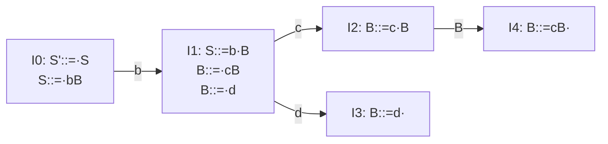

# LR(0)分析表构造（活前缀、LR(0)项目、项目集规范族）

## 先看问题：何时该移进，何时该归约？

语法分析器的核心任务只有两个：**把当前输入符号移进栈**，或者**把栈顶的句柄按某条文法规则归约**。但问题在于：一个栈顶状态里可能同时告诉你“可以移进”又告诉你“可以归约”，怎么办？

LR(0) 分析给出的回答非常“任性”：==LR(0) 做归约时完全不看输入符号==，只要状态里有归约项目，就无条件归约。这导致稍有冲突就无法建表。

要理解这一点，必须先说清三个概念：**活前缀、LR(0) 项目、项目集规范族**。

## 活前缀：栈里装的东西必须“有希望”

自底向上分析用符号栈存放已读入但尚未归约的符号。栈中符号串 $\gamma$ 称为**活前缀**，如果它满足：

$$
S \Rightarrow^* \delta A w \Rightarrow \delta \alpha \beta w = \gamma \beta w
$$

其中 $\gamma = \delta\alpha$，而 $\alpha\beta$ 是某个句柄的完整表示。

直观地说：==活前缀是某条规范句型的前缀，并且它没有越过句柄的右端==。栈中的内容始终是活前缀，保证了后面还有可能归约成功；如果栈中出现了“无论后面来什么都不可能归约成功”的串，分析就已经死了。

## LR(0) 项目：在右部加一个“点”

为了刻画“已经识别到规则右部的哪一步”，在产生式右部插入一个点 `.`，得到 LR(0) 项目。

例如产生式 $E ::= E + T$ 对应四个项目：

| 项目 | 含义 |
|---|---|
| $E ::= \cdot E+T$ | 还没识别任何符号，期待 E |
| $E ::= E \cdot +T$ | 已识别 E，期待 + |
| $E ::= E + \cdot T$ | 已识别 E+，期待 T |
| $E ::= E + T \cdot$ | 整个右部已识别，==可归约== |

> [!TIP]
> 点在最右端的项目叫**归约项目**；点右边是终结符的叫**移进项目**；点右边是非终结符的叫**待约项目**。

## 项目集规范族：把所有可能状态一次算清楚

只靠单个项目不够，还要把“点后跟着同一非终结符”时引入的新项目也算进去，这就是**闭包 CLOSURE**；再对每个文法符号做转移，得到**GO 函数**。从初始闭包 $CLOSURE\{S' ::= \cdot S\}$ 出发反复求 GO，得到的所有项目集合起来就是==项目集规范族==，也就是==识别活前缀的 DFA 的状态集==。

构造步骤：

1. 拓广文法，加入 $S' ::= S$ 作为第 0 条规则；
2. 求 $I_0 = CLOSURE\{S' ::= \cdot S\}$；
3. 对每个已有项目集 $I_i$ 和每个文法符号 $X$，若 $GO(I_i, X)=I_j$ 非空且是新状态，就加入规范族；
4. 重复直到不再产生新状态。

箭头标的是文法符号，转移后的状态就是该符号进栈后分析器所处的新状态。

## LR(0) 分析表构造：把 DFA“搬”成表

分析表分 ACTION 和 GOTO 两部分：

- 若项目 $A ::= \alpha \cdot X\beta \in I_i$ 且 $GO(I_i, X)=I_j$：
  - $X$ 是终结符 $\Rightarrow$ `ACTION[i, X] = Sj`
  - $X$ 是非终结符 $\Rightarrow$ `GOTO[i, X] = j`
- 若归约项目 $A ::= \alpha \cdot \in I_i$，设 $A ::= \alpha$ 是第 $j$ 条规则：==对**所有**终结符 a 和 # 都置 `ACTION[i, a] = rj`==
- 若 $S' ::= S \cdot \in I_i$，置 `ACTION[i, #] = acc`

> [!WARNING]
> 第二步“对所有终结符都置 rj”正是 LR(0) 的致命伤：它不给任何输入符号留“商量”的余地，所以一旦某状态既有移进项目又有归约项目，就会表项冲突，只能说明该文法不是 LR(0) 文法。

## 一个算对了的例子

文法：

$$
\begin{aligned}
E &::= aA \\
A &::= d \\
B &::= cB \mid d
\end{aligned}
$$

第一问给出识别活前缀的 DFA，第二问用分析表判断串 `bcd` 是否合法。

分析过程表节选如下（这里 ACTION 表中 `S3` 表示移进后转到状态 3，`r6` 表示按第 6 条规则归约）：

| 步骤 | 状态栈 | 符号栈 | 输入串 | 动作 |
|---|---|---|---|---|
| 1 | 0 | # | bcd# | S3 |
| 2 | 03 | #b | cd# | S5 |
| 3 | 035 | #bc | d# | S11 |
| 4 | 03511 | #bcd | # | r6 |
| 5 | 0359 | #bcB | # | r5 |
| 6 | 037 | #bB | # | r2 |
| 7 | 01 | #E | # | acc |

最后 ACTION 报 `acc`，==说明 `bcd` 是该文法定义的合法句子==，归约顺序为 d→B，cB→B，bB→E。

## 和 SLR(1)、LR(1) 的区别

| 方法 | 归约条件 | 能力 |
|---|---|---|
| LR(0) | 有归约项目就归约，不看输入 | 最弱 |
| SLR(1) | 仅当输入符号 ∈ FOLLOW(A) 才按 A→α 归约 | 中等 |
| LR(1) | 项目带前瞻符，按具体终结符决定归约 | 最强 |

LR(0) 构造的 DFA 是后续 SLR(1)、LR(1) 的共同基础：==DFA 一样，差别只在“归约那一格怎么填”==。
