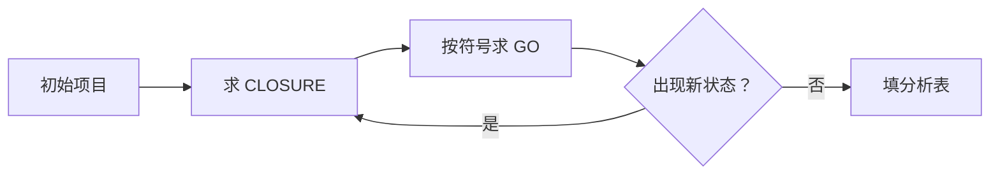

# LR(1)分析表构造

LR(1) 分析表是在 SLR(1) 基础上，把“向前看一个符号”的信息直接写进项目，从而更精确地决定何时归约。它解决的核心问题是：**同一个归约项目，在不同活前缀下，允许的下一个输入符号可能不同，不能一概使用 $\operatorname{FOLLOW}(A)$。**

## 为什么需要 LR(1)

LR(0) 遇到 $A\to\alpha\cdot$ 时，不查看输入符号，整行都填归约，容易产生冲突。SLR(1) 改为只在 $\operatorname{FOLLOW}(A)$ 上归约，但仍可能过宽。

例如某状态同时要求遇 $a$ 移进、遇 $a$ 归约，而 $a\in\operatorname{FOLLOW}(A)$，SLR(1) 就无法区分。LR(1) 则进一步记录：==只有当前项目所携带的向前搜索符出现时，才允许归约==。

## LR(1) 项目与闭包

LR(1) 项目写成
$$
[A\to\alpha\cdot\beta,\ a],
$$
其中 $a$ 是向前搜索符。若 $\beta=\varepsilon$，则仅当当前输入符号为 $a$ 时，才按 $A\to\alpha$ 归约。

构造项目集规范族仍使用 CLOSURE 和 GO：

- 初始项目为 $[S'\to\cdot S,\ \#]$；
- 若 $[A\to\alpha\cdot B\beta,\ a]\in I$，则对每个产生式 $B\to\gamma$，加入
  $$
  [B\to\cdot\gamma,\ b],\qquad b\in\operatorname{FIRST}(\beta a);
  $$
  若 $\beta$ 可推空，必须保留原来的 $a$；
- $GO(I,X)$：把点越过 $X$，再求闭包；
- 重复求转移，直到没有新项目集。

> [!IMPORTANT]
> LR(1) 闭包最容易考、也最容易错的一步是：==新增项目的搜索符取 $\operatorname{FIRST}(\beta a)$，而不是直接取 $\operatorname{FOLLOW}(B)$==。

## 分析表怎样填写

设状态 $I_i$ 对应第 $i$ 行：

| 项目或转移 | 填表规则 |
|---|---|
| $[A\to\alpha\cdot a\beta,\ b]\in I_i$，且 $GO(I_i,a)=I_j$ | $ACTION[i,a]=s_j$ |
| $GO(I_i,A)=I_j$ | $GOTO[i,A]=j$ |
| $[A\to\alpha\cdot,\ a]\in I_i$ | $ACTION[i,a]=r_k$，$k$ 为产生式编号 |
| $[S'\to S\cdot,\ \#]\in I_i$ | $ACTION[i,\#]=acc$ |
| 其余表项 | 空白，表示出错 |

若同一表项出现不同动作，则仍有“移进—归约”或“归约—归约”冲突，该文法不是 LR(1) 文法。

## 一个算对了的小例子

文法
$$
S'\to S,\qquad S\to S(S),\qquad S\to\varepsilon .
$$

初始状态 $I_0$ 为
$$
\begin{aligned}
&[S'\to\cdot S,\ \#],\\
&[S\to\cdot S(S),\ \#],\quad [S\to\cdot,\ \#],\\
&[S\to\cdot S(S),\ (],\quad [S\to\cdot,\ (].
\end{aligned}
$$

这里搜索符 $( $ 来自 $S$ 后面的终结符 $($。因此第 $0$ 行应填：
$$
ACTION[0,\#]=r_{S\to\varepsilon},\qquad
ACTION[0,(]=r_{S\to\varepsilon},
$$
而不是在所有终结符列都归约。由 $GO(I_0,S)=I_1$，得到
$$
[S'\to S\cdot,\ \#],\quad
[S\to S\cdot(S),\ \#],\quad
[S\to S\cdot(S),\ (].
$$
所以 $ACTION[1,\#]=acc$；若 $GO(I_1,()=I_2$，则 $ACTION[1,(]=s_2$，同时 $GOTO[0,S]=1$。

## 与相近方法的区别

| 方法 | 归约依据 | 状态规模 | 能力 |
|---|---|---:|---|
| LR(0) | 不看输入符号 | 小 | 最弱 |
| SLR(1) | $\operatorname{FOLLOW}(A)$ | 与 LR(0) 相同 | 较弱 |
| LR(1) | 项目自带搜索符 | 最大 | 最强 |
| LALR(1) | 合并 LR(1) 同心集 | 与 SLR(1) 相同 | 介于两者之间 |

> [!WARNING]
> $\varepsilon$ 产生式不经过 $GO(I,\varepsilon)$ 转移；$S\to\cdot\varepsilon$ 直接写成 $S\to\cdot$，按归约项目处理。也不要把“同心集合并”用于 LR(1)，那是 LALR(1) 的步骤。

> [!TIP]
> 做题顺序可记为：**拓广文法 → 编号产生式 → 初项目带 $\#$ → 闭包算 $\operatorname{FIRST}(\beta a)$ → GO 转移 → 按搜索符填归约**。
