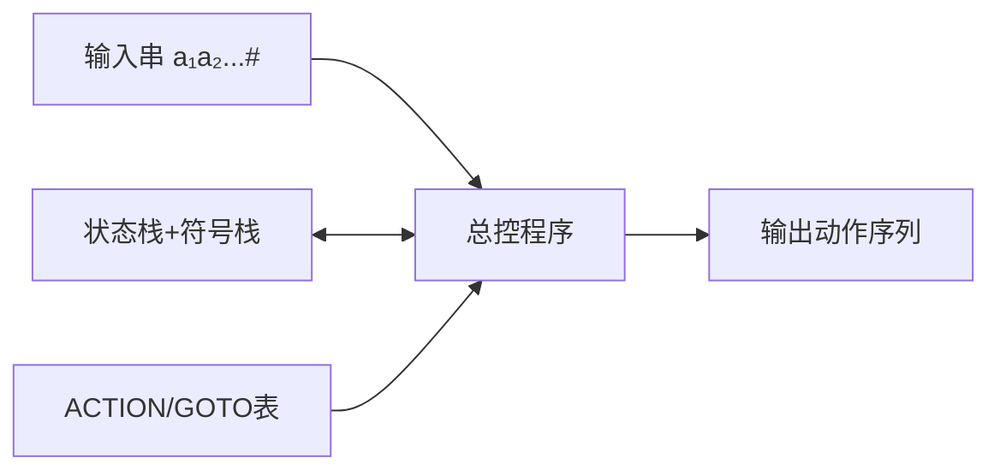

# LR分析法基本思想与LR分析器结构

---
requires: [编译原理/文法与推导, 编译原理/移进-归约分析]
---

LL 分析法从左到右扫描输入串，但需要回溯或向前看很多符号才能决定用哪条产生式。能不能只根据==已经读入的符号历史==就确定下一步动作？LR 分析法正是为此而生。

## 基本思想

LR 分析是一种==自底向上、移进-归约==的分析方法。L 表示从左到右扫描输入串，R 表示构造最右推导的逆过程（规范归约）。

它的核心问题是：在任意时刻，如何判断栈顶的符号串是否构成某个产生式的右部（即==句柄==）？LR 分析法通过维护一个**状态栈**来记录分析历史，把“找句柄”的问题转化为“查表”的问题。

> [!IMPORTANT]
> LR 分析的本质是：==用状态记住历史，用查表驱动动作==。只要当前状态和下一个输入符号确定了，该移进还是归约就唯一确定了。

## 分析器结构

LR 分析器由三部分组成：总控程序、分析表和状态栈/符号栈。

- **状态栈**：存放 LR 自动机的状态编号，初始为 $0$。
- **符号栈**：存放已识别的文法符号，初始为 $\#$。
- **分析表**：分为 ACTION 表和 GOTO 表。
  - $\text{ACTION}[s, a]$：状态 $s$ 面临输入符号 $a$ 时的动作（移进 $S_j$、归约 $r_k$、接受 acc 或报错）。
  - $\text{GOTO}[s, A]$：状态 $s$ 归约出非终结符 $A$ 后应转移到的新状态。

> [!NOTE]
> 与 LL 分析对比：LL 用预测分析表 + 单符号栈；LR 用 ACTION/GOTO 双表 + 状态栈与符号栈同步操作。LL 是自顶向下展开，LR 是自底向上归约。

## 总控程序工作流程

每次循环，设状态栈顶为 $s$，当前输入符号为 $a$：

1. 查 $\text{ACTION}[s, a]$：
   - 若为 $S_j$：将 $a$ 压入符号栈，$j$ 压入状态栈，读下一符号。
   - 若为 $r_k$（第 $k$ 条产生式 $A \to \beta$）：从两栈各弹出 $|\beta|$ 个元素，将 $A$ 压入符号栈，查 $\text{GOTO}[\text{新栈顶}, A]$ 得新状态压入状态栈。
   - 若为 acc：分析成功。
   - 若为空：报错。

> [!TIP]
> 口诀：==移进压双栈，归约弹长度，GOTO 查非终结==。归约时弹出的符号数严格等于产生式右部的长度。

## 常见易错点

> [!WARNING]
> 归约后查 GOTO 表时，行号是==弹出句柄后的新栈顶状态==，不是被弹出前的旧栈顶！这是考试中最容易算错的一步。

> [!CAUTION]
> 状态栈和符号栈必须同步进出。归约弹出 $|\beta|$ 个符号时，状态栈也必须弹出相同个数。

## 实例演示

利用真题中的分析表，判断 `bcd` 是否为该文法的句子。

| 步骤 | 状态栈 | 符号栈 | 剩余输入 | 查表动作 | 说明 |
|:---:|:---:|:---:|:---:|:---:|:---|
| 1 | $0$ | $\#$ | bcd$\#$ | $\text{ACTION}[0,b]=S_3$ | 移进 b，压入状态 3 |
| 2 | $0\;3$ | $\#b$ | cd$\#$ | $\text{ACTION}[3,c]=S_5$ | 移进 c，压入状态 5 |
| 3 | $0\;3\;5$ | $\#bc$ | d$\#$ | $\text{ACTION}[5,d]=S_{11}$ | 移进 d，压入状态 11 |
| 4 | $0\;3\;5\;11$ | $\#bcd$ | $\#$ | $\text{ACTION}[11,\#]=r_6$ | 按第 6 式归约，弹出 1 个 |
| 5 | $0\;3\;5$ | $\#bcB$ | $\#$ | $\text{GOTO}[5,B]=9$ | 新栈顶 5，查 GOTO 得 9 |
| 6 | $0\;3\;5\;9$ | $\#bcB$ | $\#$ | $\text{ACTION}[9,\#]=r_5$ | 按第 5 式归约，弹出 2 个 |
| 7 | $0\;3$ | $\#bB$ | $\#$ | $\text{GOTO}[3,B]=7$ | 新栈顶 3，查 GOTO 得 7 |
| 8 | $0\;3\;7$ | $\#bB$ | $\#$ | $\text{ACTION}[7,\#]=r_2$ | 按第 2 式归约，弹出 2 个 |
| 9 | $0$ | $\#E$ | $\#$ | $\text{GOTO}[0,E]=1$ | 新栈顶 0，查 GOTO 得 1 |
| 10 | $0\;1$ | $\#E$ | $\#$ | $\text{ACTION}[1,\#]=acc$ | 接受，是合法句子 |

注意第 5 步：归约 $r_6$ 后栈顶回到 $5$，此时必须用 $\text{GOTO}[5,B]$ 而非 $\text{GOTO}[11,B]$，这就是上文强调的易错点。
