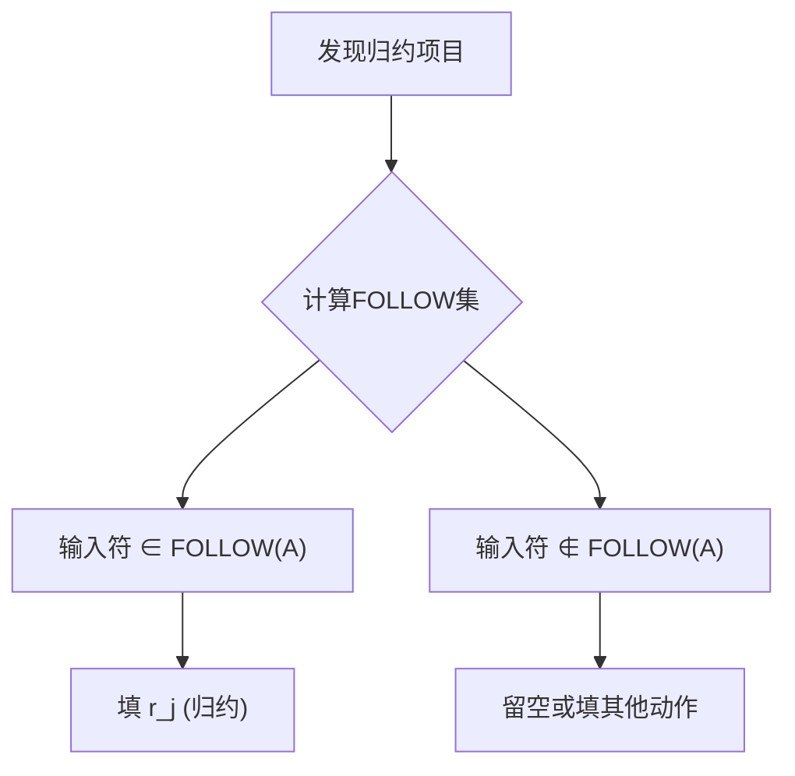

# SLR(1)分析表构造

---
requires: [编译原理/LR(0)分析法, 编译原理/FOLLOW集]
---

## 为什么需要 SLR(1)？

在构造 LR(0) 分析表时，如果某个项目集 $I_i$ 中同时存在：
- **归约项目**（如 $B ::= \beta \cdot$）
- **移进项目**（如 $A ::= \alpha \cdot b \gamma$）

LR(0) 的做法是“无脑”在所有终结符列都填 $r_j$。这就会导致同一格既要求移进又要求归约，产生==多重定义冲突==。

> [!IMPORTANT]
> 冲突的根源：LR(0) ==不向前看任何符号==，一律执行归约。

怎么解决？我们能不能只看当前输入的一个符号，再决定要不要归约？这就是 SLR(1) 的思路。

## SLR(1) 的核心思想

SLR(1) 中的 S 代表 Simple（简单），1 代表==至多向前查看一个输入符号==。

它的核心规则只改动了 LR(0) 构造规则的第 2 条：
若归约项目 $A ::= \alpha \cdot$ 属于 $I_i$，且 $A ::= \alpha$ 是文法第 $j$ 个规则，则**仅对属于 $\text{FOLLOW}(A)$ 的输入符号 $a$**，置 $\text{ACTION}[i, a] = r_j$。其余符号列不再盲目填 $r_j$。

> [!TIP]
> 记忆口诀：**“只在 FOLLOW 里归约，不在 FOLLOW 里不归约。”**

## 与相近概念的区别

| 方法 | 向前看符号数 | 解决冲突的依据 | 适用文法范围 |
| :---: | :---: | :--- | :--- |
| LR(0) | 0 | 不看符号，一律归约 | 最小 |
| **SLR(1)** | **1** | **全局 $\text{FOLLOW}$ 集** | **较大** |
| LR(1) | 1 | 精确的局部向前看符号 | 最大 |

> [!NOTE]
> 所有 LR 分析器的总控程序相同，不同的仅仅是分析表的构造算法。

## 构造步骤

1. 引入增广文法 $S' ::= S$ 作为第 0 条规则。
2. 构造识别活前缀的 LR(0) DFA（项目集规范族）。
3. 检查每个状态 $I_i$ 是否存在“移进-归约”或“归约-归约”冲突。
4. 若有冲突，求相关非终结符的 $\text{FOLLOW}$ 集。若冲突项目的 $\text{FOLLOW}$ 集与移进符号集==两两不相交==，则可用 SLR(1) 解决。
5. 按修改后的规则填写 ACTION 表和 GOTO 表。

> [!WARNING]
> 如果 $\text{FOLLOW}$ 集与移进符号集相交，说明 SLR(1) 包含的信息不够，必须用更强的 LR(1) 方法。

## 完整例题演练

给定文法：$E ::= EE+ \mid EE* \mid a$。引入 $E'$ 为第 0 条规则。

**第一步：编号并求 FOLLOW 集**
- $r_0: E' ::= E$
- $r_1: E ::= EE+$
- $r_2: E ::= EE*$
- $r_3: E ::= a$

由于 $E$ 可推导整个句子，$\text{FOLLOW}(E) = \{+, *, \#\}$；而开始符号 $\text{FOLLOW}(E') = \{\#\}$。

**第二步：构造 DFA 关键状态**
在初始状态经过 $E$ 到达的状态 $I_1$ 中包含：
- $E' ::= E \cdot$ （接受/归约项目）
- $E ::= E \cdot E+$ （移进项目，遇 $E$ 移进）
- $E ::= E \cdot E*$ （移进项目，遇 $E$ 移进）

这里存在“接受（本质是归约 $r_0$）”和“移进”的潜在冲突。

**第三步：用 SLR(1) 消解冲突**
对于 $E' ::= E \cdot$，其左部是 $E'$，$\text{FOLLOW}(E') = \{\#\}$。
移进项目需要遇到终结符 $a$ 才能继续推导 $E$。
因为 $\text{FOLLOW}(E') \cap \{a\} = \{\#\} \cap \{a\} = \emptyset$，==交集为空，冲突被成功消解==！所以该文法是 SLR(1) 文法。

**第四步：填写分析表**
当输入为 $\#$ 时，在状态 1 执行 acc（接受）；当输入为 $a$ 时，移进到状态 2。

| 状态 | ACTION (+) | ACTION (*) | ACTION (a) | ACTION (#) | GOTO (E) |
| :---: | :---: | :---: | :---: | :---: | :---: |
| 0 | | | $S_2$ | | 1 |
| 1 | | | $S_2$ | acc | 3 |
| 2 | $r_3$ | $r_3$ | $r_3$ | $r_3$ | |
| 3 | $S_4$ | $S_5$ | $S_2$ | | 3 |

> [!CAUTION]
> 考试常见坑：判断是否为 SLR(1) 文法时，不能只算 FOLLOW 集，必须先画出 DFA 找到具体的冲突状态，再验证该状态下冲突符号的集合是否相交。
