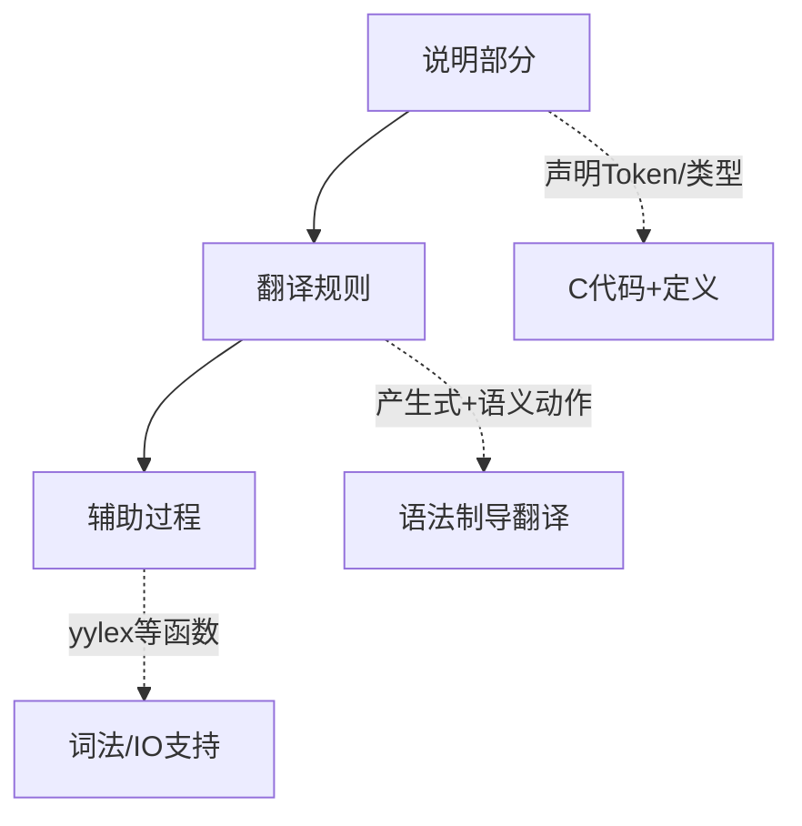
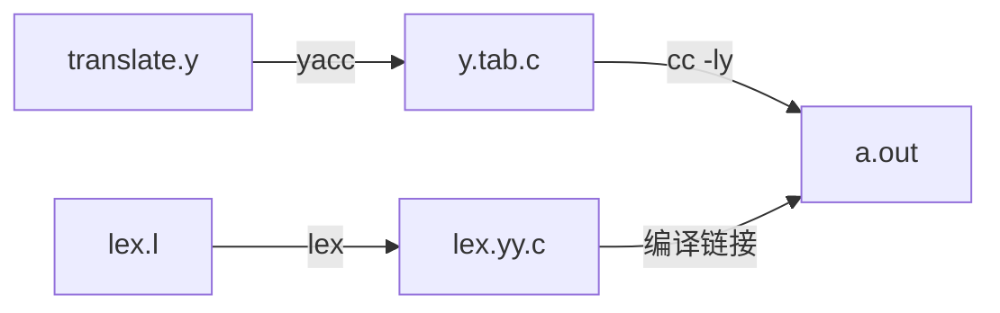

# 语法分析程序的自动生成（YACC）

## YACC 是什么与为什么需要

手写 LR 分析表繁琐且易错，能否让工具代劳？==YACC（Yet Another Compiler-Compiler）==正是为此诞生的语法分析器生成器。它接收用户提供的 LALR(1) 文法规格说明，自动构造语法分析器并执行语义动作。相比手写递归下降或 LL 分析器，YACC 基于更强大的 ==LALR 分析法==，能处理绝大多数编程语言文法，且将语法结构与翻译逻辑解耦，大幅提升编译器开发效率。

## 规格说明的三段式结构

YACC 源文件（`.y`）由双百分号 `%%` 分隔为三部分，这与 LEX 类似但用途不同：

> [!IMPORTANT]
> 语义动作中 `$$` 代表左部属性值，`$1`、`$3` 分别代表右部第 1、3 个符号的属性值；省略 `{ $$ = $1; }` 时 YACC 默认复制该动作。

翻译规则中，终结符可用单引号括起（如 `'+'`），未声明为 token 的标识符视为非终结符。每条产生式以分号结束，多个候选式用 `|` 分隔。

## 二义性文法的冲突解决

若文法存在二义性，YACC 生成 LALR 表时会报告冲突。此时不必改写文法，可利用以下机制：

| 冲突类型 | 缺省规则 | 用户可控机制 |
| :--- | :--- | :--- |
| 移进-归约 | ==优先移进== | `%left` / `%right` / `%nonassoc` 声明优先级与结合性 |
| 归约-归约 | 选靠前产生式 | 调整产生式书写顺序或使用虚拟终结符 |

> [!WARNING]
> 使用 `-v` 选项可生成 `y.output` 文件，查看项目集核心与冲突详情，这是调试二义性的关键手段。

例如表达式文法中，声明 `%left '+' '-'` 和 `%left '*' '/'` 即可正确体现运算符优先级与左结合性；一元负号可用 `%right UMINUS` 赋予最高优先级，并在产生式中引用该虚拟终结符强制绑定。

## 完整工作流与正确示例

YACC 并非独立运行，需与 LEX 及 C 编译器配合：

> [!TIP]
> 编译命令 `cc y.tab.c -ly` 中 `-ly` 链接 YACC 运行时库；`yylex()` 必须返回 token 类型，并通过全局变量 `yylval` 传递属性值。

以台式计算器为例，输入 `3+5*2\n` 时，词法分析器依次返回 `DIGIT(3)`、`'+'`、`DIGIT(5)`、`'*'`、`DIGIT(2)`、`'\n'`。由于 `*` 优先级高于 `+`，分析器先归约 `5*2` 得 10，再归约 `3+10` 得 13，最终 `printf("%d\n", $1)` 输出正确结果。若误将 `+` 声明为 `%right` 或未声明 `*` 更高优先级，则可能错误计算为 16——这正是理解优先级声明必要性的典型算例。
