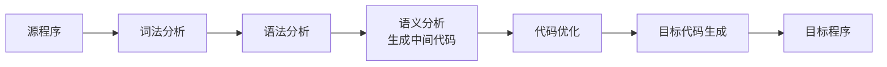
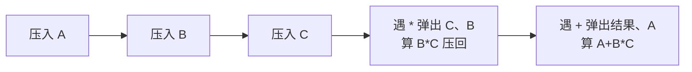
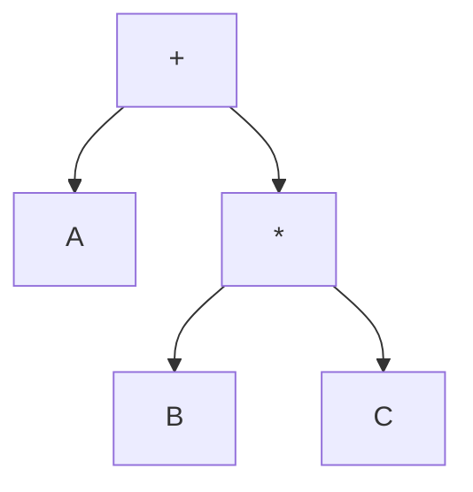

# 中间语言（逆波兰、三元式、树形、四元式）

## 中间语言是什么

源程序经过词法分析、语法分析之后，如果直接生成目标代码，会带来两个问题：一是目标机千差万别，编译器的后半段必须为每种机器重写；二是源语言和目标语言之间跨度太大，很多优化难以开展。

解决办法是在语法分析和代码生成之间插入一层**中间语言**（中间代码）。它既不偏向源语言，也不偏向某台具体机器，而是介于两者之间的一种独立表示形式：

> [!IMPORTANT]
> 中间语言的核心作用：**逻辑上独立于机器，形式上便于优化和翻译**。引入它之后，只需更换“中间代码→目标代码”这一段，就能适配不同目标机。

---

## 逆波兰表示

### 概念

普通表达式如 `A+B` 的运算符写在两个运算对象中间，称为**中缀表示**。如果把运算符放在运算对象的后面，就得到**后缀表示**，也叫**逆波兰表示**：

| 中缀表达式 | 逆波兰表示 |
| :---: | :---: |
| $A+B$ | $AB+$ |
| $A \geq B$ | $AB\geq$ |
| $A+B*C$ | $ABC*+$ |
| $(A+B)*C$ | $AB+C*$ |

### 为什么好用

逆波兰表示**不需要括号**，运算顺序完全由运算符出现的位置决定。机器处理时，从左到右扫描一遍即可：遇到运算对象就压栈，遇到运算符就弹出相应个数的运算对象、计算、再把结果压栈。

例如求值 `ABC*+`：

> [!TIP]
> 中缀转逆波兰的关键：**遇到操作数直接输出，遇到运算符时先与栈顶比较优先级**——栈顶优先级高的先弹出输出，低的入栈。括号“左括号入栈、右括号弹出到左括号为止”。

---

## 三元式

### 形式与作用

三元式的一般形式为：

$$
(i)\quad (OP,\ ARG1,\ ARG2)
$$

其中 $(i)$ 是三元式的编号，ARG1 和 ARG2 是运算对象。它们可以指向**符号表**中的登记项（常数或标识符），也可以指向**另一个三元式的编号**（中间结果）。

例如 $A+B*C$ 的三元式：

$$
\begin{aligned}
(1)&\quad (*,\ B,\ C)\\
(2)&\quad (+,\ A,\ (1))
\end{aligned}
$$

三元式 $(2)$ 中的 `(1)` 表示引用第 (1) 条三元式的结果。

### 间接三元式

三元式之间是靠编号引用的，一旦调整顺序，所有引用都要跟着改。**间接三元式**把“三元式本身”和“执行顺序”拆成两张表：

| 执行表 | 三元式表 |
| :---: | :---: |
| (4) | (1) $(*,\ a,\ b)$ |
| (2) | (2) $(+,\ (1),\ c)$ |
| (3) | (3) $(+,\ (2),\ (1))$ |
| (1) | (4) $(:=,\ x,\ (3))$ |

如果某个三元式出现多次（如公共子表达式 $a*b$），三元式表里只存一份，执行表里多次引用它即可。优化时只需调整执行表，不动三元式本体。

> [!WARNING]
> 普通三元式中，**相同内容也不能合并**——因为编号本身就是被引用的依据，删掉一条编号就断了引用链。这正是间接三元式存在的理由。

---

## 树形表示

表达式可以用树来表示：**叶节点是运算对象，内部节点是运算符**。对树进行后序遍历，就得到逆波兰表示；树的每个内部节点对应一条三元式。

后序遍历这棵树：`ABC*+`，与逆波兰表示完全一致。

---

## 四元式

### 形式

四元式的一般形式为：

$$
(OP,\ ARG1,\ ARG2,\ RESULT)
$$

与三元式最大的不同：**结果不再是某条编号的隐式引用，而是显式的临时变量**。

例如 $a:=-b*(c+d)$ 的四元式：

$$
\begin{aligned}
(1)&\quad (\bigcirc,\ b,\ -,\ T_1)\\
(2)&\quad (+,\ c,\ d,\ T_2)\\
(3)&\quad (*,\ T_1,\ T_2,\ T_3)\\
(4)&\quad (:=,\ T_3,\ -,\ a)
\end{aligned}
$$

### 三元式与四元式的对比

| 比较项 | 三元式 | 四元式 |
| :---: | :---: | :---: |
| 结果引用方式 | 用三元式编号 | 用临时变量 |
| 优化时调整顺序 | 困难，需改引用编号 | 方便，临时变量独立 |
| 存储空间 | 较少 | 较多 |
| 典型用途 | 语法制导翻译 | 代码优化、目标代码生成 |

> [!IMPORTANT]
> 四元式中，==运算结果存放入 RESULT 显式指定的临时变量==，四元式之间靠临时变量名产生联系，调整顺序不影响引用正确性。这是它比三元式更适合优化处理的关键原因。

---

## 一个完整的例子

将语句 `while (a<b) do if (c<d) then x:=y+z` 翻译为四元式序列：

$$
\begin{aligned}
(1)&\quad (j<,\ a,\ b,\ (3))\\
(2)&\quad (j,\ ,\ ,\ (7))\\
(3)&\quad (j<,\ c,\ d,\ (5))\\
(4)&\quad (j,\ ,\ ,\ (1))\\
(5)&\quad (+,\ y,\ z,\ T_1)\\
(6)&\quad (:=,\ T_1,\ ,\ x)\\
(7)&\quad (j,\ ,\ ,\ (1))
\end{aligned}
$$

其中 `(j<, a, b, (3))` 表示“若 $a<b$ 成立则跳转到第 (3) 条四元式”，`(j, , , (7))` 是无条件跳转。先产生条件跳转的四元式时，目标位置往往还不知道，需要在后续翻译过程中**回填**。

> [!CAUTION]
> 条件语句翻译中最容易出错的是**真假出口的回填顺序**。外层条件先产生跳转指令但暂不填目标，等到内层语句翻译完毕，再把当时的位置回填进跳转指令。多个跳转指令形成链条时，从链头开始逐个填充。
