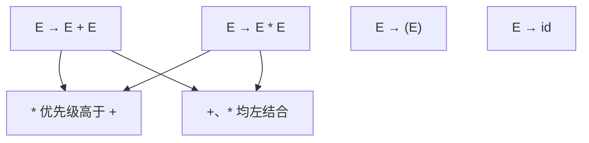

# LR分析中二义性文法的应用

## 为什么 LR 会“怕”二义文法

LR 分析的核心是**移进—归约**决策。二义文法的问题在于：面对同一个栈顶句柄和同一个输入符号，分析表里可能出现两个动作，比如“既该归约、又该移进”，或者“该按两条产生式同时归约”。标准 LR(0)/SLR(1)/LR(1) 构造方法对此无法容忍，会产生冲突。

但这并不意味着 LR 技术**无法适用**二义文法。Yacc / Bison 这类工具的处理方式表明：==只要为冲突补充“消解规则”，二义文法完全可以被 LR 分析器使用==，而且常常比等价的无二义文法更简洁、状态更少。

所以判断题“LR 分析技术无法适用二义文法”是 **×**：LR 无法直接处理，但可以通过优先级和结合性规则消除冲突后使用。

## 两类典型冲突与消解

### 移进—归约冲突

最经典的是“悬空 else”文法：

```
stmt → if expr then stmt
     | if expr then stmt else stmt
     | other
```

当栈顶出现 `if expr then stmt`、输入符为 `else` 时：

- 按第一条产生式**归约**：`else` 属于外层 `if`；
- 把 `else` **移进**：`else` 属于内层 `if`。

Yacc 的默认规则是**移进优先**，这正好实现了“else 与最近的 then 配对”。

> [!IMPORTANT]
> 移进优先并不是通用真理，而是针对悬空 else 语义的**人为约定**。

### 归约—归约冲突

例如对输入为 `id + id` 的二义表达式文法，栈顶出现 `E + E` 时，同时能用 `E → E + E` 归约，也可能该归约的是刚识别的 `E`。这类冲突更麻烦，通常需要重写文法或调整归约优先级（Yacc 中按产生式出现顺序）。

## 表达式文法的经典做法



对输入 `id + id * id`：

- 读到 `id + id` 时，栈顶 `E + E`，输入符 `*`。若归约则先做加法，若移进则先做乘法。
- 规定 `*` 优先级高于 `+`，所以**移进 `*`**，得到 `E + E * E`；再归约 `E * E`，最终得到 `E + E`，即 `id + (id * id)`。

对输入 `id - id - id`：

- 栈顶 `E - E` 时输入符 `-`，若移进则是右结合 `id - (id - id)`，若归约则是左结合 `(id - id) - id`。
- 规定 `-` 左结合，所以**归约优先**。

> [!TIP]
> 记忆口诀：**同优先级看结合性——左结合、归约优先；右结合、移进优先。高优先级、移进优先。**

## 一个算例

文法：

```
E → E + E | E * E | (E) | id
```

规则：`*` 优先级高于 `+`；`+`、`*` 左结合。

输入串：`id + id + id * id`

分析过程（简化表）：

| 栈 | 输入 | 动作 |
|---|---|---|
| $ | id + id + id * id $ | 移进 id |
| $ id | + id + id * id $ | 归约 E→id |
| $ E | + id + id * id $ | 移进 + |
| $ E + | id + id * id $ | 移进 id |
| $ E + id | + id * id $ | 归约 E→id |
| $ E + E | + id * id $ | **归约**（+ 左结合） |
| $ E | + id * id $ | 移进 + |
| $ E + | id * id $ | 移进 id |
| $ E + id | * id $ | 归约 E→id |
| $ E + E | * id $ | **移进**（* 优先级高） |
| $ E + E * | id $ | 移进 id |
| $ E + E * id | $ | 归约 E→id |
| $ E + E * E | $ | 归约 E→E*E |
| $ E + E | $ | 归约 E→E+E |
| $ E | $ | 接受 |

最终得到 `((id + id) + (id * id))`，与预期语义一致。

## 常见坑

> [!WARNING]
> 二义文法的 LR 分析必须**显式声明**优先级和结合性。单靠产生式书写顺序不够可靠，不同工具（Yacc/Bison）的默认行为可能不同。

> [!CAUTION]
> 归约—归约冲突不能靠“结合性”解决，因为结合性只针对同一优先级的同一运算符。两个不同产生式抢着归约时，需要重写文法或调整语义动作。

## 与“等价无二义文法”的区别

| | 二义文法 + 消解规则 | 等价无二义文法 |
|---|---|---|
| 文法规模 | 更小、更直观 | 更庞大（如引入 E'、T、F 分层） |
| 冲突处理 | 依赖工具约定 | 无冲突，LR 自动接受 |
| 可读性 | 高 | 产生式层次抽象 |
| 风险 | 消解规则隐含语义，易误用 | 语义显式，无隐含约定 |

所以，南邮考试中遇到“LR 分析技术无法适用二义文法”，直接答 **×**，并说明：==二义文法 + 优先级与结合性规则 ⇒ 可用 LR 分析==。
