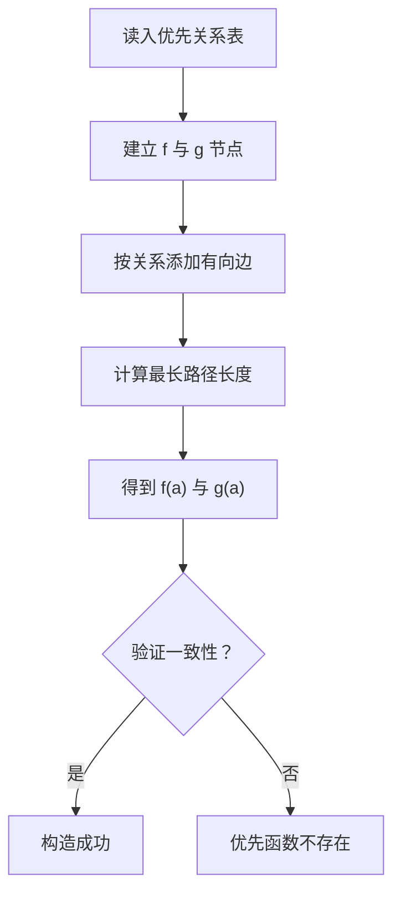

# 优先函数及其构造（Bell方法）
### 为什么需要优先函数

算符优先分析中，每对终结符都要查一次优先关系表。若文法有 $n$ 个终结符，分析表就要 $n \times n$ 个单元，存储量大。能不能把二维表压成两个一维数组？

==优先函数 $f(a)$ 和 $g(a)$ 把终结符映射为整数，用 $f(a)$ 与 $g(b)$ 的大小比较代替 $a$ 与 $b$ 的优先关系比较，将存储空间从 $O(n^2)$ 降到 $O(n)$==。

### 优先函数的定义

设 $f$ 和 $g$ 是定义在终结符集 $V_T$ 上的两个函数，值域为非负整数。若对任意终结符对 $(a,b)$ 满足：

| 优先关系 | 函数条件 |
| :--- | :--- |
| $a \lessdot b$（$a$ 低于 $b$） | $f(a) < g(b)$ |
| $a \doteq b$（$a$ 等于 $b$） | $f(a) = g(b)$ |
| $a \gtrdot b$（$a$ 高于 $b$） | $f(a) > g(b)$ |

则称 $(f,g)$ 为优先函数。

> [!IMPORTANT]
> 优先函数**不一定存在**。若优先关系表中存在矛盾循环（如 $a \lessdot b$、$b \lessdot c$、$c \lessdot a$ 同时成立），则无法构造满足条件的 $f$ 和 $g$。

### Bell方法（有向图法）构造步骤

核心思路：**把优先关系转化为有向图中的边，通过计算最长路径确定函数值**。

**Step 1：画有向图**

建立两个点集 $\{f_a \mid a \in V_T\}$ 和 $\{g_b \mid b \in V_T\}$，共 $2n$ 个节点。

- 若 $a \gtrdot b$ 或 $a \doteq b$，画边 $f_a \to g_b$
- 若 $a \lessdot b$ 或 $a \doteq b$，画边 $g_b \to f_a$

**Step 2：求最长路径**

从各节点出发，计算其能到达的最长路径长度（边数），即为该节点的函数值。

**Step 3：验证**

检查所有 $f(a)$ 与 $g(b)$ 的大小关系是否与原优先关系表一致。若一致则构造成功；否则说明优先函数不存在。

### 算对了的例子

对文法 $E \to E+T \mid T$，$T \to T*F \mid F$，$F \to (E) \mid i$ 的算符优先关系表，用 Bell 方法：

- 由 $+ \lessdot *$，画边 $g_* \to f_+$
- 由 $+ \gtrdot +$，画边 $f_+ \to g_+$
- 由 $* \gtrdot *$，画边 $f_* \to g_*$
- …（其余类似）

计算最长路径后得：

| 符号 | $f(a)$ | $g(a)$ |
| :--- | :---: | :---: |
| $+$ | 2 | 1 |
| $*$ | 4 | 3 |
| $i$ | 5 | 5 |
| $($ | 5 | 5 |
| $)$ | 5 | 5 |

验证：$f(+) = 2 < g(*) = 3$ ✓（对应 $+ \lessdot *$）；$f(*) = 4 > g(+) = 1$ ✓（对应 $* \gtrdot +$）。

### 与迭代法的对比

| 对比项 | Bell方法（有向图法） | 迭代法 |
| :--- | :--- | :--- |
| 基本思想 | 图论最长路径 | 逐次逼近修正 |
| 初始值 | 无需预设 | 通常全置 1 |
| 收敛性 | 一次计算直接得结果 | 需迭代至不变 |
| 直观性 | 图形化，关系清晰 | 表格操作，步骤机械 |

> [!WARNING]
> 常见错误：画边方向混淆。记忆口诀——=="$a$ 优先级高，则 $f(a)$ 指向 $g(b)$；$a$ 优先级低，则 $g(b)$ 指向 $f(a)$"==。画反方向会导致函数值全错。
