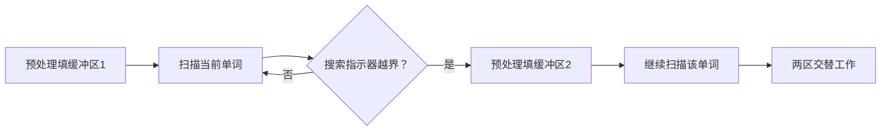

# 单词的内部编码与预处理（超前搜索）

## 单词的内部编码

词法分析器读取源程序字符后，并不是把原始字符串直接交给语法分析器，而是输出==单词的种别编码和自身值==。种别编码通常用整数表示单词类别，自身值则记录该单词的具体信息。

例如，可以规定：

| 单词类别 | 种别编码 | 自身值示例 |
|---|---:|---|
| 关键字 `if` | 1 | 可省略或填约定值 |
| 标识符 | 2 | 符号表入口或名字信息 |
| 无符号整数 | 3 | 数值或常数表入口 |
| 运算符 `+` | 4 | 可省略或填约定值 |
| 界符 `;` | 5 | 可省略或填约定值 |

进行内部编码，是为了从源字符串中识别单词，并确定其类型和值，供编译程序后续部分使用。编码原则是==长度统一，既刻画单词本身，又刻画其属性==。标识符先被判定为“标识符”类别，再填写统一的类别编码；其自身值根据具体名字确定，常指向符号表中的相应信息。

> [!IMPORTANT]
> 词法分析器的输出结果应选“单词的种别编码和自身值”，只写种别编码或只写自身值都不完整。

## 扫描缓冲区与预处理

源程序通常不能简单地逐字符直接从外存读取。扫描缓冲区先把一段源程序读入内存，词法分析器在缓冲区中扫描，以减少输入开销并便于回退、超前搜索。

课件采用两个扫描缓冲区，每个可装入 $120$ 个字符，并设置两个指示器：

- **起点指示器**：指向当前单词的第一个字符；
- **搜索指示器**：向前扫描，寻找当前单词的终点。

预处理子程序负责填充缓冲区，并剔除无用的空白符、跳格符、回车换行符等编辑性字符。这里剔除的是单词之间无意义的编辑性字符，不能笼统理解为删除源程序中的所有空格，例如字符串内部字符不能随意删除。

搜索指示器越界，说明当前缓冲区中的字符不足以组成一个完整单词，此时填充另一缓冲区并继续搜索；==越界不等于当前单词已经结束==。两个缓冲区交替工作，可避免把尚未扫描完的单词直接截断。

## 超前搜索

有些单词只看当前字符无法确定边界，需要继续向后看。所谓==超前读字符（超前搜索）==，就是仅向前读取字符、判别它是什么，暂不做其他处理；判明情况后，再回过头处理已经读过的字符。

例如扫描无符号整数 `123;`：

1. 起点指示器指向 `1`，搜索指示器依次读入 `1`、`2`、`3`；
2. 再超前读到 `;`，发现数字串已经结束；
3. 将 `123` 识别为无符号整数，输出 $(3,\text{数值或常数表入口})$；
4. 回退搜索指示器，使 `;` 留待下一次扫描，再识别为界符。

超前搜索解决的是“还需要看多少字符才能判定单词”，预处理解决的是“怎样取得便于扫描的字符”，内部编码解决的是“识别后向后续阶段输出什么”，三者不能混为一谈。

> [!WARNING]
> 超前搜索不是把多读的字符一并归入当前单词，也不是永久丢弃它。若多读字符不属于当前单词，应正确回退，否则可能漏识 `;` 等后继单词。
