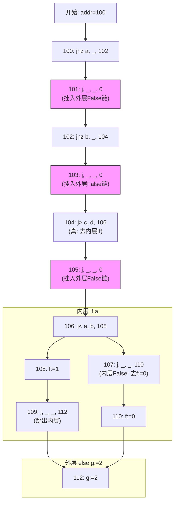

# 布尔表达式的翻译（回填技术）
在语法制导翻译中，布尔表达式通常作为条件控制语句（如 `if-then-else`、`while`）的判断条件。由于采用**短路求值**（Short-circuit Evaluation）策略，我们无法在生成代码的当下立即确定跳转的目标地址（即真出口 `true.list` 和假出口 `false.list`）。==回填技术（Backpatching）==正是为了解决这一“向前引用”问题而设计的核心机制。

### 为什么需要回填？

当编译器处理 `if E then S1 else S2` 时，先生成 $E$ 的代码。若 $E$ 为真，应跳至 $S_1$；若为假，应跳至 $S_2$。但在生成 $E$ 的四元式时，$S_1$ 和 $S_2$ 的起始地址尚未可知。因此，我们暂时将跳转指令的目标地址填为 `0`（或空），并将这些待回填的地址记录在链表中。待后续代码生成完毕，确定了确切地址后，再回头修改这些 `0`。

### 核心机制：真假出口链

每个布尔子表达式 $E$ 维护两个属性：
- $E.true$：当 $E$ 为真时，需跳转到的地址链表。
- $E.false$：当 $E$ 为假时，需跳转到的地址链表。

对于基本关系运算（如 `a > b`），生成一条条件跳转指令（真则跳转）和一条无条件跳转指令（假则跳转）。对于逻辑运算，通过合并链表实现短路逻辑：

| 运算符 | 语义逻辑 | 链表操作 |
| :--- | :--- | :--- |
| $E_1 \land E_2$ | $E_1$ 假则整体假；$E_1$ 真则看 $E_2$ | $E.true = E_2.true$   $E.false = merge(E_1.false, E_2.false)$ |
| $E_1 \lor E_2$ | $E_1$ 真则整体真；$E_1$ 假则看 $E_2$ | $E.true = merge(E_1.true, E_2.true)$   $E.false = E_2.false$ |

> [!IMPORTANT]
> 核心结论：`and` 连接的是假出口链，`or` 连接的是真出口链。这是因为短路特性决定了前项失败/成功时，直接继承前项的出口状态。

### 实例推导：嵌套条件语句

考虑语句：`if a∧b∧c>d then if a<b then f:=1 else f:=0 else g:=2`。假设起始地址为 100。

**关键步骤解析：**
1.  **外层条件**：`a∧b∧c>d`。若 `a` 或 `b` 为假，生成 `j` 指令指向 `0`，并入外层假出口链。`c>d` 为真时跳至内层 `if` 入口（地址 106），为假时生成 `j` 指向 `0`，也并入外层假出口链。
2.  **内层条件**：`a<b`。真出口执行 `f:=1` 后跳过 `else`；假出口执行 `f:=0`。
3.  **回填时刻**：
    -   内层 `if` 结束后，得知其“后续地址”为 112。将内层真/假出口中指向 `0` 的指令回填为 112（或对应分支地址）。
    -   整个语句结束后，得知外层 `else` 后的下一条地址。将外层假出口链（101, 103, 105）中的 `0` 回填为该地址。

> [!WARNING]
> 常见坑：混淆内外层出口。外层 `else` 部分是内层 `if` 的“后续环境”。内层 `if` 的真/假出口最终都应汇入外层结构的控制流中，切勿让内层跳转直接跳出整个外层语句块，除非逻辑如此。

通过这种**先生成、后回填**的策略，编译器只需单遍扫描即可生成正确的控制流中间代码。
