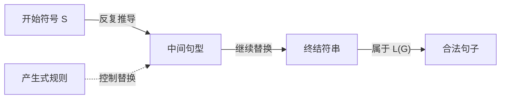

# 形式语言的提出与文法的引入

## 形式语言的提出

编译器的前端工作，说到底是一个**翻译**过程：把用高级语言写的源程序，转换成机器能理解的中间表示。这个翻译要想做到“自动化”“零歧义”，就不能靠“大概理解”，而是需要一套**严格的数学工具**来描述源语言。

这就引出了形式语言的核心问题：

> 给定一个有限的符号表（字母表），如何精确地定义“哪些字符串是合法的程序语句”？

例如，C 语言里 `if (a > 0) a = 1;` 是合法的，但 `if a > 0) a = 1;` 就不合法。如果编译器只靠“人看着改”，那就没法工作了。形式语言正是用数学手段，明确定义出“合法字符串的集合”，让编译器的词法分析和语法分析有了理论依据。

## 文法的引入

要描述一种形式语言，最直接的办法是“把合法句子全都列出来”——但这对于无限的语言显然行不通。于是我们引入**文法（Grammar）**：用**有限条规则**生成无限的字符串集合。

> [!IMPORTANT]
> 文法是一组产生式（重写规则）的集合，它定义了如何从开始符号出发，反复替换非终结符，最终只留下终结符串的过程。

一个文法 $G$ 定义为四元组 $(V_N, V_T, P, S)$：

- $V_N$：非终结符集合（语法变量，如 $A, B, S$）
- $V_T$：终结符集合（语言中实际出现的字符）
- $P$：产生式集合，形如 $\alpha \rightarrow \beta$
- $S$：开始符号

## 推导的核心思想

推导就是从 $S$ 出发，每一步把句型中的某个非终结符用其产生式右部替换，直到没有非终结符为止。整个过程就像搭积木：规则是“积木拼接方法”，目标是搭出只含终结符的成品。

例如，文法 $G$：
$$
S \rightarrow aS \mid a
$$
从 $S$ 出发，可以这样推导：
$$
S \Rightarrow aS \Rightarrow aaS \Rightarrow aaa
$$
这个文法生成的语言是 $\{ a^n \mid n \geq 1 \}$。

> [!TIP]
> 推导时每次只替换**一个**非终结符，称为最左推导或最右推导。这在自顶向下语法分析中是关键操作。

## 乔姆斯基谱系：四种文法

不是所有文法都一样强大。乔姆斯基根据产生式的形式，把文法分为四类，对应四类自动机：

| 文法类型 | 产生式限制 | 对应自动机 |
|---------|-----------|-----------|
| 0 型（短语结构） | 无限制 | 图灵机 |
| 1 型（上下文有关） | $\alpha A \beta \rightarrow \alpha \gamma \beta$（$A$ 在上下文中被替换） | 线性有界自动机 |
| 2 型（上下文无关） | $A \rightarrow \alpha$（左部单个非终结符） | 下推自动机 |
| 3 型（正规文法） | $A \rightarrow aB$ 或 $A \rightarrow a$（右线性） | 有限自动机 |

> [!WARNING]
> **常见的坑**：一类常见的判断错误是看到文法里含有 $\varepsilon$，就以为它不是 3 型或 2 型文法。实际上，==正规文法和上下文无关文法都可以包含空产生式==（只要满足形式要求）。判断类型看的是产生式的“形状”，而不是有没有 $\varepsilon$。

## 一个算对了的例子

**题目**：判断以下文法分别属于哪一类？

(2) $S ::= aB \quad B ::= bC \quad C ::= c \quad C ::= \varepsilon$

一步步分析：

1. 所有产生式左部都是单个非终结符 $(S, B, C)$ → 满足 $A \rightarrow \alpha$ 的形式，所以==必为 2 型（上下文无关）或更严格==。
2. 看是否满足 3 型（正规）：右线性要求右部形如 $aB$ 或 $a$（或 $\varepsilon$）。
   - $S \rightarrow aB$：符合 $aB$ 形式 ✓
   - $B \rightarrow bC$：符合 $bC$ 形式 ✓
   - $C \rightarrow c$：符合 $c$ 形式 ✓
   - $C \rightarrow \varepsilon$：符合 $\varepsilon$ 形式 ✓
3. 全部满足右线性正规文法要求 → ==该文法属于 3 型（正规文法）==，自然也属于 2 型和 0 型。

对比第 (1) 题里的 $S ::= aB \quad B ::= cB \quad B ::= b \quad C ::= c$，前三条规则满足 3 型，但多了个 $C ::= c$ 且 $C$ 从未被其他规则引用，虽冗余但不破坏形式，仍属正规文法。

> [!NOTE]
> 高级程序设计语言的语法大部分用 2 型（上下文无关文法）描述，词法（标识符、常数等）用 3 型（正规文法 / 正规表达式）描述。这正好对应编译器前端的两大阶段：词法分析和语法分析。
