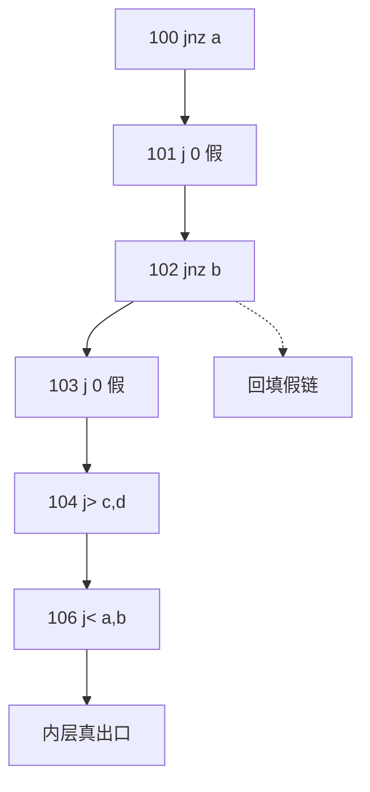

# 控制语句的翻译（if、while、for、goto）

## 是什么

控制语句的翻译，就是在语法制导翻译里把 `if`、`while`、`for`、`goto` 这些改变程序执行顺序的语句，变成中间代码（主要是**四元式**）的过程。南邮课件里重点讲 `if E then S1 else S2` 和 `while E do S`，常用两种表示：一是**后缀式（POST 数组）**，把结构写成 $E'\,p_1\,\mathrm{JEZ}\,S_1'\,p_2\,\mathrm{JUMP}\,S_2'$；二是**四元式序列**，用 `(jnz, a, , p)`、`(j, , , p)`、`(j>, c, d, p)` 等跳转指令实现真假出口。

## 为什么需要

源程序里的条件是“ if 真就走这儿、假就走那儿”，但四元式是线性排下来的。我们必须显式生成“跳到哪儿”的指令，并且因为嵌套时出口地址一开始算不出来，就得先填 0 再**地址回填（backpatching）**。

## 怎么做

[!IMPORTANT]
> `if E then S1 else S2` 的翻译骨架：算 $E$ 的真假出口；真出口接 $S_1$ 开头，假出口接 $S_2$ 开头；$S_1$ 结束后用 `JUMP` 跳过 $S_2$ 到整个语句之后。
> 对短路求值的 `a∧b∧c>d`：`a` 假就跳假出口，真则看 `b`，`b` 真再看 `c>d`。

看嵌套例子 `if a∧b∧c>d then if a<b then f:=1 else f:=0 else g:=2`：

$$
\begin{array}{l l l}
100\;(\mathrm{jnz},a,,102)\\
101\;(\mathrm{j},,,0) & \to \text{假出口}\\
102\;(\mathrm{jnz},b,,104)\\
103\;(\mathrm{j},,,0) & \to \text{假出口}\\
104\;(\mathrm{j}>,c,d,106)\\
105\;(\mathrm{j},,,0) & \to \text{假出口}\\
106\;(\mathrm{j}<,a,b,0) & \to \text{内层真出口}\\
107\;(\mathrm{j},,,0) & \to \text{内层假出口}
\end{array}
$$

外层假出口最后回填到 `g:=2` 之后；内层 `if a<b` 的真出口回填到外层 then 分支末尾，假出口回填到 `f:=0` 那条块。

## while 语句

`while E do S` 结构不同：先记**循环头**地址，判 $E$，假出口跳出循环，真出口执行 $S$，然后跳回开头。例如 `while (a<b) do if (c<d) then x:=y+z`，先生成 `a<b` 的判定，假出口指向循环后，真出口进入内层 `if` 判定。

## 相近概念区别

| 表示 | 形式 | 用途 |
|---|---|---|
| 后缀式 POST | $E' p_1 \mathrm{JEZ} S_1' p_2 \mathrm{JUMP} S_2'$ | 课件要求掌握 |
| 四元式 | `(jnz,a,,p)`、`(j,,,p)` | 实际翻译结果 |

## 常见坑

[!WARNING]
> 嵌套时最容易填错：外层条件的**假出口**是整个语句之后；内层条件的**真出口**不是单独跳，而是接到外层 then 分支末尾，别把 104 的 `0` 直接当成最终地址，要按链回填。

[!TIP]
> 记法：`jnz` 留真链，`j` 留假链；填 0 是占位，回填才定终址。
