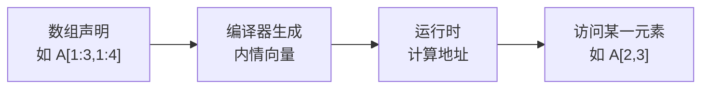

# 数组元素的翻译（内情向量）

## 内情向量与数组元素地址计算

编译程序要把对数组元素 `A[i][j]` 的逻辑访问，翻译成对内存地址的正确操作。这里的关键桥梁就是 **内情向量（dope vector）**。

### 为什么需要内情向量？

静态数组在编译时已知各维上下界和类型大小，所有信息都存在符号表中。但动态数组或可调数组的界在运行前才能确定，编译器必须生成一段“描述信息”，让运行时能据此算出地址。这个描述信息就是内情向量。

[!NOTE]
内情向量是**运行时**的描述符，记录了数组的维数、类型、维上下界、界差等核心属性，但**不包含数组元素本身的值**。

### 内情向量里存什么？

内情向量的核心字段包括：

| 字段 | 含义 | 示例（A[1:3, 1:4]） |
| :--- | :--- | :--- |
| $d$ | 维数 | 2 |
| 类型 | 元素类型及大小 | integer, 4字节 |
| $l_k, u_k$ | 第k维的下界、上界 | $l_1$=1, $u_1$=3 |
| $c_k$ | 第k维的**界差**（跨度因子） | 见下方推导 |

>[!IMPORTANT]
> 内情向量肯定不含数组的==维数==吗？恰恰相反，**维数是必选项**。考题中的“肯定不含有”是故意设置的陷阱。（对应原选择第30题）

### 如何计算数组元素地址？

数组元素地址计算**与存储方式有关**（原判断第8题，已验证正确）。常用的是**行主序**：先存完一整行再存下一行。

计算第 $i_1$ 行第 $i_2$ 列元素地址的通用公式如下（假设下标从1开始，每元素占 $w$ 字节）：

$$
\text{addr}(A[i_1,i_2]) = \text{base} + ((i_1-1) \times n + (i_2-1)) \times w
$$

其中 $n$ 是每行的元素个数。$n$ 在运行时可从内情向量中取出，即此维的界差 $c_2 = u_2 - l_2 + 1$。

把提题干货抽象成**递归公式**更通用。对于 $d$ 维数组，定义第 $k$ 维的界差 $c_k$，它是第 $k$ 维下标增加1时地址的增量。

设 $A[l_1:u_1,\dots,l_d:u_d]$，$w$ 是元素字节数。自右向左地计算：
$$
c_d = w
$$
$$
c_{k-1} = (u_k - l_k + 1) \times c_k \quad (1 < k \le d)
$$

则元素地址为：
$$
\text{addr}(\vec{i}) = \text{base} - \sum_{j=1}^{d}(l_j \times c_j) + \sum_{j=1}^{d}(i_j \times c_j)
$$
第一部分的常量通常预先算出，存在内情向量里。访问时只需做**一次乘加链**。

>[!TIP]
> “界差”并不等于维长乘以元素大小的粗粒度跨度，而是该维走一步时实际跨过的字节数。对二维行主序数组 `A[1:3, 1:4]`，第二维界差 $c_2 = w$，第一维界差 $c_1 = 4 \times w$。

### 常见坑

- **以为是“静态数组就需要内情向量”**。完全静态且界已知时，编译器直接算出所有偏移，无需生成内情向量。内情向量服务于**动态、可调或需要在运行时传递数组信息**的场景。
- **把上下界和界差搞混**。上下界限定了下标取值范围，而界差是用于地址运算的倍数因子。
- **误认为维数可有可无**。对变长数组，必须先读出维数才能知道有几组界差信息。维数是内情向量的**元信息**，必不可少。
