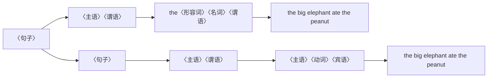
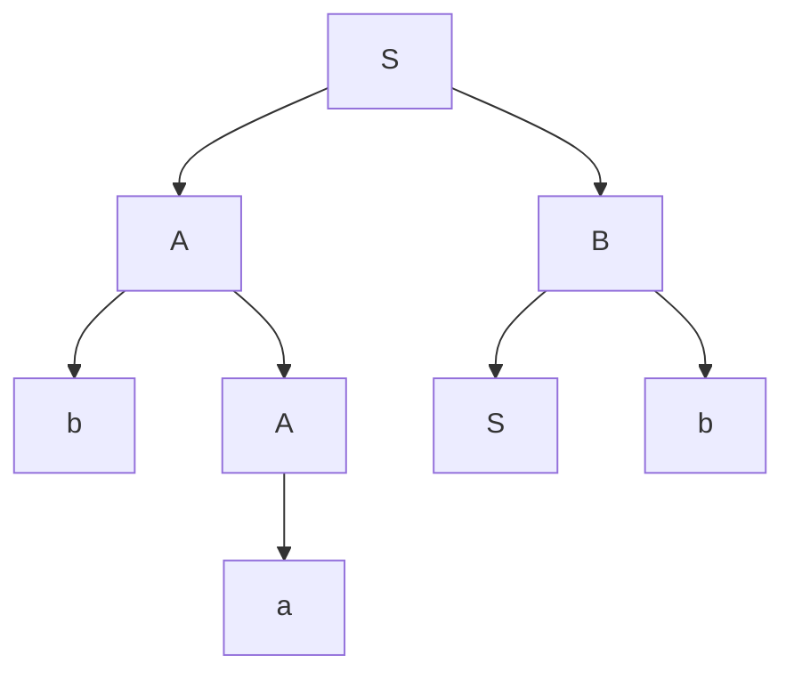

# 文法产生式、推导与规约

## 它是什么

文法 $G$ 的**产生式** $U ::= u$ 规定了"左边的非终结符 $U$ 可以被替换成右边的符号串 $u$ "这一条规则。有了规则，就能量化地讨论"怎么从开始符号一步步变出一个句子"——这就是**推导**；反过来，从句子一步步变回开始符号，就是**规约**。

> [!IMPORTANT]
> 一条产生式就是一次**直接推导**。把产生式右部的 $U$ 换成左部的 $u$，叫一次**直接规约**。

形式定义：设 $G$ 中有产生式 $U ::= u$，$v = xUy$，$w = xuy$（$x, y \in V^*$），则

$$v \Rightarrow w \quad\text{（v 直接推导出 w）}\qquad\Longleftrightarrow\qquad w \xRightarrow{} v \quad\text{（w 直接规约到 v）}$$

注意推导一般使串**变长或不变**：$|w| \ge |v|$（当产生式右部为空时取等号）。

## 三种"推导距离"的区别

| 记号 | 含义 | 步数 |
|---|---|---|
| $v \Rightarrow w$ | ==直接推导== | 恰 1 步 |
| $v \Rightarrow^+ w$ | 推导（若干步） | $\ge 1$ |
| $v \Rightarrow^* w$ | 广义推导 | $\ge 0$（含 $v = w$） |

> [!WARNING]
> $\Rightarrow^+$ **不含** $v = w$；$\Rightarrow^*$ 才含。题目问"推导长度为 $n$"，一律指 $\Rightarrow^+$ 的 $n$ 步。

## 一步步推导：从〈句子〉到句子

以课件中"the big elephant ate the peanut"为例，产生式有（节选）：

$$\begin{aligned}
(1)\ \langle句子\rangle &::= \langle主语\rangle\ \langle谓语\rangle \\
(2)\ \langle主语\rangle &::= \langle冠词\rangle\ \langle形容词\rangle\ \langle名词\rangle \\
(3)\ \langle冠词\rangle &::= \texttt{the}\qquad
(4)\ \langle形容词\rangle ::= \texttt{big}\qquad
(8)\ \langle名词\rangle ::= \texttt{elephant}\ |\ \texttt{peanut}
\end{aligned}$$

推导过程（每步换一个非终结符）：

$$
\begin{aligned}
\langle句子\rangle &\Rightarrow \langle主语\rangle\ \langle谓语\rangle
\Rightarrow \langle冠词\rangle\ \langle形容词\rangle\ \langle名词\rangle\ \langle谓语\rangle \\
&\Rightarrow \texttt{the}\ \langle形容词\rangle\ \langle名词\rangle\ \langle谓语\rangle
\Rightarrow \texttt{the big}\ \langle名词\rangle\ \langle谓语\rangle \\
&\Rightarrow^+ \texttt{the big elephant ate the peanut}
\end{aligned}
$$

> [!TIP]
> 每一步只替换**一个**非终结符。换哪个非终结符不限，但若总挑==最左的非终结符==，就是**最左推导**；总挑最右的，就是**最右推导**（又叫==规范推导==）。

## 最左推导 vs 最右推导

左侧链条是==最左推导==（每步替换最左非终结符），右侧链条是==最右推导==（规范推导）。同一句型/句子，两者都存在，但**顺序不同**；其逆过程分别叫**最右规约**和**最左规约**。

## 算对了的例子（短语 / 句柄）

设文法 $G[S]$：$S ::= AB$，$A ::= bA\ |\ a$，$B ::= SB\ |\ Sb\ |\ a$，求句型 $baSb$ 的短语、简单短语。

**构造语法树**：

由语法树可直观读出：

- ==短语==：$ba$（相对 $A$）、$Sb$（相对 $B$）、$a$（相对 $B$）
- ==简单短语==：$a$、$Sb$（各自只有**一层**父子）
- $a$ 同时是**句柄**（最左的简单短语）

> [!NOTE]
> **短语**：某非终结符能推出的一段子串；**简单短语**：该非终结符一步（直接）推出的子串；**句柄**：句型中最左的简单短语。语法树上==一个子树的所有末端节点连起来就是一个短语==；一步父子即简单短语。

## 常见的坑

> [!CAUTION]
> - $\Rightarrow^+$ 与 $\Rightarrow^*$ 仅差"0 步"一项，题目问"是否存在推导"多用 $\Rightarrow^*$。
> - 一个句型可以有**多种推导顺序**，但它们的==语法树相同==；反过来，不同语法树对应**二义文法**。
> - 直接递归（$U ::= \dots U \dots$）只是**间接递归**的特例，别看到"没有直接递归"就判定非递归。
