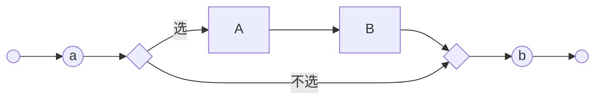

# 文法的其他表示法（扩充BNF、语法图）

标准 BNF 用 `::=` 和 `|` 就能描述所有文法，但遇到“零个或多个”时只能写成 $A ::= A\alpha \mid \varepsilon$ 这样的左递归形式。有没有一种更紧凑、更直观的写法？这就是扩充 BNF 和语法图要解决的问题。

## 扩充 BNF 的三种核心符号

扩充 BNF（EBNF）在标准 BNF 基础上引入了三个元符号，用来==消除左递归并压缩产生式==：

| 符号 | 含义 | 等价的标准 BNF 展开 |
| :---: | :--- | :--- |
| `{ }` | 花括号内的内容重复 **0 次或多次** | $A ::= A\alpha \mid \varepsilon$ |
| `[ ]` | 方括号内的内容 **可选**（出现 0 次或 1 次） | $A ::= \alpha \mid \varepsilon$ |
| `( )` | 圆括号用于 **分组**，改变结合优先级 | 仅起界定作用 |

> [!IMPORTANT]
> 考试中最核心的转换逻辑：**直接左递归 $A ::= A\alpha \mid \beta$ 可以直接压缩为 $A ::= \beta\{\alpha\}$**。

## 怎么做：转换与化简技巧

将普通文法转为扩充 BNF，本质是**提取公因子**和**识别循环/可选结构**。

以真题为例，化简 $Z ::= AB \mid AC \mid A$：
1. 观察发现三项都以 $A$ 开头，提取公因子：$Z ::= A(B \mid C \mid \varepsilon)$
2. 发现 $(B \mid C \mid \varepsilon)$ 表示“B 或 C 或空”，正好对应可选语义，替换为方括号：$Z ::= A[B \mid C]$

再看一个含左递归的例子，化简 $A ::= Aab \mid \varepsilon$：
1. 这是典型的 $A ::= A\alpha \mid \varepsilon$ 形式，其中 $\alpha = ab$
2. 直接用花括号消除左递归：$A ::= \{ab\}$

> [!TIP]
> 解题口诀：**先提公因子，再认左递归；有 $\varepsilon$ 变方括，纯循环用花括**。若选项间既有公共前缀又有 $\varepsilon$，优先把 $\varepsilon$ 吸收进 `[ ]` 中。

## 语法图：文法的可视化

语法图（Syntax Diagram）是用图形表示文法规则的方法，常在第 6 章词法分析的状态图之前作为直观铺垫。

- **矩形框**：表示非终结符
- **圆形/椭圆框**：表示终结符
- **带箭头的线**：表示推导方向
- **分支与回路**：分别对应 `|` 选择和 `{ }` 循环

例如 $S ::= a[AB]b$ 的语法图如下：

## 常见坑与辨析

> [!WARNING]
> **混淆 `[ ]` 和 `{ }` 的语义**：$[X]$ 最多出现 1 次，$\{X\}$ 可以出现无数次。$A ::= BC \mid BCD$ 提取后是 $BC[D]$，绝不能写成 $BC\{D\}$。

> [!CAUTION]
> **花括号内不要遗漏组合关系**：如 $A ::= BC \mid BCD \mid AXZ \mid AXY$，正确结果是 $A ::= BC[D] \mid A X[Z \mid Y]$。注意后半部分 $AXZ \mid AXY$ 提取 $AX$ 后，剩下的是 $Z \mid Y$，必须用圆括号包起来放在花括号内吗？不对！这里 $A$ 自身在左侧，原式是 $A ::= AX(Z \mid Y) \mid \dots$，属于左递归，应写为 $A ::= BC[D] \mid \{X[Z \mid Y]\}$（假设非递归部分已处理）。严格按课件答案，此处记为 $A ::= BC[D] \mid AX[Z \mid Y]$（若未要求彻底消左递归）。

> [!NOTE]
> **与标准 BNF 的区别**：标准 BNF 只有 `::=` 和 `|`，无法直接表达“重复”而不引入新非终结符；扩充 BNF 通过元符号实现了“无新变量的压缩”。两者描述的语言完全等价。

## 完整算例演示

**题目**：用扩充 BNF 表示 $S ::= aABb \mid ab$。

**解答步骤**：
1. 找公共前后缀：两项均以 $a$ 开头、$b$ 结尾。
2. 提取 $a$ 和 $b$：$S ::= a(AB \mid \varepsilon)b$
3. 将 $(AB \mid \varepsilon)$ 转换为可选符号：$S ::= a[AB]b$

最终结果：$S ::= a[AB]b$。
