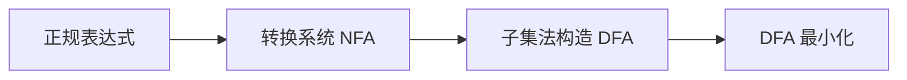

# 正规表达式与自动机的转换及DFA最小化

## 为什么需要正规表达式与自动机的转换

词法分析的任务是把源程序字符流识别成单词。正规表达式便于**描述**单词，例如标识符可写成 $l(l|d)^*$；DFA 便于程序**执行**识别，每读一个字符就确定地转移一次。因此需要完成：

Kleen 定理说明：正规文法、正规表达式和有穷自动机描述正规语言的能力等价。所谓正规集，就是正规表达式所表示的字符串集合；正规表达式本身是“式子”，二者不要混淆。

## 正规表达式怎样变成 NFA

按正规表达式的结构递归构造转换系统：单个符号用一条相应弧连接；连接 $e_1e_2$ 表示先识别 $e_1$ 再识别 $e_2$；选择 $e_1|e_2$ 用 $\varepsilon$ 弧分出两条支路；闭包 $e^*$ 用 $\varepsilon$ 弧实现“零次或重复多次”。构造后通常只有一个初态和一个终态，但允许存在 $\varepsilon$ 弧及同一符号的多条出弧，所以一般是 NFA。

> [!IMPORTANT]
> ==NFA 转 DFA 的核心不是删去 $\varepsilon$ 弧，而是把“可能所处的状态集合”整体作为 DFA 的一个状态。==

## 子集法构造 DFA

设 $I$ 是 NFA 的状态子集：

- $\varepsilon\text{-CLOSURE}(I)$：$I$ 中状态以及仅经 $\varepsilon$ 弧能到达的全部状态；
- $I_a=\varepsilon\text{-CLOSURE}(J)$：先从 $I$ 中状态读入一个 $a$，到达状态组成 $J$，再求 $\varepsilon$ 闭包。

从 $I=\varepsilon\text{-CLOSURE}(\{S\})$ 开始，反复计算各输入符号下的 $I_a$，直到不再出现新子集。含原初态的子集是 DFA 初态；==只要子集含原终态，对应 DFA 状态就是终态==。

以课件例题 $(0|11^*0)^*$ 为例，子集计算结果如下：

| 子集 $I$ | 新状态 | $I_0$ | $I_1$ | 是否终态 |
|---|---:|---:|---:|---|
| $\{S,1,Z\}$ | $A$ | $B$ | $C$ | 是 |
| $\{1,Z\}$ | $B$ | $B$ | $C$ | 是 |
| $\{2,3,4\}$ | $C$ | $B$ | $D$ | 否 |
| $\{3,4\}$ | $D$ | $B$ | $D$ | 否 |

因此初态为 $A$，终态为 $A,B$。例如输入 $110$：$A\xrightarrow{1}C\xrightarrow{1}D\xrightarrow{0}B$，被接受；输入 $1$ 停在 $C$，不被接受。这符合“$0$ 或若干个 $1$ 后接 $0$，整体重复任意次”的含义。

> [!WARNING]
> 求 $I_a$ 时，读 $a$ 前后的 $\varepsilon$ 弧都要处理；但 $a$ 必须恰好读一次。也不要因为某个子集“看起来不含初态”就漏算，或把“所有状态都是终态”误当成子集成为终态的条件。

## DFA 最小化

DFA 化简是合并**等价状态**，而不是简单合并终态或非终态。若对任意输入串 $w$，从状态 $p,q$ 出发的接受结果都相同，则 $p,q$ 等价；否则可区分。

常用划分法：

1. 先删除从初态不可达的状态；
2. 初始划分为“终态组”和“非终态组”；
3. 若同组状态读入同一符号后落入不同组，就继续细分；
4. 划分稳定后，每组合并为一个状态。

上例中 $A,B$ 都是终态，且读 $0$ 都到 $B$、读 $1$ 都到 $C$，故等价，可合并为 $A$；$C,D$ 都是非终态，读 $0$ 都到 $B$、读 $1$ 都到 $D$，也可合并为 $C$。最小 DFA 的转移为：

| 状态 | $0$ | $1$ | 类型 |
|---|---|---|---|
| $A$ | $A$ | $C$ | 初态、终态 |
| $C$ | $A$ | $C$ | 非终态 |

> [!TIP]
> 检查转换题可按“语言是否一致—闭包是否完整—终态是否正确—能否继续合并”四步复核。最小化不会改变语言，只减少状态数。
