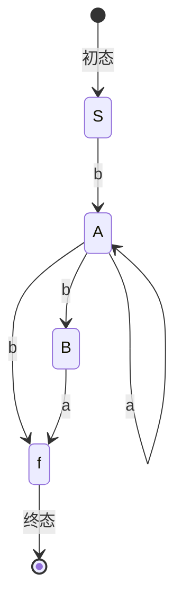

# 正规文法与状态转换图
词法分析器如何识别标识符或常数？靠的不是死记硬背字符串，而是==状态转换图==。它是正规文法（3型文法）的图形化表示，也是后续构造有穷自动机（FA）的基础。面对一个文法，我们首先要问：它是左线性还是右线性？这直接决定了画图时箭头的方向和终态的位置。

### 左线性与右线性文法的区别

正规文法分为两类，它们的产生式形式不同，对应的状态转换图构造规则也截然相反：

| 特性 | 左线性文法 | 右线性文法 |
| :--- | :--- | :--- |
| 产生式形式 | $A ::= Ba$ 或 $A ::= a$ | $A ::= aB$ 或 $A ::= a$ |
| 推导方向 | 自底向上（归约视角） | 自上而下（推导视角） |
| 初始状态 | 额外增设开始状态 $S$ | 文法开始符号即为初态 |
| 终止状态 | ==文法开始符号为终态== | 额外增设终态 $Q$ (或 $f$) |
| 箭头含义 | $B \xrightarrow{a} A$ | $A \xrightarrow{a} B$ |

> [!IMPORTANT]
> 左线性文法的==开始符号是终态==，需另设初态 $S$；右线性文法的==开始符号是初态==，需另设终态 $Q$。这是考试中最易混淆的点。

### 由右线性文法构造状态转换图

以真题为例，已知右线性文法 $G = (\{S, A, B\}, \{a, b\}, S, P)$，其中 $P$ 为：
$$S ::= bA \quad A ::= bB \mid aA \mid b \quad B ::= a$$

构造步骤如下：

1.  **定节点**：非终结符 $\{S, A, B\}$ 作为状态节点，$S$ 为初态；因是右线性，增设终态 $f$。
2.  **画转移弧**：对每条 $U ::= aV$，画 $U \xrightarrow{a} V$；对每条 $U ::= a$，画 $U \xrightarrow{a} f$。
    -   $S ::= bA \Rightarrow S \xrightarrow{b} A$
    -   $A ::= bB \Rightarrow A \xrightarrow{b} B$
    -   $A ::= aA \Rightarrow A \xrightarrow{a} A$（自环）
    -   $A ::= b \Rightarrow A \xrightarrow{b} f$
    -   $B ::= a \Rightarrow B \xrightarrow{a} f$

> [!TIP]
> 验证句子 `bab`：从 $S$ 出发，$S \xrightarrow{b} A \xrightarrow{a} A \xrightarrow{b} f$，到达终态，故 `bab` 是合法句子。若输入 `baa`，最终停在 $A$ 未达终态，则拒绝。

### 由左线性文法构造状态转换图

左线性文法规则相反：对 $U ::= a$，画 $S \xrightarrow{a} U$；对 $U ::= Ba$，画 $B \xrightarrow{a} U$；==开始符号设为终态==。例如文法 $Z ::= U0 \mid Z1, U ::= Z1 \mid 1$，其初态为新增的 $S$，终态为 $Z$。

> [!WARNING]
> 左线性文法识别句子是==自底向上==的过程，读入字符串后若恰好停在开始符号（终态），则该串合法。切勿将左右线性的初/终态规则搞反。

### 常见误区与辨析

-   **混淆初终态**：右线性“始→终”，左线性“新始→原文法开始符”。做题前先判断文法类型再动笔。
-   **遗漏终态**：右线性文法中形如 $A ::= a$ 的产生式，必须指向==额外增设的终态==，不能悬空或指向自身。
-   **等价性定理**：任何左线性文法都存在等价的右线性文法，反之亦然，且都对应同一个有穷自动机。若题目要求转换，可先转为右线性再画图，降低出错率。

> [!NOTE]
> 状态转换图是有穷自动机的直观表达。掌握本节内容后，§3.5 的 DFA/NFA 构造及 §3.7 的词法分析器自动生成将水到渠成。
