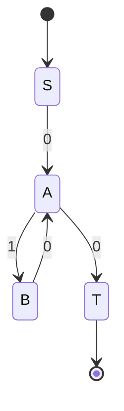

# 正规文法与有穷自动机的相互转换

## 什么是正规文法与有穷自动机

正规文法是乔姆斯基文法中的 **3 型文法**，也称正则文法。它描述的语言恰好是**正则语言**，既可以用状态转换图表示，也可以用有穷自动机（FA）表示。

正规文法分为：

- **右线性文法**：$A\to aB$ 或 $A\to a$
- **左线性文法**：$A\to Ba$ 或 $A\to a$

其中 $a$ 是终结符，$A、B$ 是非终结符。

> [!IMPORTANT]
> ==正规文法与有穷自动机能表示相同的语言==：存在正规文法 $G$ 和有穷自动机 $M$，使得 $L(G)=L(M)$。这称为 Kleene 定理。

## 为什么需要相互转换

正规文法适合描述单词的语法规则，而状态转换图和有穷自动机适合直接执行识别过程。例如识别关键字、标识符和数字时，可以沿着自动机的状态转移逐字符扫描。

转换时必须保证：两者接受的字符串集合完全相同，而不仅仅是包含关系。

## 由正规文法构造有穷自动机

以**右线性文法**为例。设

$$
G=(\{S,A,B\},\{0,1\},P,S)
$$

其中：

$$
S\to0A,\qquad A\to1B\mid0,\qquad B\to0A
$$

构造方法是：

1. 用非终结符作为状态，文法开始符号 $S$ 作为初始状态；
2. 增加一个终态 $T$；
3. 对规则 $A_i\to aA_j$，建立转移 $\delta(A_i,a)=A_j$；
4. 对规则 $A_i\to a$，建立转移 $\delta(A_i,a)=T$；
5. 若有 $S\to\varepsilon$，则初始状态 $S$ 本身也是终态。

因此可得：

$$
\delta(S,0)=A,\quad
\delta(A,1)=B,\quad
\delta(A,0)=T,\quad
\delta(B,0)=A
$$

例如字符串 `010` 的运行过程为：

$$
S\xrightarrow{0}A\xrightarrow{1}B\xrightarrow{0}A
$$

$A$ 不是终态，因此 `010` 不被接受；而 `00` 的路径为

$$
S\xrightarrow{0}A\xrightarrow{0}T
$$

到达终态，所以 `00` 被接受。

## 由有穷自动机构造正规文法

若自动机为

$$
M=(Q,\Sigma,\delta,S,Z),
$$

则对每条状态转移

$$
\delta(q_i,a)=q_j
$$

建立产生式：

$$
Q_i\to aQ_j
$$

若 $q_j$ 是终态，还应增加

$$
Q_i\to a
$$

其中 $Q_i、Q_j$ 是与自动机状态对应的非终结符。

例如：

$$
M=(\{A,B,C\},\{0,1\},\delta,A,\{B\})
$$

且

$$
\delta(A,0)=B,\quad
\delta(B,1)=C,\quad
\delta(C,0)=B
$$

由于 $B$ 是终态，可构造右线性文法：

$$
A\to0B\mid0,\qquad
B\to1C,\qquad
C\to0B\mid0
$$

> [!TIP]
> 记忆方法：右线性文法“**读一个终结符，再走一步状态**”；左线性文法“**先确定前一状态，再读终结符**”。

## 左右线性文法的区别

| 项目 | 右线性文法 | 左线性文法 |
|---|---|---|
| 产生式 | $A\to aB$、$A\to a$ | $A\to Ba$、$A\to a$ |
| 状态图方向 | 从 $A$ 读 $a$ 到 $B$ | 从 $B$ 读 $a$ 到 $A$ |
| 初始状态 | 开始符号 | 另设初始状态 $S$ |
| 终态 | 另设终态 $Q$ | 开始符号所在状态 |
| 状态含义 | 后面还要继续推导 | 前面已经读取的部分 |

例如，右线性文法

$$
S\to aA,\qquad A\to b
$$

对应：

而左线性版本可写成：

$$
S\to Aa,\qquad A\to b
$$

二者都生成字符串 $ab$。

## 常见错误

> [!WARNING]
> - 规则 $A\to aB$ 只产生一条“读入 $a$ 后转到 $B$”的边；不能遗漏规则 $A\to a$。
> - 同一状态和同一输入符号可能有多条边，这对应 **NFA**，不能误写成 DFA。
> - 构造文法时，只有转移到终态才增加 $A\to a$，否则会错误地提前结束句子。
> - 检查字符串时，必须从初始状态出发，并在**读完全部字符后**判断是否位于终态。

左、右线性文法可以相互转换，而且表示的语言相同：右线性形式是“终结符在前”，左线性形式是“终结符在后”。因此，实际题目中可先判断题目指定的方向，再按固定规则画边或写产生式。
