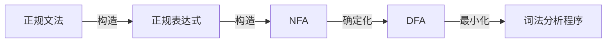

# 正规表达式与正规集
先看一个简单问题：词法分析器如何描述“所有以 `0` 开头、后跟任意多个 `1` 的二进制串”？你可以列举 `0`、`01`、`011`、`0111`……但“任意多个”意味着无穷集合，列举永远列不完。我们需要一种**有限形式**来精确刻画**无穷语言**，这就是正规表达式（Regular Expression，简称正规式）的由来。

> [!IMPORTANT]
> 正规表达式是**语法**概念，它本身只是一串符号；正规集是它表示的**语言**，即符号串的集合。例如正规式 $0(1)^*$ 对应的正规集是 $\{0, 01, 011, 0111, \dots\}$。

### 递归定义

设 $\Sigma$ 为有穷字母表，$\Sigma$ 上的正规式和正规集递归定义如下：

| 正规式 | 正规集 |
| :---: | :---: |
| $\varepsilon$ | $\{\varepsilon\}$（只含空串的集合） |
| $\varnothing$ | $\varnothing$（空集） |
| $a$（$a \in \Sigma$） | $\{a\}$ |
| $(e_1)$ | $L(e_1)$ |
| $e_1 \mid e_2$ | $L(e_1) \cup L(e_2)$ |
| $e_1 \cdot e_2$ | $L(e_1) L(e_2)$（连接） |
| $(e_1)^*$ | $\bigl(L(e_1)\bigr)^*$（闭包） |

运算优先级从高到低为：`*` > 连接 > `|`。例如 $a \mid bc^*$ 等价于 $a \mid \bigl(b(c^*)\bigr)$。

> [!WARNING]
> $\varepsilon$ 和 $\varnothing$ 容易混淆：$\{\varepsilon\}$ 是含一个空串的集合，$\varnothing$ 是没有任何元素的集合。两者都是正规集，但完全不同。

### 正规式的等价

若两个正规式表示的正规集相同，则称它们**等价**，记为 $e_1 = e_2$。例如：

$$e_1 = b(ab)^*, \quad e_2 = (ba)^*b$$

验证：

$$L(e_1) = \{b\}\{ab\}^* = \{b,\ bab,\ babab,\ \dots\}$$

$$L(e_2) = \{ba\}^*\{b\} = \{b,\ bab,\ babab,\ \dots\}$$

两集合相同，故 $e_1 = e_2$。

### 与正规文法、有穷自动机的关系

Kleene 定理揭示了词法分析中三条核心路径的统一：

> [!NOTE]
> 正规文法、正规式、有穷自动机三者描述**同一类语言**——正规集。但并非所有语言都是正规集：$L = \{a^n b^n \mid n \geq 0\}$ 不能用正规式表示，需上下文无关文法。

### 由右线性文法构造正规式（通用解法）

将文法产生式改写为**方程式组**，再用代入与 Arden 定理求解。步骤：
1. 用 `=` 代替 `::=`，用 `+` 代替 `|`；
2. 将每个非终结符看作变量，产生式右侧看成该变量的表达式；
3. 形如 $X = aX + b$ 的方程（$a$ 为终结符串），其解为 $X = a^*b$；
4. 回代消元，求出开始符号的表达式。

**示例**：已知文法 $S ::= aS \mid aB,\quad B ::= bA,\quad A ::= aA \mid a$，求对应正规式。

写出方程组：

$$S = aS + aB,\quad B = bA,\quad A = aA + a$$

由第三式解出 $A = a^*a$（即 $aa^*$），代入第二式得 $B = b\,aa^*$，再代入第一式：

$$S = aS + a\,b\,aa^* \quad\Longrightarrow\quad S = a^*\,ab\,aa^*$$

所以正规式为 $a^*ab\,aa^*$，对应正规集 $\{a^m a b a a^n \mid m \geq 0,\ n \geq 1\}$。

> [!TIP]
> Arden 定理核心：$X = aX + b$ 的最小解为 $X = a^*b$。若右侧还有 $X$ 之外的项，先合并同类项再套用。

### 常见的坑

- **空串与空集**：$L(\varepsilon^*) = \{\varepsilon\}$，但 $L(\varnothing^*) = \{\varepsilon\}$ 也成立——空集的闭包仍含空串。
- **连接不满足交换律**：$L(ab) \neq L(ba)$ 通常成立。
- **优先级错误**：$ab^*$ 表示 $a$ 后跟任意多个 $b$，而非“$ab$ 的重复”；后者应写 $(ab)^*$。
- **等价性证明要双向**：证明 $e_1 = e_2$ 时，需说明 $L(e_1) \subseteq L(e_2)$ 且 $L(e_2) \subseteq L(e_1)$。
