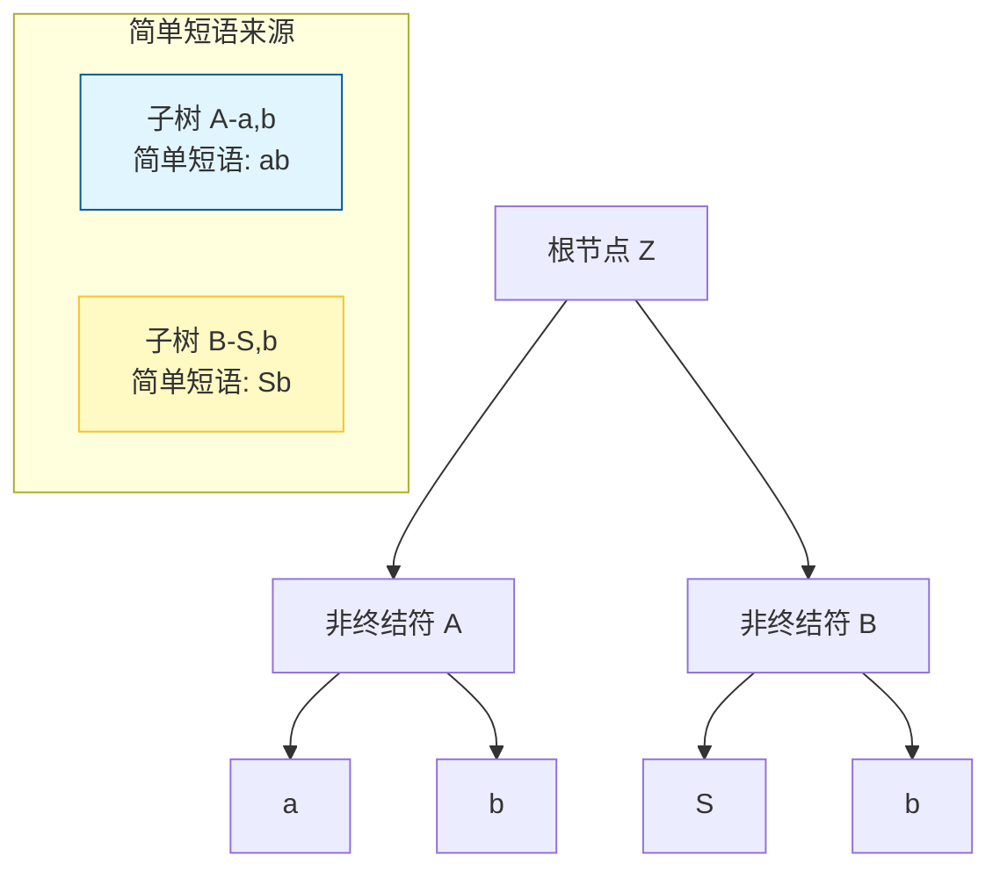

# 短语、简单短语与句柄

## 核心定义与直观理解

在自底向上的语法分析中，我们需要从输入串中识别出可归约的子串。**短语**、**简单短语**和**句柄**是描述这种“局部结构”的关键概念。

设 $G[Z]$ 是文法，$\alpha$ 是句型（即 $Z \Rightarrow^* \alpha$）。
- **短语**：若 $Z \Rightarrow^* xUy$ 且 $U \Rightarrow^+ u$，则 $u$ 是句型 $xuy$ 相对于非终结符 $U$ 的短语。
- **简单短语**（直接短语）：若 $Z \Rightarrow^* xUy$ 且 $U \Rightarrow u$（一步推导），则 $u$ 是简单短语。
- **句柄**：一个句型中**最左边**的简单短语。

> [!IMPORTANT]
> ==句柄是自底向上分析的核心==。每次归约操作，本质上就是将当前句型的**句柄**替换为对应产生式左部的非终结符。

## 借助语法树快速查找

死记推导定义容易出错，**语法树**是最直观的辅助工具。对于给定句型的语法树：

1.  **短语**：任意子树末端节点组成的符号串。
2.  **简单短语**：只有**父子两代**的子树（即直接由某个非终结符推导出的叶子节点串）。
3.  **句柄**：**最左边**的那棵“两代子树”的末端符号串。

> [!TIP]
> **找句柄口诀**：画树 -> 找最下层 -> 找最左侧 -> 读叶子。

## 易混淆概念辨析

| 概念 | 推导步数要求 | 语法树特征 | 唯一性 |
| :--- | :--- | :--- | :--- |
| **短语** | $\Rightarrow^+$ (至少一步) | 任意子树的叶子串 | 多个 |
| **简单短语** | $\Rightarrow$ (仅一步) | 高度为2的子树叶子串 | 多个 |
| **句柄** | $\Rightarrow$ (仅一步) | **最左**高度为2的子树叶子串 | **唯一** |

> [!WARNING]
> **常见坑**：句柄一定是简单短语，但简单短语不一定是句柄。务必检查“最左”这一条件。例如句型中有两个简单短语 $a$ 和 $Sb$，若 $a$ 在 $Sb$ 左边，则句柄是 $a$。

## 典型例题解析

**题目**：给定文法 $Z ::= bMb, M ::= (L \mid a, L ::= Ma)$。求句型 `b(aa)b` 的句柄。

**分析步骤**：
1.  **构建语法树**（逆推导过程）：
    -   $Z \Rightarrow bMb$
    -   $M \Rightarrow (L$
    -   $L \Rightarrow Ma$
    -   $M \Rightarrow a$
    -   组合得到树结构：根 $Z$ 下有 $b, M, b$；中间 $M$ 下有 $(, L$；$L$ 下有 $M, a$；最内层 $M$ 下有 $a$。
2.  **识别简单短语**：
    -   最内层 $M \Rightarrow a$，故 `a` 是简单短语。
    -   注意：此时句型若视为 `b((Ma)a)b` 的中间态，需明确当前句型。
    -   让我们看课件中的归约过程：对于输入 `b(aa)b`，其规范推导的逆过程（归约）揭示了句柄的变化。
    -   在句型 `b((aa)a)b` 的某一步，如 `#b(Ma)` 栈顶，`a` 是由 $M \Rightarrow a$ 得到的简单短语。
3.  **确定句柄**：
    -   在自底向上分析的任何时刻，**当前句型的最左简单短语**即为句柄。
    -   例如在归约初期，扫描到第一个 `a` 时，它构成简单短语 $M \Rightarrow a$，且位于最左，故此时句柄为 `a`。

> [!NOTE]
> 在不同归约阶段，句柄是动态变化的。考试通常要求针对**特定句型**（如 `baSb` 或 `b(aa)b` 的某个中间形式）找出其句柄。只需画出该句型对应的完整语法树，找到**最左下角**的那个直接产生叶子的非终结符即可。
