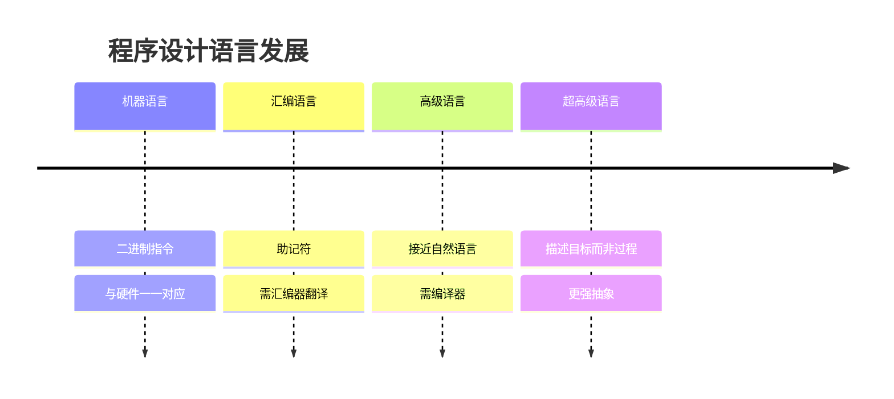
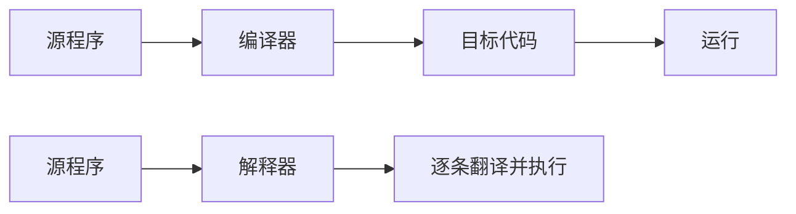

# 程序设计语言的发展历程（机器语言到超高级语言）

## 程序设计语言的发展历程

### 从“对机器说话”到“对问题说话”

程序设计语言演进的动力只有一个：**让人更容易地描述计算过程**。机器只认识 0 和 1，但人希望用接近自然语言或数学符号的方式表达意图。每向上抽象一层，就多一层“翻译”的工作——这层翻译正是编译原理要研究的对象。



### 机器语言与汇编语言

**机器语言**是计算机唯一能直接执行的语言，每一条指令都是二进制编码，例如 `10110000 01100001`。它完全依赖于特定硬件，可读性几乎为零，编写效率极低。

**汇编语言**用助记符替代二进制码，如 `MOV AL, 61H`。它仍是面向机器的——每条汇编语句基本对应一条机器指令，只是把“记不住的数字”换成了“能看懂的缩写”。从汇编到机器码的翻译由**汇编器**完成，过程相对机械。

> [!NOTE]
> 汇编语言和机器语言都属于**低级语言**，共同特点是与具体机器结构紧密绑定，移植性差。

### 高级语言：关键的一跃

高级语言的出现改变了游戏规则：一条语句可以对应多条机器指令，程序员不再关心寄存器分配和指令编码，而关心**算法和数据结构**。例如：

```c
sum = a + b;
```

这一条语句翻译到机器层面可能涉及取数、加法、存数等多条指令。高级语言带来的核心优势：

| 特性 | 低级语言 | 高级语言 |
|------|---------|---------|
| 可读性 | 差 | 好 |
| 可移植性 | 几乎不可移植 | 一次编写，跨平台编译 |
| 编程效率 | 低 | 高 |
| 对硬件的控制力 | 强 | 较弱 |

翻译高级语言的程序称为**编译程序**或**解释程序**。

### 编译型与解释型：两种翻译策略

这是考试的高频辨析点。**编译方式**先整体翻译为目标代码，再执行目标代码；**解释方式**逐条翻译、逐条执行，不产生目标代码。



> [!IMPORTANT]
> ==解释程序的特点是处理程序时不产生目标代码==。它边解释边执行，执行效率通常低于编译方式。

典型语言归类如下：

| 语言 | 实现方式 |
|------|---------|
| C、PASCAL、FORTRAN | 编译型 |
| BASIC | ==解释型==（典型代表） |
| Java | 先编译为字节码，再解释/即时编译 |

> [!WARNING]
> 考场易错点：认为“解释程序是为打开编译程序技术的僵局而开发的”或“解释程序适用于 COBOL 和 FORTRAN”——这两条都不成立。COBOL 和 FORTRAN 是典型的编译型语言。

### 系统程序设计语言

一个自然的问题：编译程序本身也是程序，用什么语言来写它？

> [!IMPORTANT]
> ==能够编写编译程序或其他系统软件的高级语言称为系统程序设计语言==。

典型代表是 **C 语言**。C 兼具高级语言的表达能力和低级语言的操作能力（如指针操作、位运算），既能方便地描述算法，又能精确地控制内存和硬件，因此既适合写应用，也适合写操作系统、编译器等系统软件。

> [!NOTE]
> PASCAL 也是较早的系统程序设计语言之一，但 C 在这方面的地位更为突出。

### 超高级语言

超高级语言（如 SQL、某些 4GL 语言）进一步提高了抽象层次：程序员只需**描述“做什么”**，不必指明“怎么做”。例如 SQL 查询 `SELECT * FROM students WHERE score > 90` 中，用户无需关心数据库内部如何扫描、排序、过滤，语言实现自身负责规划执行策略。它们是**非过程化**的，与 C、PASCAL 等**过程化**语言形成对照。

### 小结与常见坑

- 语言层级越高，==对人的友好度越高，对机器的直接控制力越弱==。
- 低级 → 高级 → 超高级，抽象层次递增，翻译复杂度也递增。
- 编译与解释的区分看**是否产生独立目标代码**，而不是看语言名字。
- 系统程序设计语言是“能写编译器的语言”，==C 是典型代表==。

**算对了的例子**：选择题问“哪种是典型的解释型语言”，只要抓住 BASIC 传统上以解释方式执行为主，直接选 A 即可；而 C、FORTRAN、PASCAL 均以编译方式为主流实现。
