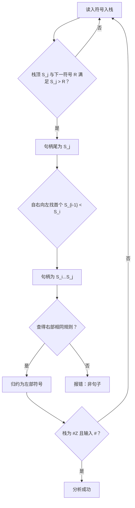

# 简单优先分析法（优先关系、简单优先文法）

## 简单优先分析法

### 为什么需要优先关系？

自底向上分析的核心任务是**找句柄**。面对句型 $\dots S_1S_2\dots$，分析器必须判断：这两个相邻符号，是都还在句柄里（继续读入），还是 $S_1$ 已是句柄尾（该归约了）？

简单优先分析法给文法字母表中任意一对符号 $S_1$、$S_2$ 定义三种**优先关系**，只要它们在某句型中相邻出现：

- $S_1 \doteq S_2$：两者同处一个句柄（如产生式右部 $A::=S_1S_2$）；
- $S_1 \lessdot S_2$：$S_1$ 在句柄外，$S_2$ 是句柄头；
- $S_1 \gtrdot S_2$：$S_1$ 是句柄尾，$S_2$ 在句柄外。

> [!IMPORTANT]
> 优先关系**不具有对称性**：$S_1 \gtrdot S_2$ 绝不意味着 $S_2 \lessdot S_1$；且只有真正在某句型中相邻的符号对才有关系，否则二者**无关系**。

### 简单优先文法

能使用此法分析的文法必须满足两个条件，称为**简单优先文法**：

1. **关系唯一**：字汇表中任意两符号间至多一种优先关系成立；
2. **右部唯一**：任意两条产生式不能有相同的右部。

> [!WARNING]
> 若文法二义，则某句型会出现两个句柄，必然导致同一对符号被赋予两种关系，条件 1 被破坏。例如 $E::=E+E\mid E*E$ 的句型 $E+E*E$ 中，$E+E$ 与 $E*E$ 都是句柄，该文法**不是**简单优先文法。课件中“让 $+$ 优先于 $*$”正是通过人为规定 $+\gtrdot *$，强制先归约 $E+E$，从而消除移进-归约冲突。

### 分析算法

维护符号栈 $S$（栈底先入 `#`），反复执行：

> [!TIP]
> 口诀：**先右后左，先定尾后定头**。向右扫到第一个 $\gtrdot$ 定句柄尾，再回头向左扫到第一个 $\lessdot$ 定句柄头。

### 算例

对文法
$$Z::=bMb,\quad M::=(L)\mid a,\quad L::=Ma$$
分析输入串 `b(aa)b#`：

| 步骤 | 符号栈 | 关系 | 输入串 | 动作 |
|:---:|:---:|:---:|:---:|:---:|
| 1 | # | $\lessdot$ | b(aa)b# | 移进 |
| 2 | #b | $\lessdot$ | (aa)b# | 移进 |
| 3 | #b( | $\lessdot$ | aa)b# | 移进 |
| 4 | #b(a | $\gtrdot$ | a)b# | 句柄尾为 a |
| 5 | #b(M | | a)b# | $M::=a$ 归约 |
| 6 | #b(Ma | $\doteq$ | )b# | 移进 |
| 7 | #b(Ma) | $\gtrdot$ | b# | 句柄尾为 ) |
| 8 | #b(L | $\gtrdot$ | b# | $L::=Ma)$ 归约 |
| 9 | #bM | | b# | $M::=(L)$ 归约 |
| 10 | #bMb | $\gtrdot$ | # | 句柄尾为 b |
| 11 | #Z | | # | $Z::=bMb$ 归约，成功 |

> [!NOTE]
> 与算符优先分析不同，简单优先分析比较的是**全部符号**（含非终结符），且归约时必须严格匹配产生式右部，因此能处理非算符文法，但构造关系矩阵的工作量更大。
